---
header-includes:
  - \usepackage{xcolor}
  - \usepackage{amsmath,amssymb}
  - \usepackage{unicode-math}
  - \setmathfont{Latin Modern Math}
mainfont: "Noto Sans CJK SC"
CJKmainfont: "Noto Sans CJK SC"
geometry: a4paper, margin=2cm
fontsize: 11pt
secnumdepth: 5
toc-depth: 5
block-headings: true
---

# lecture 1 Introduction

## course description

>A basic understanding of the behaviour of electrical circuits

## knowledge map
| week  |                        lecture topic                        |        laboratory topics         |
| :---: | :---------------------------------------------------------: | :------------------------------: |
|  1,2  |              命名与电路表示法，复数及相关数学               |                                  |
|  3,4  |       欧姆定律与基尔霍夫定律，分压器，串联与并联元件        |        熟悉实验室及其设备        |
|  5,6  |               网孔与节点分析，电路偏置点计算                | 使用PSpice的直流电路与戴维南定理 |
|  7,8  |                  等效电路（戴维南与诺顿）                   |          瞬态与时间常数          |
| 9,10  |                      瞬态（一阶与二阶)                      |         交流电路与滤波器         |
| 11,12 |                 交流电路分析（相量与阻抗）                  |            运算放大器            |
| 13,14 |                       滤波器分析应用                        |           实验报告撰写           |
| 15,16 | 用于功率计算的RMS（均方根）值概念，运算放大器，考前最终复习 |                                  |

## 要求与打分

75%期末考试 + 25%实验（6个实验+1个报告）

## Introduction

### voltage
>A voltage source with voltage Vs provides a constant potential difference to the circuit
connected between the positive terminal and the negative terminal. If the voltage from the
voltage source is constant with time, the voltage source is a direct current (dc) source. If
the voltage from the voltage source is a sinusoid, the voltage source is an alternating
current (ac) voltage source.

### current
>A current source with current Is provides a constant current of Is amperes to the circuit
connected to the two terminals. If the current from the current source is constant with
time, the current source is a direct current (dc) source. If the current from the current
source is a sinusoid, the current source is an alternating current (ac) current source.

> [!NOTE]
> The voltage or current on the dependent sources depends solely on the controlling
voltage or controlling current.(受控源上的电压或电流完全取决于控制电压或控制电流)

## 国际单位制 International System of Units (SI)
- Meter(长度)
- Kilogram(质量)
- Second(时间)
- Ampere(电流) 
> [!NOTE]
> !注意是电流而不是电压
- Kelvin(温度)
- Mole(物质的量)
- Candela (发光强度)

## 单位前缀 SI Prefixes

| 前缀  | 符号 | 大小   |
| ----- | ---- | ------ |
| pico  | p    | $10^{-12}$ |
| nano  | n    | $10^{-9}$  |
| micro | u    | $10^{-6}$  |
| milli | m    | $10^{-3}$  |
| centi | c    | $10^{-2}$  |
| deci  | d    | $10^{-1}$  |
| deka  | da   | $10$|
| hecto | h    | $10^{2}$   |
| kilo  | k    | $10^{3}$   |
| maga  | M    | $10^{6}$   |
| giga  | G    | $10^{9}$   |
| tera  | T    | $10^{12}$  |

## 库仑定律 Coulomb’s Law
$$
F=\frac{1}{4\pi\varepsilon}\frac{Qq}{r^{2}}
$$

$$
\text{这里的 }\varepsilon \text{ 是介质的绝对介电常数，真空介电常数 } \varepsilon_0 = \frac{1}{4\pi\cdot 10^{-7} c^2}
$$

$$
单位：F/m（法拉/米）
$$

$$
permittivity, 介电常数/电容率
$$

## 电压 voltage
### 定义 definition
$$
\text{Voltage:work done per unit charge against the force}
$$

> 单位电荷沿电场力做的功

### 电势差 potential difference
$$
V_{AB}=V_A-V_B=\int_A^B \mathbf{E}\cdot d\mathbf{l},\text{将单位正电荷从 } A \text{ 点移动到 } B \text{ 点，电场力所做的功}
$$
电场力做正功(电势能转化为其他形式的能)，电势能减小，电场力做负功(其他形式的能转化成电势能)，电势能增加

> [!NOTE]
> 电压具有$\text{path independent}$的性质
>
>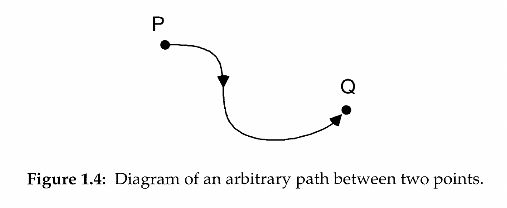 
>
>无论沿什么路径，电场力从$P$点到$Q$点所做的功都是一样的

## 电流 current

>In the absence of electric field, the free electrons in the conduction band of conductors
such as copper wire make random movements. When an electric field is applied along the
copper wire, the negatively charged electrons will move toward the direction of higher
potential.

>在没有电场的情况下，导体（如铜线）导带中的自由电子做无规则运动。当沿铜线施加电场时，带负电的电子将向高电势方向移动(过程中电势能减小，会主动向电势低的地方移动).

### 定义definition
$$
\text{单位时间流过导体某一个横截面的电荷量}
$$

$$
I=\frac{Q}{t}\text{，单位：C/s\ \ \ \ 或者\ \ \ \ A}
$$

### 微分形式
$$i(t)=\frac{\mathrm{d}q(t)}{\mathrm{d}t}$$

### 方向
$\text{正电荷移动的方向}$

#### 例题1.1
The charge flowing into a circuit element for t ≥ 0 is given by
$$
\text{q(t)}=2\times10^{-3}(1-\mathrm{e}^{-1000t})\ \ \ \ coulomb
$$
What is the current flowing into the element for t ≥ 0?

 答案 

$$
	\text{直接对 }t\text{ 求导得到答案}\text{\ \ :}i(t) = 2 \, e^{-1000t} \ \text{A}
$$

## 功率 power
>When a positive charge $\mathrm{d}q$ is moved from the negative terminal to the positive terminal through the battery of voltage v, the potential energy
is increased by $\mathrm{d}q \times V = \mathrm{W}$.

>$\mathrm{d}q ->\text{正电荷所带的电荷大小}positive\ \ charge$

>$V ->\ \ \text{正电荷终点和起始点的电势差}Voltage$

>$W->\ \ \text{所做的功的大小}Work$

$\text{另一种形式：}$

$$
P=IV,\text{将}\ \  \mathrm{d}q\ \ \text{看成一个关于时间}\ \ t\ \ \text{的函数，再将}\ \ P=\frac{\mathrm{d}W}{\mathrm{d}t}\ \ \text{展开即可}
$$

> [!NOTE]
> 我们需要明确的是能量总是有限的,这句话对后续的电容器两端的电压和流经电感器的电流的连续性起着重要的支撑作用

## 无源符号规定 Passive sign convention
- 电流在元件内部从正极流向负极，说明元件正在吸收功率，在吸收能量
- 电流在元件内部从负极流向正极，说明元件正在释放功率，在释放能量
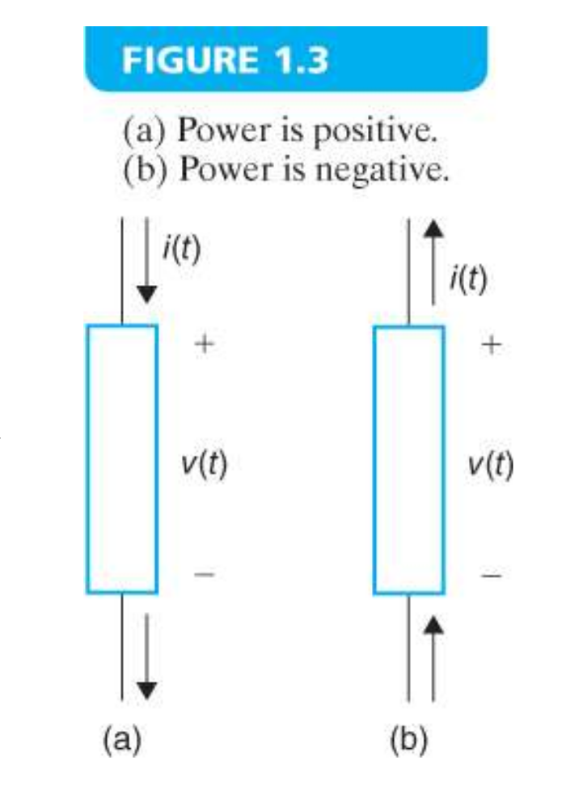

## 独立电源 independent source
- 独立电压源 independent voltage source
- 独立电流源 independent current source

### 独立电压源
>两端电压由自身决定，与电路中其他部分的电流、电压无关

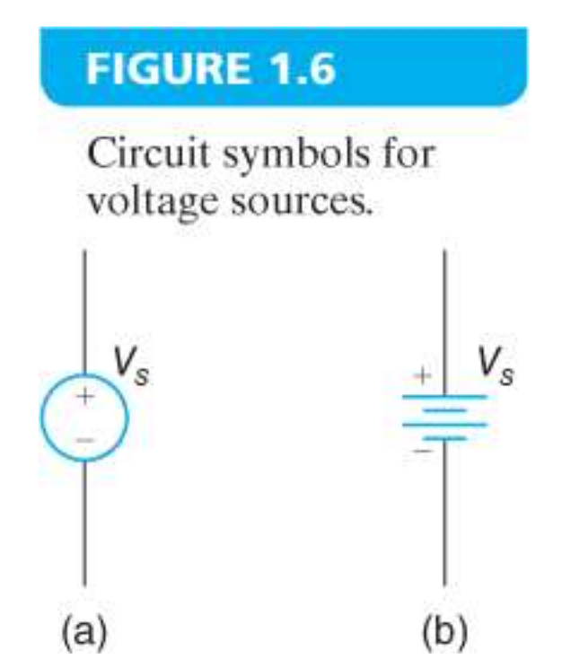

### 独立电流源
>输出电流由自身决定，与电路中其他部分的电压、电流无关

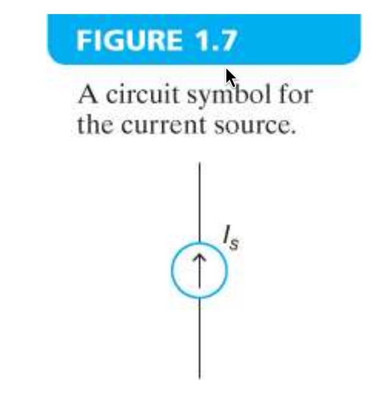

## 直流源和交流源 DC Sources and AC Sources
>If the voltage from the voltage source is
constant with time, the voltage source is
called the direct current (DC) voltage
source. Likewise, if the current from the
current source is constant with time, the
current source is called the direct current
(DC) current source.

>如果电压源输出的电压不随时间变化（恒定），则该电压源称为直流（DC）电压源。同样地，如果电流源输出的电流不随时间变化（恒定），则该电流源称为直流（DC）电流源。

>交流（AC）电压源是指输出电压随时间周期性变化的电压源；交流（AC）电流源是指输出电流随时间周期性变化的电流源。

### 符号 symbol

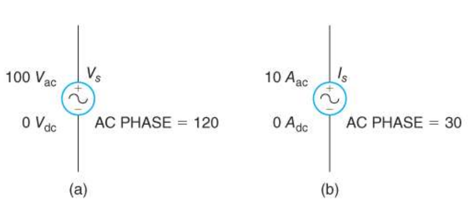

## 参考方向(reference direction)
我们所遇到的元件大多数都有2个端口,比如电阻，电容器，电感器和电源

并且每一个二端的元件都以"流经这个元件的电流"和"元件两端的电压"为特征

为了列出有意义的方程，我们认为规定电流流经的方向和元件两端的极性就尤其重要：我们可以先假定一个方向，如果计算出来是负数，那么真实方向就和原先假定的方向相反;如果计算出来的值是正数，那么真实方向就和原先假定的方向相同

我们假定的方向就叫参考方向(reference direction),这个在后续学习$KCL,KVL$的时候很重要
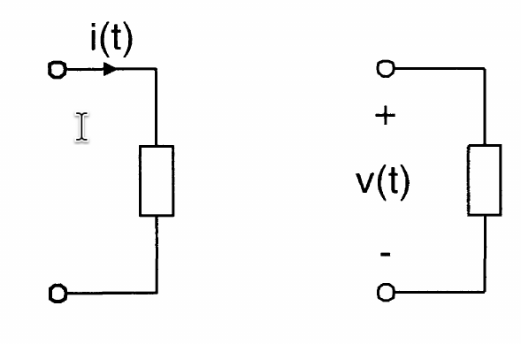 

# Lecture 2

## 等效电压源和等效电流源   Equivalent Voltage Source and Equivalent Current Source

### 直流电压源串联 ->相加即可

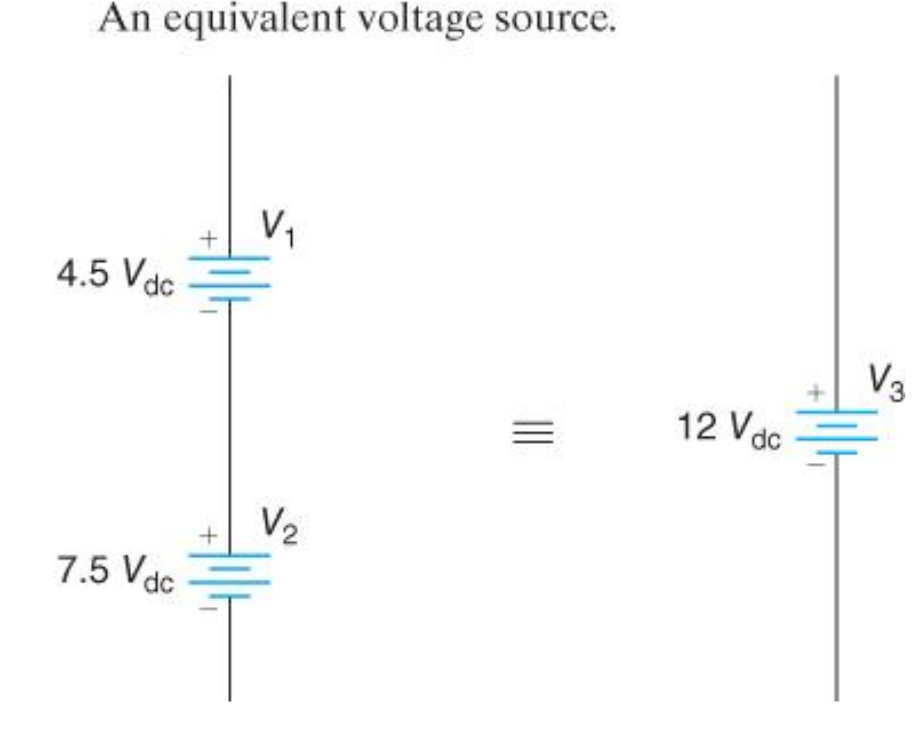

### 直流电流源串联 ->相加即可

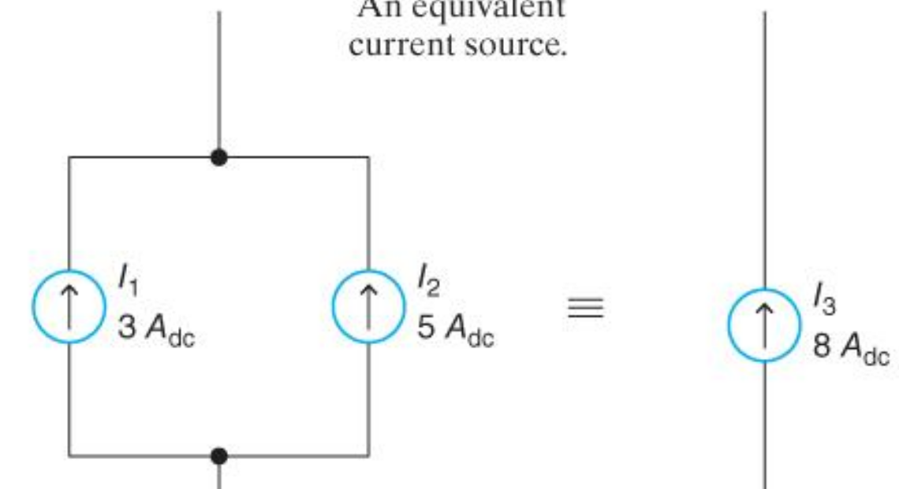

> [!NOTE]
> 注意方向，方向决定了是加号还是减号

#### 例题1.4
>Redraw the circuit shown in Figure 1.12 with one voltage source and one current source
without affecting the voltages across and currents through the resistors in the circuit.
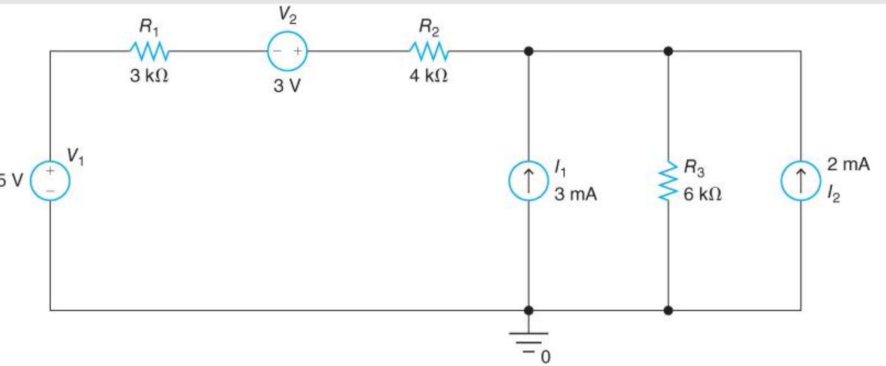

	
 答案 

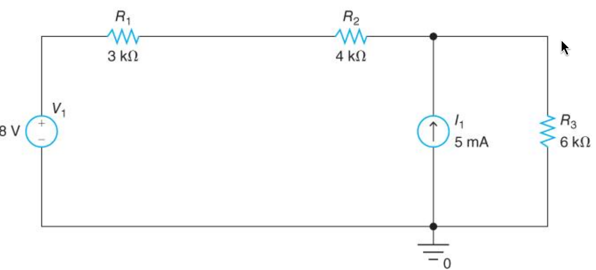

 

> [!IMPORTANT]
> 电流可以从独立电压源流入或流出，但电压的极性由电压源自身决定。
>
> Current can flow in and out of an independent voltage source, but the polarity of the voltage is determined by the voltage source.

## 无源元件 Passive Elements

### 定义definition
>无源器件是指在电路中不需要外部电源供电即可工作，且自身不能产生能量增益的电子元件

### 性质
>流过无源器件的电流大小和压降取决于所连接或者附近的电源（压/流）
>
>The magnitude of the voltage drop and current flowing through passive devices depends on
the voltage and current sources that are present and/or recently attached to the circuit.
### 分类
通常传统分类将电阻、电容、电感作为典型无源器件
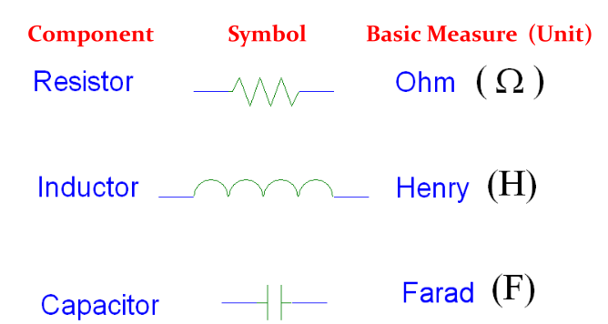

## 受控源 Dependent Sources

### 定义definition

>是指其输出电压或电流的大小受电路中其他支路的电压或电流控制的电源。
>
>The voltage or current on the dependent sources depend solely on the controlling
voltage or controlling current.

> [!TIP]
> controlling voltage controlling current 指的是受控源的大小取决于在支路中某一个电压或者电流的大小。取决与电压就是，那么那个电压就是controlling voltage，controlling current同理。

### 分类 classification

|         类型         |           意思           |
| :------------------: | :----------------------: |
| 电压控制电压源(VCVS) | 输出电压由某处电压控制。 |
| 电压控制电流源(VCCS) |  输出电流由某处电压控制  |
| 电流控制电压源(CCVS) |  输出电压由某处电流控制  |
| 电流控制电流源(CCCS) |  输出电流由某处电流控制  |

> [!TIP]
>  VCVS 代表着 voltage controlled voltage source

### 符号 symbol
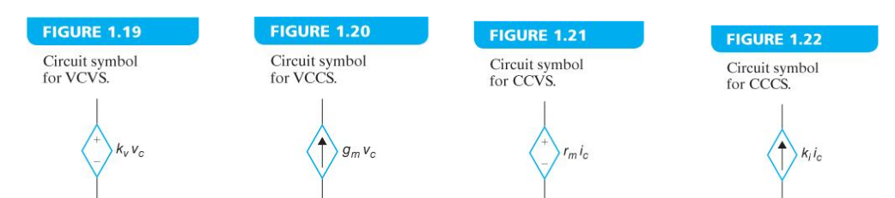
菱形就是受控源，标有正负极就是电压源，标有方向就是电流源，表达式中是`V`就说明是电压控制，是`I`就说明是电流控制

>对比独立源的符号
>
>
>

> [!IMPORTANT]
> 独立源是圆形的，受控源是菱形的

### 例题1.6

	
 In the circuit shown in Figure 1.23, the controlling voltage, which is the voltage across R2, is Va = 0.9851 V. Find the controlled current through the VCCS

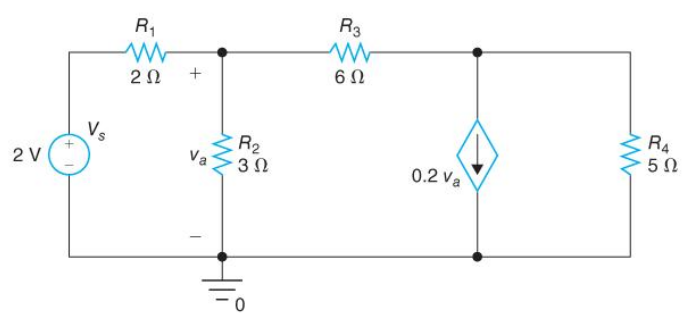

$$
	\text{the controlled current through the VCCS}=0.2 \times {V_a}=0.2(A/V) \times 0.9851 V=1.9702A
$$

## 初等函数 Elementary Functions

### 分类 classification
- 狄拉克δ函数 Dirac Delta Function
- 阶跃函数 Step Function
- 斜坡函数 Ramp Function
- 三角脉冲 Rectangular Pulse
- 矩形脉冲 Triangular Pulse

#### 狄拉克δ函数 Dirac Delta Function

##### 基础概念

A rectangular pulse with height $\frac{1}{\tau}$ and width $\tau$ is shown in Figure 1.25. The pulse is centered at $–\frac{\tau}{2}$ and the area of the pulse is one. The rectangular pulse can be written as

$$
f(x)=\frac{1}{\tau} rect(\frac{t+\frac{\tau}{2}}{\tau})
$$
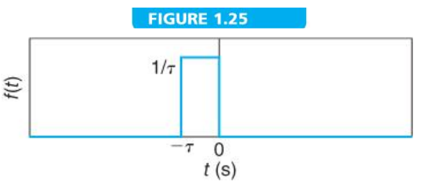

> [!NOTE]
> rect 函数全称是矩形函数，也叫门函数，是信号处理和电路分析中用来描述一个有限宽度的矩形脉冲的标准数学函数。
>
>定义：
$$
\text{rect}(x) = 
\begin{cases}
1, & |x| < \frac{1}{2} \\[4pt]
0, & |x| > \frac{1}{2}
\end{cases}
$$

实际使用时，往往要对它进行时间平移和宽度缩放。公式：
$$f(t) = \frac{1}{\tau}\,\text{rect}\!\left(\frac{t + \frac{\tau}{2}}{\tau}\right)$$
就是通过变量代换，得到一个从 $t=-\tau$ 开始、持续到 $t=0$、高度为 $\frac{1}{\tau}$、总面积为 1​ 的矩形脉冲。

 

当$\tau$趋于0是，脉冲的高度会趋于无穷大并保持这个脉冲的面积为1
$$
\delta(t) = \lim_{\tau \to 0} \frac{1}{\tau} \operatorname{rect} \left( \frac{t + \frac{\tau}{2}}{\tau} \right)
$$
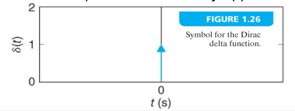

> [!NOTE]
> Question:
>
>为什么在第二个函数图像上面纵坐标是1而不是正无穷，当$\tau$趋于0的时候这个高度难道不是应该趋于正无穷吗
>
>

>	
答案

>	我们要区分 幅值 与 强度 的区别。图中的箭头标柱的1代表的是 Delta 函数的强度，即积分面积，而不是在某一点的幅值
>

##### 变形
- 时移(时间超前或者时间延迟)：eg.$\delta(t+1)$

	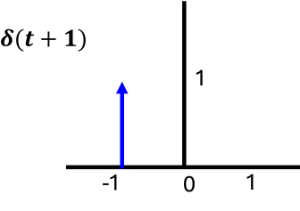
时间提前1个单位
- 强度缩放

	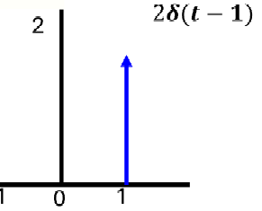
时间延后一个单位，并且强度变为2倍

###### 例题

	
画函数图像

$$
\text{f(t)=4}\delta
(t – 1)
$$

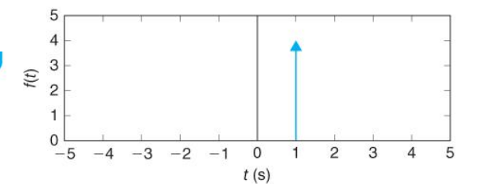

##### 筛选性质 Sifting Property

>当一个连续信号 $f(t)$ 与延迟了 $a$ 的δ函数相乘，并在全时间轴（$-\infty$ 到 $\infty$）上积分时，结果会精准提取出信号在 $t=a$ 时刻的值 $f(a)$。
>
>When a continuous signal f(t) is multiplied by $\delta$(t – a) and integrated from –$\infty$ to $\infty$, we
obtain f(a), that is,
>$$
>\int_{-\infty}^{\infty} f(t)\delta(t-a)dt = f(a)
>$$

> [!NOTE]
> 在其他不靠近a的点$\delta$(t)=0(根据rect函数的定义)
>
>$$
\text{rect}(x) = 
\begin{cases}
1, & |x| < \frac{1}{2} \\[4pt]
0, & |x| > \frac{1}{2}
\end{cases}
$$

>又因为靠近a点的点积分值为1,所以整个积分的值会筛选f(a)的值，过滤掉其他点的值

#### 阶跃函数 Step Function

##### 定义

单位阶跃函数指的是当x<0时，函数值为0,x>=0时，函数值为1
The unit step function H(x), which has a value of zero for negative arguments
and one for positive arguments
$$
\text{H}(x) = 
\begin{cases}
1, & x >= 0 \\[4pt]
0, & x < 0
\end{cases}
$$

> [!NOTE]
> 单位阶跃函数的微分就是delta 函数

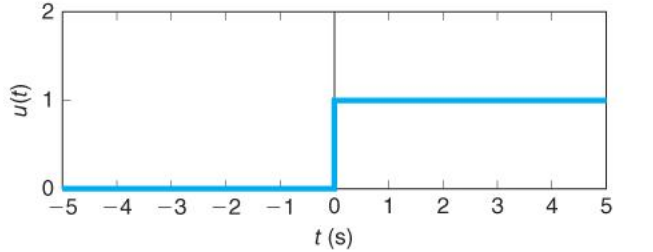

###### 例题

	
画图,u(t)是单位阶跃函数

$$
	\text{画出 f(x)=u(t)-u(t-2)}
$$

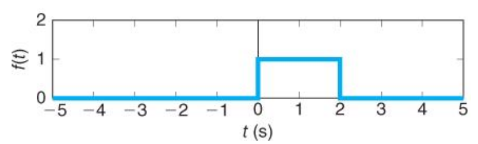

#### 斜坡函数 Ramp Function 

##### 定义(单位斜坡函数)
$$
r(t)=t \times u(t)
$$

- 单位斜坡函数是单位阶跃函数的积分
$$
r(t)=\int _{-\infty}^t u(\lambda)\mathrm{d}\lambda
$$
- 单位斜坡函数的微分就是单位阶跃函数

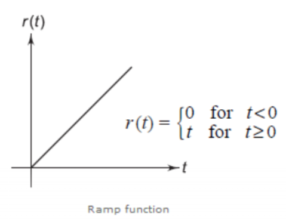

#### 指数衰减 Exponential Decay

##### 定义definition
指数衰减(Exponential Decay) 是一种随时间按指数规律逐渐减小的信号或物理过程
##### 一般形式
$$f(t) = u(t) e^{-\alpha t}, \quad t \ge 0$$
- $e^{-\alpha t}$:指数衰减因子
- $\alpha$:衰减常数

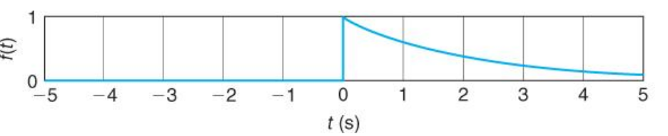

#### 三角脉冲 Rectangular Pulse
##### 定义

$$
f(t) = 
\begin{cases}
A\left(1 - \frac{|t|}{\tau}\right), & |t| \le \tau \\[4pt]
0, & |t| > \tau
\end{cases}
$$

$$or$$

$$
f(x)=A\ tri(\frac{t}{\tau})
$$
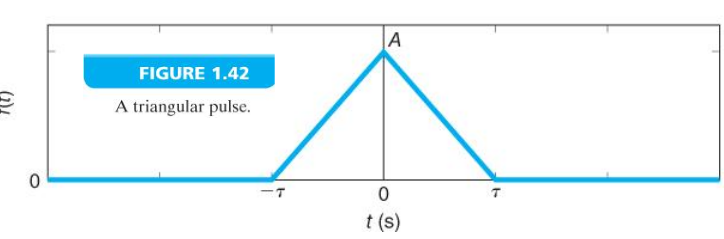

#### 矩形脉冲 Triangular Pulse
##### 定义
$$
f(t) = 
\begin{cases}
A, & |t| \le \frac{\tau}{2} \\[4pt]
 0, & |t| > \frac{\tau}{2}
\end{cases}
$$
$$or$$
$$f(t) = A \cdot \operatorname{rect}\!\left(\frac{t}{\tau}\right)$$

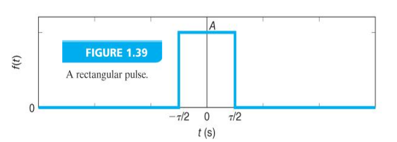

# Lecture 3

## 一些重要定义
### 支路 branch
它可以是一个单一元件，也可以是多个元件串联组成的路径

> [!NOTE]
> 一个分支的电流大小相等

### 节点 node
#### 定义
节点是电路中两个或更多电路元件（或支路）相连接的点。
- 简单节点 simple node 只连接2个元件
- 关键节点 essential node 连接三个及以上元件

### 回路 loop
任何闭合的路线都可以叫做一个回路（一个节点只能通过一次
### 网孔 mesh
内部没有其他支路和元件的回路
> [!NOTE]
> 所有网孔都是回路，但不是每一个回路都是网孔

### 电阻 resistor
>电阻的阻值是材料的导电率和尺寸共同决定的

$$
\text{大小：}R=\rho\frac{l}{A}
$$It can be shown that the current density is proportional to the electric field

反应的是阻碍电流路过的能力
### 电流密度
>单位面积流过的电流

$$
J=\frac{I}{A},I是电流大小，A是电流流过的横截面积
$$

电流密度正比于电场强度

	
推导过程

推导过程（基于均匀导体）
设有一段均匀导体，长度为 $L$，横截面积为 $A$，电阻率为 $\rho$（电导率 $\sigma = 1/\rho$）。
宏观欧姆定律​
导体两端的电压 $V$ 与流过导体的电流 $I$ 满足：
$$V = I R$$

其中电阻 $R = \rho \frac{L}{A}$。
引入电场强度​
对于均匀导体，内部的电场强度 $E$ 处处相等，且方向沿导体轴向。电压与电场强度的关系为：
$$V = E L$$
引入电流密度​
电流密度 $J$ 是单位横截面积上通过的电流，方向与电流相同：
$$J = \frac{I}{A}$$
代入推导​
将 $V = EL$ 和 $R = \rho \frac{L}{A}$ 代入欧姆定律：
$$EL = I \cdot \left( \rho \frac{L}{A} \right)$$

两边同时除以 $L$（假设 $L \neq 0$）：
$$E = I \cdot \frac{\rho}{A}$$

再将 $I = J A$ 代入：
$$E = (J A) \cdot \frac{\rho}{A} = J \rho$$

整理得：
$$J = \frac{1}{\rho} E = \sigma E$$

## 欧姆定律 Ohm’s Law
>电流与电压成正比
>
>$$ V=IR$$

$\frac{1}{R}$也被称为电导

## 基尔霍夫电流定律(KCL)
>流进一个节点的电流和流出一个点的电流相等

> [!TIP]
> 因为在稳定的电路中，如果流入一个节点的电流不等于流出一个节点的电流，那么电荷就会在节点堆积，导致电路不稳定。`基于电荷守恒定律`
>净流进量等于净流出量

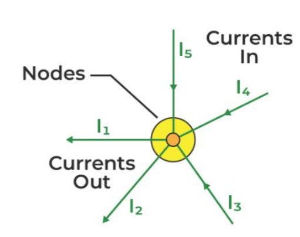
$$
{I_1}+{I_2}= {I_3} +{I_4}+{I_5}
$$
> [!TIP]
> 流进等于流出

### 例题

 

求出电流$\mathrm{I}$的大小

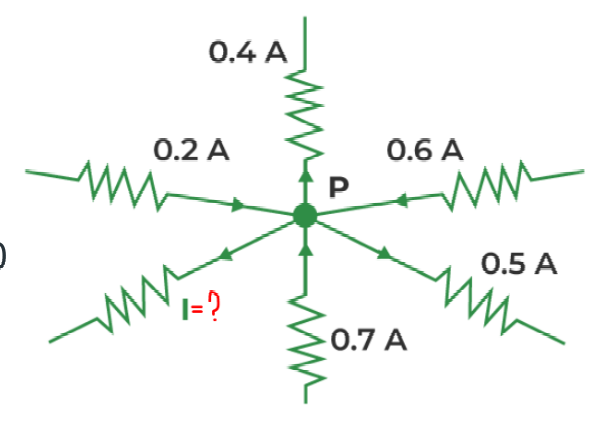

>根据KCL,流入的电流等于流出的电流
>
>$\therefore$ 0.2+0.6+0.7=I+0.4+0.5
>$\therefore$ I=0.6A

计算${V_1}$,${I_1}$,${I_2}$和${I_3}$
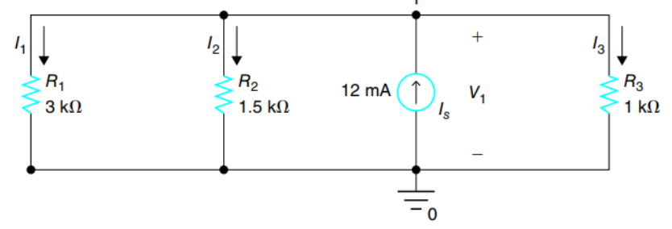

答案

>$\because {R_1},{R_2},{R_3}并联，两端的电压相等,根据$
>
>$$I=\frac{V}{R}$$
>
>可以得到流过${R_1},{R_2},{R_3}的电流的比为\frac{1}{3}:\frac{1}{1.5} : 1$,即1：2：3,对电流源的节点分析，
>
>$$12mA={I_1}+{I_2}+{I_3}$$
>
>解得${I_1}=2mA,{I_2}=4mA,{I_3}=6mA,{V_1}=6V$

## 基尔霍夫电压定律(KVL)
### 定义
>在一个回路中，升压等于降压
>
>The sum of voltage rise in a loop = the sum of voltage drops around a loop

> [!IMPORTANT]
>理解
>- 原因是 **能量守恒**,产生的电势能等于消耗的电势能，又由于 $${P_\text{电功率}}=VI$$并且物质是能量的载体，产生的能量必须转移到另外一个物质上去(这里是电路中的各种元件)，而且能量又不能凭空产生，所以用来提供能量的电能等于用来消耗的电能，即其他能量产生的电能等于电能产生的其他能量。因为时时刻刻都满足这个关系，所以电功率也满足这个关系,又因为一个回路中电流相等，所以电压满足这个关系。所以KVL成立 
>- 还可以将电压理解成电场力将一个单位正电荷通过一段距离所做的功，因为电场是保守场，所以从一点转一圈回到原点所做的功为0,所以电压差为0，这个电压差又可以分成几段，也就是${V_1}+{V_2}+...+{V_n}=0$,意思是各段做的功等于做的总功

### 电势升降
#### 电势降 potential drop
电能转换成其他能量，即电场力做正功，电势能减小，所以电流流入的一端是正极，流出的一端是负极，正极的电势能大于负极的电势能(电流从高电势流向低电势)

#### 电势升 potential rise
其他能量转换成电能，即电场力做负功，电势能增大，所以电流流入的一端是负极，流出的一端是正极，正极的电势能大于负极的电势能(电流从低电势流向高电势)

##### 例题

###### 2.7

 

Given ${V_2}$ = 6 V, find ${I_2}$, ${I_3}$, ${I_4}$, ${V_4}$, ${I_1}$, ${V_1}$, ${V_s}$ in the circuit shown in Figure 2.21.

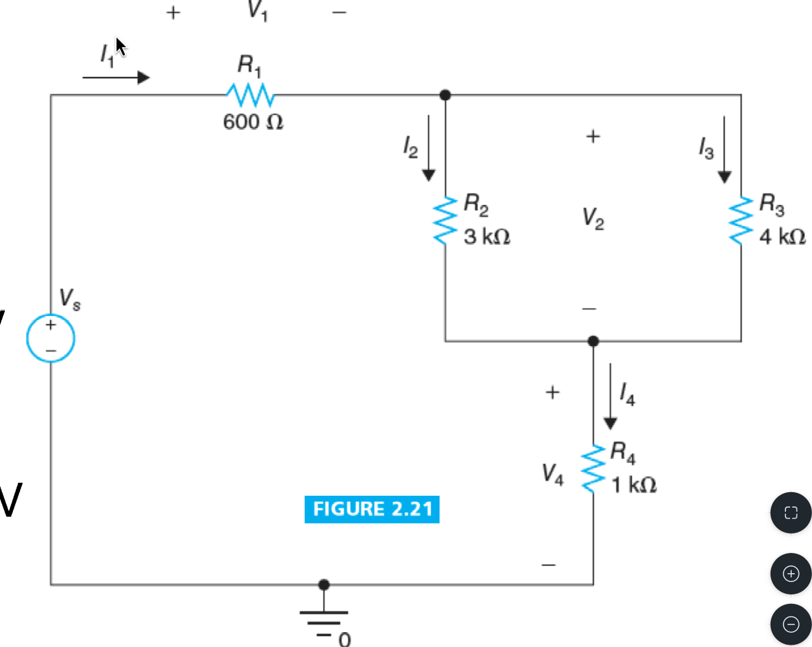

根据Ohm's Law, 
	$${I_2}=\frac{V_2}{R_2}=2mA,{I_3}=\frac{V_3}{R_3}=1.5mA$$
 
又根据KCL
	$${I_1}={I_4}={I_2}+{I_3}=2mA+1.5mA=3.5mA$$
 
Ohm's Law:
	$$ {V_4}={R_4}{I_4}=3.5V \\{V_1}={R_1}{I_1}=2.1V $$
 
KVL Again:
	$$\because 升压等于降压\\ \therefore {V_s}={V_1}+{V_2}+{V_4}\\\therefore {V_s}=11.6V$$

## 等效电阻 Equivalent Resistance

### 串联 in series
和中学学的一样
$$基于V={V_1+V_2+...+V_n}\\(KVL)$$
### 并联 in parallel
和中学学的一样
$$基于I={I_1+I_2+...+I_n}\\(KCL)$$

> [!IMPORTANT]
> 基于等效电阻，可以实现对于电路的简化，方便后续分析
>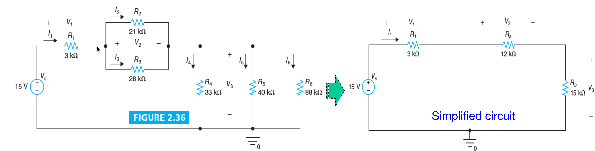

# Lecture 4

## 分压规则 Voltage Divider Rule

如果串联，那么电流相等，电阻的分压与电阻的阻值成正比

## 分压规则 Current Divider Rule

如果并联，那么两端的电压相等，各支路的电流与电阻成反比

# Lecture 5

## 节点分析法 Nodal analysis

### 定义 definition
>一种在电路中计算电压的方法
>
>“The method for calculating the voltage at the circuit
nodes.”

> [!IMPORTANT]
> 主要用到的是$\textcolor{blue}{KCL}$和$\textcolor{blue}{Ohm's Law}$
###  特征 feature
- 是KCL的应用
- 如果一共有N个节点，则需要选取一个支路较多的节点来作为参考节点。设该点的电位(电压)为0
> [!TIP]
> 因为在实际应用中，我们需要的是两点之间的电势差，即相对值，所以我们取任意一个点作为参考节点(电压为0)其实不影响最终的结果。又因为后面我们要对其他节点列出KCL方程，所以当这个流经参考节点的支路越多，，就可以省去项数最多的一项KCL方程，后面所列出的的KCL方程越简洁
- 为了解出其余的$N-1$个非参考节点，需要列出$N-1$个线性无关的方程，从而求解各个节点的电压,各个节点的电压都知道了，整个电路基本就分析清楚了

### 一般步骤 Procedure
1. 识别节点+选定参考节点
    -
	- 先找出电路中所有基本节点
	- 选其中1个作为参考节点（接地）
		>[!TIP]
		> 优先选择 **连接支路多的** 或者 **接最多独立电压源负极端** ,最大化简化后续计算
2. 标注节点电位
	-
	标记各个节点 **相对于参考节点** 的电位，如果一眼看不出来就设置未知数，后续求解

3. 用欧姆定律+KCL列节点方程
	-
	- 先通过欧姆定律求出这一条支路上面的电流
		> [!TIP]
		> 用电压差除以电阻来计算电流（欧姆定律），要先假设一个方向，如果算出来是负的，则实际电流方向与假设的电流方向相反
	- 对每个未知电位节点列KCL,流入等于流出
4. 计算个节点电压
	-

#### 例题
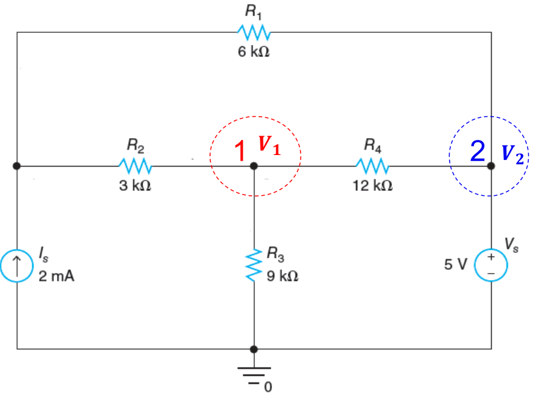

分析该电路，计算节点1,2的电压值

$$设1,2节点的电压分别为V1,V2.$$

$$根据KVL,可以得出V_2等于5V$$

设左边的节点为${V_3}$,可以对左边的节点和中间的节点列出KCL方程
	$$
	\frac{V_3-V_2}{R_1}+\frac{V_3-V_1}{R_2}=2, 
	\frac{V_3-V_1}{R_2}=\frac{V_1}{R_3}+\frac{V_1-V_2}{R_4}
	$$
$$可以解出，V_2=5V,V_1=\frac{83}{11}=7.5V,V_3=\frac{353}{33}=10.7V$$

## 超级节点 supernode

>这是一个节点分析法使用过程中需要用到的一种特殊方法，用来解决分析两个未知节点时，中间有电压源，使得无法表示这条支路的电流，导致无法列出KCL的情况

>例子
>
>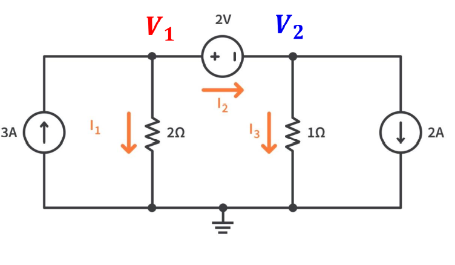

>[!NOTE]
>对这个$V_1,V_2$这两个节点列KCL时，会发现$I_2$无法用常规的节点分析法的步骤表示，即用$V_1,V_2$和对应的电阻值表示，如果直接用$I_2$,那么会引入1个新变量$I_2$。导致现在有2个节点$V_1,V_2$,我们都无法对这两个节点列出完整的KCL方程，无法求解$V_1,V_2$这个时候需要将这两个节点看成一个大节点
>
>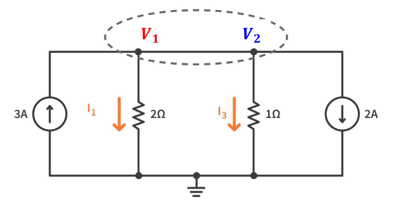
>
>可以对这个大节点列出KCL方程$$3=I_1+I_3+2$$
>带入$I_1,I_3$可以得到
>$$3=\frac{V_1}{2}+\frac{V_2}{1}+2$$
>化简可得
>$$2=V_1+2V_2$$
>这个时候我们有两个未知数$V_1,V_2$,但是只有一个方程。注意到我们还有一个 **电压源** 没有用，即
>$$V_1-2=V_2$$
>结合这两个式子，可以解出$$V_1=2V,V_2=0V$$

### 例题

识别超级节点

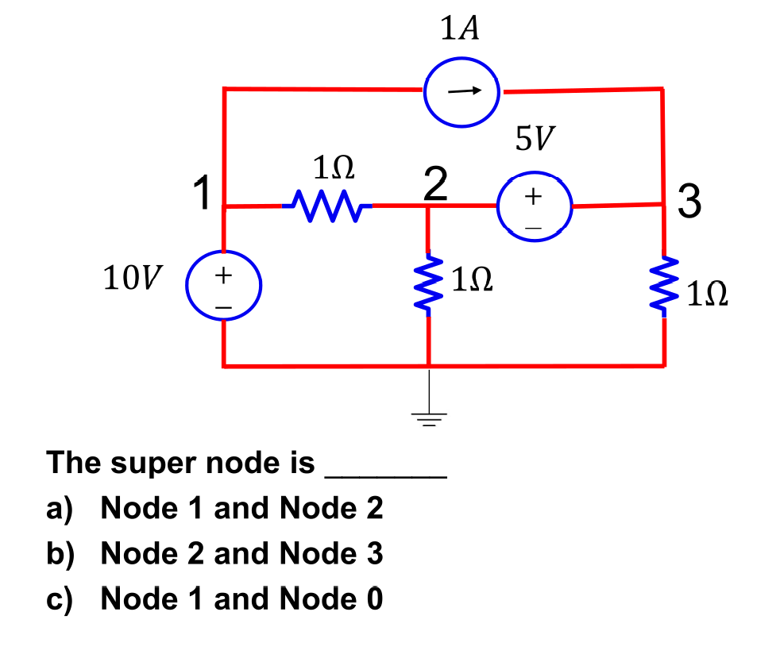

>选b，节点2,3是超级节点

# Lecture 6

## 网格分析法 Mesh analysis
### 网格 Mesh
>中间没有任何支路或者电子元件的回路叫做网格（mesh）
>
>A mesh is a loop that does not contain any other loops

#### 例题

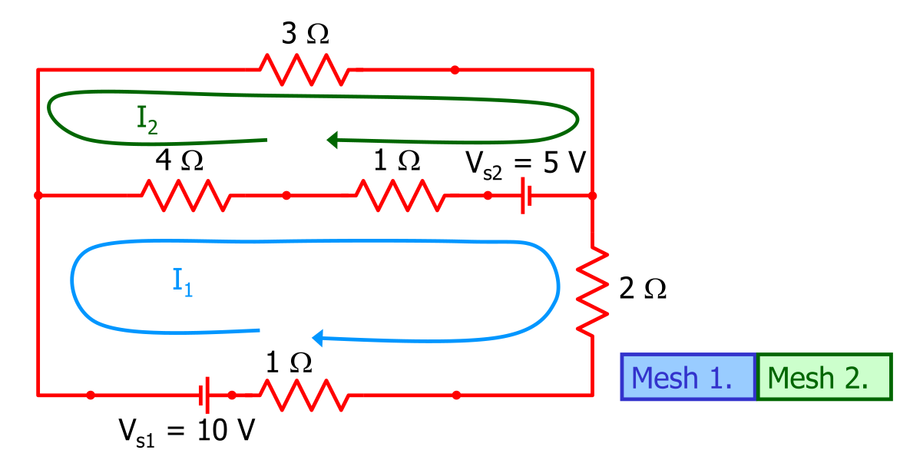

判断这个电路图包含几个网格

 

$$两个，蓝色的是1个网格，绿色的是一个网格，总的那个大回路不算，因为回路中间包含了两个电阻$$

### 与节点分析法的差异
> [!NOTE]
> 与节点分析法不同的是,节点分析法是从$\textcolor{red}{电压}$入手，从而分析整个电路，而网格分析法则是从$\textcolor{red}{电流}$入手,从而分析整个电路

|    方法    |             节点分析法             |                  网格分析法                  |
| :--------: | :--------------------------------: | :------------------------------------------: |
|    变量    |         设每一个节点的电压         |             设每网格上流过的电流             |
| 运用的定律 |            欧姆定律+KCL            |                 欧姆定律+KVL                 |
|  方程个数  |              节点个数              |                   边的个数                   |
|  特殊情况  | 超级节点(两个节点中间有一个电压源) | 超级网格(两个网格相连的那一条边有一个电流源) |

### 分析过程
> [!TIP]
>整体来说和节点分析法的过程很像，只不过是用电流来表示电压，然后再利用KVL来列出方程求解

1. 找网格 Identification
	- 
	找到电路中所有的网格
2. 标记 Lable
	-
	- 标记每一个网格的电流
	- 用欧姆定律计算节点之间的电压差
3. 运用KVL
	-
	- 每一个网格中升压等于降压
	- 列方程，解出每一个网格的电流

> [!IMPORTANT]
> 如果一个网格和另外一个网格共享一个支路，那么这条支路的电流就是这两个网格电流相加或者相减(具体是哪一个要看电流的方向)

## 超级网格 supermesh
> [!TIP]
> 想法和超级节点差不多，只不过这个是用在两个网格共享的支路上面有一个电流源。这个时候会少两个KVL方程，只有将这两个网格合在一起，看成一个超级网格，可以可以补充一个KVL方程。不过还是少了一个方程，而且这个电流源的信息还没有使用，这个时候可以用KCL将这两个网格的电流和这个电流源的信息合起来，形成一个新的方程。这个时候就有n个未知数和n个方程了。

# Lecture 7

## 叠加原理 superposition principle

>If a circuit contains more than one source, the circuit can be analyzed by summing the
response from each source with all other sources deactivated. This is called the
superposition principle.
>
>如果一个电路中有多个独立源，那么所分析的物理量可以看作是不同独立源作用的叠加

> [!IMPORTANT]
> 在计算一个独立源的作用效果时，需要屏蔽掉其他的独立源，也就是将其他的独立源的值设置成0.（独立电流源就看成断路，独立电压源就看成短路）

> [!TIP]
> 叠加原理要求电路是线性的
>即
>
> - 所有元件都是线性元件：即元件的参数（如电阻值 $R$、电感值 $L$、电容值 $C$）不随施加的电压或流过的电流改变而改变。典型例子包括固定电阻器、空气芯电感、无铁芯电容等 
> - 电路中的受控源（如果有）必须是线性受控源：受控源的输出量与控制量之间呈线性关系（例如 $V = kI$ 或 $I = gV$）
> - 电源（独立源）本身不影响线性性质：独立电压源和独立电流源属于线性元件，因为它们输出的电压或电流与外部电路变量之间满足线性关系（理想源是线性的）。

### 例题

#### 1

Consider a circuit with a voltage source $V_s$, a current source $I_s$, and two resistors $R_1$ and $R_2$. Finding $V_1$ and $I$ using superposition principle?

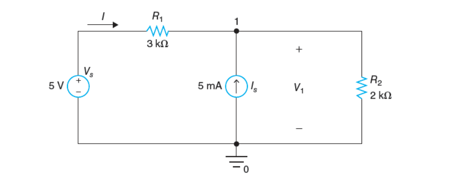 

我们可以看见这一个电路里面有2个独立源。$V_s$和$I_s$,我们可以用电路叠加原理
	
我们首先只看$V_s$对这个电路造成的影响，就需要把$I_s$的值设置成0,也就是断路。
电路就变成了这样：
	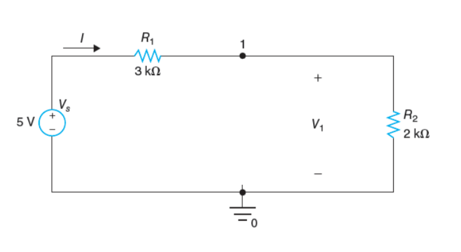

对这个电路计算$I$和$V$就比较简单了

$$
	根据欧姆定律 可以算出{I=\frac{V}{R}=\frac{V_s}{R_1+R_2}=1mA}
$$
这里的$V_1$指的是电阻$R_2$两端的电压，即

$$
	V_1=I\times R_2=1mA \times 2K\Omega=2V
$$

关于电压源的分析就完了，接下来分析电流源，将电压源的值设为0,也就是短路，电路变成了

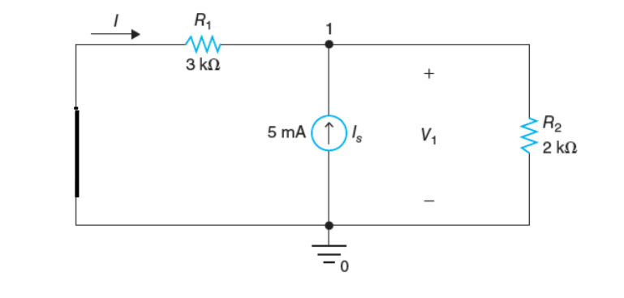 

这是一个并联电路总电流为5mA,要经过电阻值为2K$\Omega$和3K$\Omega$的电阻，因为并联，分流与电阻阻值成反比，所以分别是2mA和3mA.$V_1$为6V,$I$为-2mA(与规定正方向相反)

有叠加原理，可以求出原电路的$I$为-1A,$V_1$为8V

> [!IMPORTANT]
>- Keep only $\textcolor{red}{ONE}$ input and kill all other inputs
>- Find response to the input
>- repeat for each input
>- total response=sum of each response

# Lecture 8

## 电源变换 source transformation
>将电流源变成电压源，将电压源变成电流源

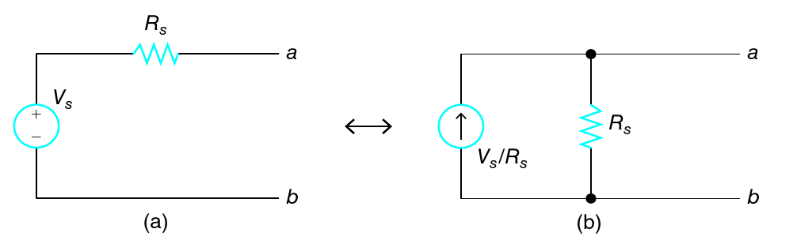 

因为要等效，所以我们需要看$a,b$端口是否等效(要求外接一个电路时，$a,b$这个端口对外输出的电压和流入外部元件的电流是相等的)

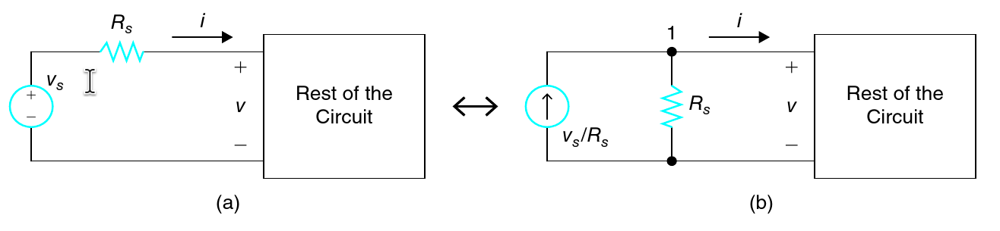 

### 从电压源到电流源
我们设$a,b$两端的电压是$V_{out}$,也就是对外输出的电压是$V_{out}$,流过外部的电流，也就是从$a$经过外部流向$b$点的电流是$I$.我们可以列出
$$V_s=IR_s+V_{out}$$
两边同时除以$R_s$,可以得到
$$\frac{V_s}{R_s}=I+\frac{V_{out}}{R_s}$$
这是一个电流等于电流加电流的结构，这和**并联分流**类似，于是构造一个并联结构，电流源的值就是$\frac{V_s}{R_s}$,电流源的值等于两个电流相加，于是是一个并联结构，根据等式，一条支路的电流是$I$,另一条支路的电流是$\frac{V_{out}}{R_s}$,又因为我们设的未知数$V_{out},I$的含义，可以知道并联的电阻阻值就是$R_s$

所以电压源$V_{out}$串联上一个电阻$R_s$等效于一个电流源$\frac{V_{out}}{R_s}$并联上一个电阻$R_s$

### 从电流源到电压源
同理，我们可以列出类似的式子。
设电流源为$I_s$,并联的电阻为$R_s$,ab端口流经的电流为$I$,对外放出的电压为$V_{out}$

可以列出方程$$V_{out}=(I_s-I)R_s$$

化简可得$$V_{out}=I_sR_s-IR_s$$
$$V_{out}+IR_s=I_sR_s$$
这是一个电压等于电压相加的式子，符合串联分压，所以可以等效成一个串联结构，又根据这些物理量的定义，可以等效为电压为$I_sR_s$的电压源串联上一个阻值为$R_s$的电阻，再于外部电路串联

### 用途
简化计算，不用列繁琐的方程就可以算出答案
#### 例题1

计算$V_o$的值
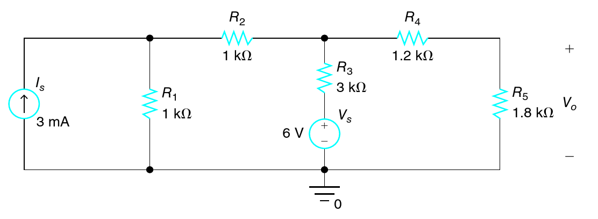

答案

我们可以观察到该电路中有很多电流源并联一个电阻或者电压源串联一个电阻的结构，可以尝试使用电源变换的方式解决

首先对$I_s$和$R_1$进行变换，根据公式，可以计算得到等效的电源$V_{s1}=I_sR_1=3V$,等效的电阻为$R_1$不变,得到电路：

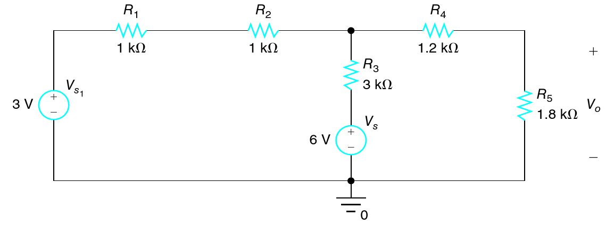 

到这里还是不好直接看出答案，但是出现了两个`电压源串联电阻`的结构，于是我们继续等效。将$V_{s1}$和$R_1,R_2$等效成$I_{s1}$并联等效电阻$R_a$,将$V_s$串联$R_3$等效成$I_{s2}$并联$R_3$,变成了

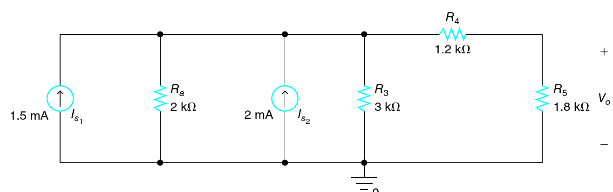 

我们还可以将两个电流源合成一个$3.5mA$的电流源(因为方向相同)

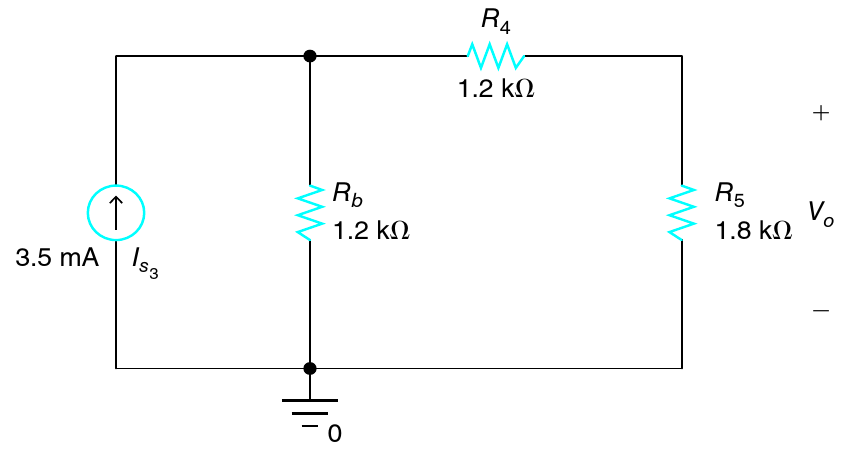 

继续等价可以得到

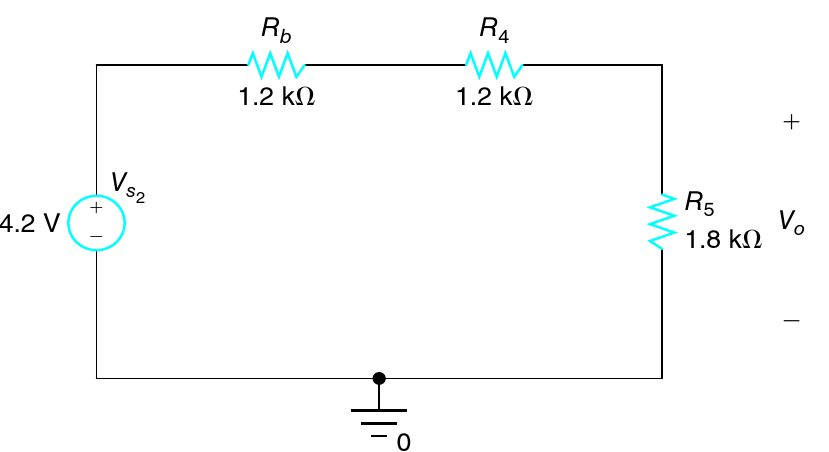 

接着就可以一眼看到答案等于$1.8V$了

> [!NOTE]
> 虽然过程看上去很繁琐，但是每一步都很简单,每一步都是可以妙算的程度，可以大大减小因为方程数量和未知数数量多而造成的计算错误，并且电源变换也方便后面做检查
>
>值得注意的是，如果有多个源的电路，最后电路化成最简的形式是化成多个独立电流源相并联或者独立电压源相串联，因为这样还可以将多个源合并成一个源，此时电路就变成了一个源加上串并联电阻的形式，也可以一眼出答案了

> [!TIP]
> 电源变换对受控源同样适用,但需要保证电路的信息不会丢失
> - 如果控制量是一条支路的电流，变换后支路仍然存在
> - 如果控制量是两点之间的电压，变换后需要这两点仍然存在并且电压可测 

## 戴维南定理 Thévenin’s theorem

### 定义 
>将$\textcolor{red}{一对端点}$所连接的电路等效成一个电压源串联上一个电阻，分别叫做戴维南电压($V_{th}$)和戴维南电阻($R_{th}$),新电路被称为戴维南等效电路。

> [!WARNING]
> - 仅适用于线性网络：戴维南定理只适用于包含电阻、独立电源和受控源的线性有源二端网络。
> - 戴维南等效只对外电路等效:把一个复杂的线性有源二端网络（比如一堆电源和电阻）化简成一个简单的电压源 $V_{th}$ 串联一个电阻 $R_{th}$ 之后，这个简化电路仅仅在它的两个输出端（a、b）所连接的外部负载上，与原复杂电路的行为完全一致。
> - 所选取的需要等效的那个电路只能有$\textcolor{red}{两个端口}$与外部电路连接。并且所求的外部电路中不能包含受所等效部分内部的电流或电压所控制的电流源或电压源(因为通过戴维南定理简化会丢失内部电路的电流和电压信息，导致后续无法分析)
### 一般步骤
1. 断开待求支路（移开负载） 
	>将要分析的外部电路（如负载电阻 $R_L$）从原电路的两个端点 a、b 处断开，使剩下的部分成为一个有源二端网络。
	>
	>目的：隔离出需要等效的内部电路，使其只剩下两个输出端
2. 求戴维南等效电压 $V_{th}$
	>计算断开的 a、b 两点之间的开路电压 $V_{oc}$
	>
	>保留原电路中的所有独立源和受控源。直接用基尔霍夫定律（KCL/KVL）、节点电压法、网孔电流法等常规方法求解 a、b 两端的电压。这个电压值就是 $V_{th}$，注意标注极性（正极指向 a 还是 b）。

3. 求戴维南等效电阻 $R_{th}$

	#### 方法1
	>将所有独立源的值设置成0(独立电流源就将这个支路看成$\textcolor{red}{开路}$，独立电压源就将这个支路看成$\textcolor{red}{短路}$)
	>
	>保留所有受控源，并且控制关系不变
	>
	>在a,b两个端口外加测试电压$V_{S}$,通过前面学过的分析简单电路的方法(KCL,KVL,节点分析法，网格分析法，等效电阻...)来计算电流$I_{S}$,进而用$$R_{th}=\frac{V_S}{I_S}$$来计算戴维南电阻

	#### 方法2
	> 用导线将$a,b$端口连接，找到短路电流$I_{sc}$,$R_{th}=\frac{V_{th}}{I_{sc}}$
#### 例题

##### 8.1

Consider a circuit shown below. We are interested in finding Vth and Rth across terminals a and b.

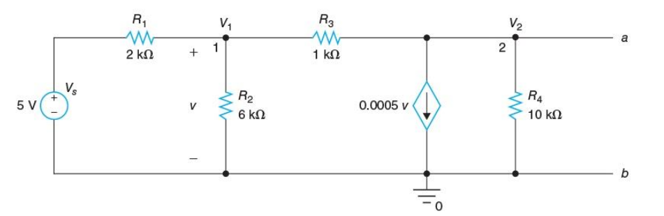 

这道题已经帮我们把需要做等效的部分给我们了，我们只需要找到对应的$V_{th}$和$R_{th}$就可以了

我们首先找$V_{th}$
$$
	首先将a,b端口设置成断路，然后求a,b之间的电压(在这个电路中就是R_4的电压),电路变成了
$$

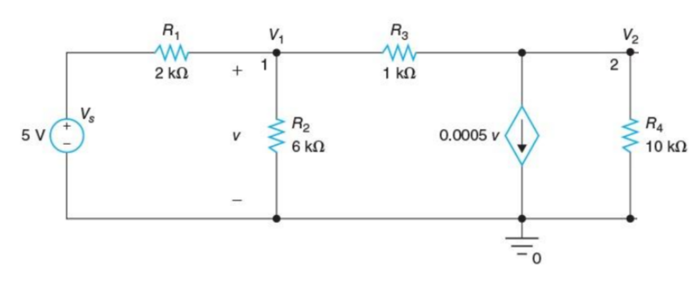

我们需要求解$V_2$

根据所学的电路分析方法，我们可以列出

$$

\frac{5-V_1}{2}=\frac{V_1-V_2}{1}+\frac{V_1}{6},
\frac{V_1-V_2}{1}=0.5V_1+\frac{V_2}{10}
$$

$$可以解得V_{th}=V_2=\frac{15}{16}=0.9375$$

接着求$R_{th}$

我们要断开所有的独立源，保留受控源,并在a,b两个端口加测试电压$V_S$电路变成了这样

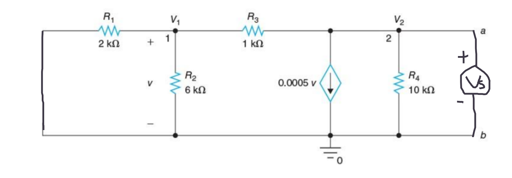

对电路进行分析，可以得到方程

$$
\frac{V2-V1}{1}=\frac{V_1}{6}+\frac{V_1}{2}
,\frac{V_2-V_1}{1}+0.5V_1+\frac{V_2}{10}=I_S
,V_2=V_S;
$$
可以解得
$$I_S=\frac{4V_S}{5},R_{th}=1.25K\Omega$$

##### 8.2

	

求出$V_{th}$和$R_{th}$ 

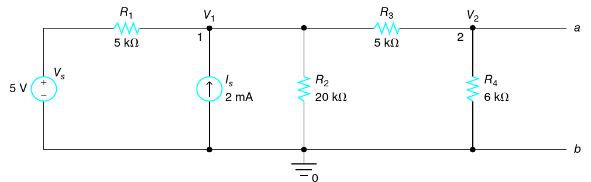 

我门可以观察到这个电路出现了$\text{电压源与电阻串联}$和$\text{电流源与电阻并联}$的结构，我们可以通过上面学到的电源转换来化简电路，以便方面我们求$V_{th}$和$R_{th}$

$V_s$与$R_1$串联，可以变换成电流源与电阻并联：

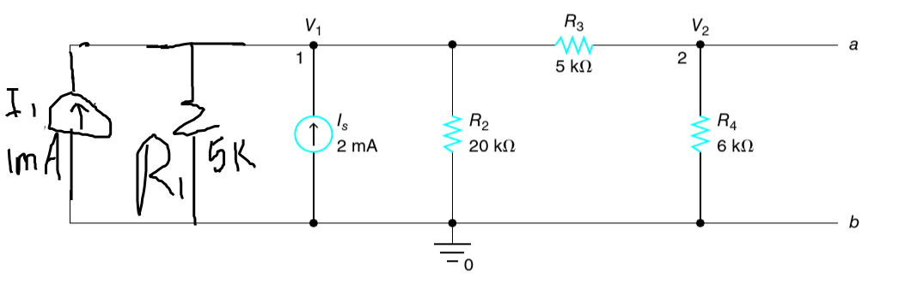

$I_1=\frac{V_s}{R_1}=1mA$

接着讲两个电流源$I_1,I_s$合并成一个$3mA$的电流源，$R_1,R_2$合成$R_5=4K\Omega$,接着出现电流源并联电阻，继续电源转换，得到

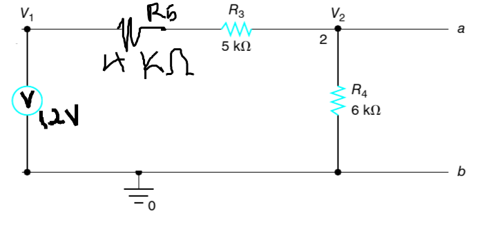 

这样简化电路过后$a,b$点测的开路电压$V_{oc}$其实就是$R_4$的分压，根据串联分压，可以得到$V_{oc}=\frac{12V}{4K\Omega+5k\Omega+6k\Omega}\times 6k\Omega=4.8V$

这样$V_{th}=V_{oc}=4.8V$就求出来了，剩下的需要求出$R_{th}$,我们尝试一下方法二:

将$a,b$短接，$R_4$被短路了，电路变成了$V$串联$R_5+R_3$,可以很轻松求出短路电流$I_{sc}=\frac{V}{R_5+R_3}=\frac{12V}{4k\Omega+5k\Omega}=\frac{4}{3}mA$

$$R_{th}=\frac{V_{oc}}{I_{sc}}=3.6k\Omega$$

最后戴维南等效过后电路变成这样：

 

# Lecture 9

## 诺顿定理Norton’s theorem

>和戴维南定理一样，是将两个端口内部的电路简化。与单位难定理不同的是，诺顿定理是将端口内的电路等效成一个电流源并联上一个电阻，其核心可以总结为
>
>
$$ 对于任意线性含源二端网络（对外仅引出a、b两个端子，内部全部由线性元件：
线性电阻、线性独立/受控源构成），对外特性可以完全等效为：
$$

$$
一个理想电流源 I_N（诺顿等效电流）与一个电阻 R_N（诺顿等效电阻）并联的电路，这个组合就叫诺顿等效电路。
$$

### 核心参数

#### 诺顿等效电流
$$将原二端网络的a、b端子直接短接，测得的端口短路电流 I_{sc} 就等于 I_N$$

#### 诺顿等效电阻
$$ 将全部独立源设置成0,保留受控源的关系$$

因为和戴维南定理十分相似，所以不另外补充例题

# Lecture 10

## 电容器 capacitor
### 定义
>电容是无源被动电子元件，核心功能是可以存储`电场`能量，需要时向外释放能量
>
>平行板电容的结构：两片平行导电极板，中间填充绝缘电介质(电介质材料：dielectric material)
>
>正负极板各自携带正电荷和负电荷

### 工作原理

能量被储存到`正负极板之间的电场`中,这个能量的大小取决于电容器的电容大小和两极板之间的电压 

 

如上图所示，平行电容板之间的距离$d$,板子的面积$S$,$\varepsilon$为两板子之间的介电常数.通常情况下，$d$相对较小，$S$相对较大,于是我们忽略平行电容板的边缘效应：
 
两板边缘的电场线弯曲就是边缘效应

忽略了边缘效应后，我们可以将两极板之间的电场看成是匀强的，电位移矢量(electric flux density)可以表示为$$D=\varepsilon E$$电位移矢量 $\mathbf{D}$ 表示单位面积上穿过的电通量

$D$的大小是由板子的自由电荷决定的(也就是板子的带电量)，$\varepsilon$是由中间的材料决定的，$D,\varepsilon$共同决定了两个板子之间的场强大小

|       $\varepsilon$        |        $\varepsilon_0$         |              $\varepsilon_r$               |
| :------------------------: | :----------------------------: | :----------------------------------------: |
|       介质的介电常数       |         真空的介电常数         |                相对介电常数                |
| permittivity of the medium | permittivity of the free space | relative permittivity(dielectric constant) |

这三者之间的关系$$\varepsilon=\varepsilon_0\times \varepsilon_r$$

> [!NOTE]
> $\varepsilon_r$没有量纲(单位)

区别于真空条件下的高斯定理

$$
\oint_S \mathbf{E} \cdot d\mathbf{A} = \frac{Q_{\text{total}}}{\varepsilon_0}
$$
介质中的高斯定理为:
$$
\oint \boldsymbol{D} \cdot d\boldsymbol{s} = \oint \varepsilon \boldsymbol{E} \cdot d\boldsymbol{s} = Q_{free}
$$
因为表面与电场强度方向始终垂直，并且电场匀强，我们可以得到

$$
\oint \varepsilon \boldsymbol{E} \cdot d\boldsymbol{s} = \varepsilon E \int ds = \varepsilon E S = Q
$$
其中S是板子的面积,经过变形，可以得到场强$$E=\frac{Q}{S\varepsilon}$$
电场的正方向从正极板指向负极板，根据电压的定义
$$
V = -\int \boldsymbol{E} \cdot d\boldsymbol{l}
$$
> [!NOTE]
> 其中的负号表示顺着电场线方向走，电势降低;逆着电场线方向走，电势增高

于是正极板到负极板的电势差为
$$
V = Ed = \frac{Qd}{\varepsilon S} = \frac{Q}{\frac{\varepsilon S}{d}}
$$
因为电容量的定义$C=\frac{Q}{V}$
所以$$C=\frac{\varepsilon S}{d}$$

> [!IMPORTANT]
> 这个公式里面的电容量和面积，两极板的距离的关系与电容的串并联所形成的等效电容量有很大关系！串联可以理解成增大两板之间的间距；并联可以理解成增加两板间的面积

#### 求解电容C
上面展示了平行电容板如何求解电容C,下面求一下圆柱形的电容器的电容

	

	The cross-sectional view of a cylindrical capacitor with length L is shown in Figure 6.4. An inner conductor with charge Q has a radius a and the outer conductor with charge -Q has a radius b. The space between the conductors are filled with dielectric material with permittivity epsilon. The direction of the electric field inside the dielectric medium is radial.
	

$$\oint \varepsilon \boldsymbol{E} \cdot d\boldsymbol{s} = \varepsilon E 2\pi\rho L = Q$$

$$E = \frac{Q}{\varepsilon 2\pi\rho L}$$

$$V_{ab} = V_a - V_b = -\int_{b}^{a} \frac{Q}{\varepsilon 2\pi\rho L} d\rho = \frac{Q}{\varepsilon 2\pi L} \left[ -\int_{b}^{a} \frac{1}{\rho} d\rho \right]$$
$$= \frac{Q}{\varepsilon 2\pi L} \left[ -\ln\left(\frac{a}{b}\right) \right] = \frac{Q}{\varepsilon 2\pi L} \ln\left(\frac{b}{a}\right)$$

$$C = \frac{Q}{V_{ab}} = \frac{2\pi\varepsilon L}{\ln\left(\frac{b}{a}\right)}$$

> [!NOTE]
> 根据物理所学的高斯定理，平行电容板的上下两级所带电荷总是大小相同，属性相反的。不可能一个板子上带+Q电荷，另一个板子上面带-2Q电荷。总是+Q,-Q成对出现的，于是我们将Q成为电容的带电量

### 分类
> 根据电容大小和使用的材料，电容器可以分为很多种类
- Aluminium electrolytic capacitor（铝电解电容）
- Ceramic capacitors（陶瓷电容）
- Tantalum capacitors（钽电容）
- Film capacitors（薄膜电容）
- Polyester capacitors etc ...（聚酯电容等...）

### 使用场景

1. 储能与供能
2. 信号处理
	- 过滤特殊频率范围内的信号

。。。

### 电容 capacitance

>电容器的电荷量与极板两端的电压成正比
>
>The amount of charge Q (in coulombs) on the plates is proportional to the voltage V (in
volts) of the source

$$Q=CV=>C=\frac{Q}{V},常数C被称为电容，单位为法拉(F)$$
电容被定义为储存的电荷量与极板两端电压的比值

> [!IMPORTANT]
> 电容反应的是累积电荷的能力
>
>Physically, capacitance determines the ability of the capacitor to accumulate charge.

### 电容器中电流与电压的关系
如果极板两端电压随时间变化，那么电荷量可以写成$Q=CV(t)$,其中，Q是电容器所储存的电荷量，V是极板两端的电压，C是电容器的电容

$\textcolor{red}{因为电流是电荷量关于时间的微分,所以可以等式左右两边同时对时间t求导，得到}$

$$i(t)=C\frac{dV(t)}{dt}$$

同样的，我们可以得到
$$V(t)=\frac{1}{C}\int_{-\infty}^{t}i(t) \, dt=V_0+\frac{1}{C}\int_{0}^{t}i(t) \, dt$$

其中$V_0$就是t=0时刻电容器两端的电压

### 功率和能量
对于所有二端元器件，瞬时功率都可以表示成$p(t)=v(t) i(t)$
那么对于电容器来说，也是如此，我们将上面的电流电压关系带入瞬时功率的式子，就可以得到$$p(t)=Cv(t)\frac{dv(t)}{dt}$$

> [!IMPORTANT]
> 同样地，根据功率不可能无穷大，所以电容器两端的电压也不能突变，意味着$$V(t_{0-})=V(t_{0+})$$

电容器储存的能量w(t)=$\int_{-\infty}^{t} p(t) \, dt$
再进行一次替换，得到$w(t)=C\int_{-\infty}^{t}v(t)\frac{dv(t)}{dt} \, dt=\frac{Cv^{2}(t)}{2}$

### 电容器的串联

因为在这条线路上通过各个电容器的电流是相等的，只是总的$V(t)=V_1(t)+V_2(t)+...+V_n(t)$
所以$V_t=\frac{1}{C_1}\int_{-\infty}^{t}i(t) \, dt+\frac{1}{C_2}\int_{-\infty}^{t}i(t) \, dt+\frac{1}{C_3}\int_{-\infty}^{t}i(t) \, dt+...+\frac{1}{C_n}\int_{-\infty}^{t}i(t) \, dt=\frac{1}{C_eq}\int_{-\infty}^{t}i(t) \, dt$
。所以等效的电容满足
$$\frac{1}{C_{eq}}=\frac{1}{C_1}+\frac{1}{C_2}+...+\frac{1}{C_n}$$

> [!TIP]
> 电容器的串联的等效结果公式与电阻的并联等效公式很像

### 电容器的并联
 

因为并联，所以各个电容器两个极板之间电压相同，电流满足总的$I(t)=I_1(t)+I_2(t)+...+I_n(t)$

也就是
$i(t)=C_{eq}\frac{dV(t)}{dt}=C_{1}\frac{dV(t)}{dt}+C_{2}\frac{dV(t)}{dt}+...+C_{n}\frac{dV(t)}{dt}$。
所以
$$C_{eq}=C_1+C_2+...+C_n$$

> [!TIP]
> 电容器的并联的等效结果公式与电阻的串联等效公式很像

> [!IMPORTANT]
> 1. 电容器不符合欧姆定律
> 2. 电容器两端的电压不能突变，因为电流不可能无穷大
> 3. 当电压不变的时候，流过电容器的电流为0，电容器所在的支路相当于开路
> 4. 不像电阻，当电压为0的时候，流经电容器的电流不一定为0,当电流为0的时候，电容器两端的电压不一定为0

# Lecture 11

## 基本定理
### 安培定理 Ampère’s Law
>电流通过线圈确实会产生磁场
>
>current through a coil generates a magnetic field

围绕闭合回路的磁场与穿过该回路的总电流成正比
$$\oint \vec{B} \cdot d\vec{l} = \mu_0 I_{enc}$$
其中，B是磁场大小，dl是沿着磁场的一小段路径的微元，$\mu$是真空磁导率，$I_{enc}$是所选取回路里面的电流

对于长直的磁感线，电场强度是$B=\mu_0nl$

> [!NOTE]
>  
>
>电流流过单匝线圈所产生的磁场
>
>通电直导线的磁场和通电螺旋管的磁场都符合右手螺旋定则
>
>其实这两个是一样的，看上面的图就可以看出来，通电螺线管通过的磁场其实是通电直导线的磁场叠加形成的，所以符合右手螺旋定则

### 法拉第电磁感应定律 Faraday’s Law
$$\varepsilon = -\frac{d\Phi_B}{dt}$$
>闭合回路的感应电动势等于穿过回路的磁通量变化率的负值
>
>The induced electromotive force (EMF) in a closed circuit is
equal to the negative rate of change of magnetic flux through the circuit

磁通量：是描述穿过某个面的磁场总量的物理量
$$\Phi = B \cdot A \cdot \cos\theta$$

### 楞次定理 Lenz’s Law
感应电流产生的磁场，总是阻碍「引起感应电流的原磁通量的变化」

### 磁场强度，磁通密度，磁导率

$B = \mu H$

$B$：磁通密度（磁感应强度），代表空间中总的磁场效果（包括外加激励和介质磁化产生的附加场）。

$H$：磁场强度，仅反映外部激励源（如传导电流）产生的磁场，与介质无关

$\mu$：磁导率，刻画材料被磁化的难易程度，即材料在单位磁场强度下能产生多大的磁通密度。

它与电位移 $D = \varepsilon E$ 完全对应：

$E$（电场强度）↔ $H$（磁场强度）：仅由自由电荷/传导电流决定。

$D$（电位移）↔ $B$（磁通密度）：包含了介质极化和磁化的总效果。

$\varepsilon$（介电常数）↔ $\mu$（磁导率）：材料的响应系数。

## 电感器 inductor

 
>最简单的电感器- ->螺旋管(solenoid)

如果有电流流过线圈，那么磁场就会产生，磁场的方向遵循右手定则。如果线圈的直径相较于螺旋管的长度来说很小，即是一个长直螺旋管，那么就可以认为螺旋管内部的磁场是匀强的，并且外部磁场的磁通密度是0(因为所有的磁感线都被包围在螺旋管里面了，磁感线出不去)。螺旋管内部的磁通密度(磁感应强度)可以通过安培定理找到，令螺旋管长度是$l$,线圈的匝数是$N$,我们将闭合线路设置成矩形：

 

根据上面的假设:磁场是匀强的，并且矩形边a没有磁场所以$\oint \vec{B} \cdot d\vec{l} = \mu_0 I_{enc}$

所以$Bl=\mu_0NI,B=\frac{\mu_0NI}{l}$

可以通过磁通密度计算磁通量:

$$
\Phi = \int\limits_{S} \boldsymbol{B} \cdot d\boldsymbol{s} = BS = \frac{\mu_0 N I}{\ell} S
$$

假设螺旋线的半径是$r$,可以算出磁通量$\Phi=\frac{\mu_0NI\pi r^2}{l}$

因为每一匝线圈都包含磁通量，所以有了一个新的概念:磁通链$\Lambda = N\Phi= N \left( \frac{\mu_0 N I}{\ell} \pi r^2 \right) = \frac{\mu_0 N^2 I \pi r^2}{\ell}$

自感定义:磁通连除以电流:$L = \frac{\Lambda}{I} = \frac{\mu_0 N^2 \pi r^2}{\ell}$

> [!IMPORTANT]
> 为什么前面要讲什么法拉第电磁感应定律和一些自感的定义？这些感觉跟电分没什么关系？？？
>
>大的来了
>
>根据法拉第电磁感应定律:变化的磁通量会产生感应电动势(electromotive force->emf)$\mathcal{E} = -\frac{d\Phi_B}{dt}$
>
>在这里是N匝线圈，相当于电池的串联，感应电动势就变成了$\mathcal{E} = -N\frac{d\Phi_B}{dt}$)=$\mathcal{E} = -\frac{d(N\Phi_B)}{dt}$
>
>楞次定理可以用来找感应电流的方向，也就相当于感应电动势的正负极分别在哪个方向
>
> 
>
>对于螺旋线圈，可以替换成$\mathcal{E} = -\frac{d}{dt}\!\left(\frac{\mu_0 N^2 \pi r^2}{\ell} I\right)= -\frac{\mu_0 N^2 \pi r^2}{\ell}\,\frac{dI}{dt}$
>
>前面的一推系数就是自感系数$L$,所以$\mathcal{E} = -L\,\frac{dI}{dt}$
>
>我们还可以注意到电感和磁通链符合以下等式
>$$L=\frac{\Lambda}{I}$$
>即使$L$与磁通链和电流无关，只是电感器自身的性质

感应电动势方向:

 
 
### 基本介绍
- 和电容器一样，属于无源元件
- 简单的电感器由螺旋管组成，即绕成螺旋状的导线
- 螺线管内部的核心可以填充空气，也可以填充铁磁性材料（ferromagnetic），使用铁磁性材料可以显著增强电感器的磁场强度和电感量

### 工作原理
- 当电流流过电感器时，会产生磁场，由法拉第电磁感应定律可以得到，变化的磁场会产生感应电动势
- 电感是衡量电感器在给定电流变化下产生磁通量的能力的度量

### 使用场景
- 在磁场中储能（有电流通过的时候会储能）
- 滤波（会阻碍高频信号，通过低频信号）
- 调谐信号（与电容器混合使用可以用来选择特定频率的信号）
- 变压器（通过电磁感应实现电压的升降）
- 感应传感（检测金属或者变化的磁场）

> [!NOTE]
> 跟电容器不一样，电感器是将能量储存在`磁场`中，而不是电场

### 电感
>电感是衡量电感器在给定电流变化下产生磁通量的能力的度量

电感器里面存储的能量与自身的电感和流经的电流相关

电感器两端的电压$v(t) = L \frac{di(t)}{dt}$

电感电压取决于电流的变化率，而不是电流的大小。

同样，对该式子积分就可以得到电流随时间的关系
$$i(t) = \underbrace{\frac{1}{L}\int_{-\infty}^0 v(\tau)d\tau}_{i(0)} + \frac{1}{L}\int_0^t v(\tau)d\tau$$
### 能量
$$p(t) = v(t)i(t)$$
$$p(t) = i(t) \left[ L \frac{di(t)}{dt} \right] = Li(t) \frac{di(t)}{dt}$$

> [!IMPORTANT]
> 从这个式子可以看出来，流经电感器的电流不能突变，否则$\frac{di(t)}{dt}$趋近于无穷，其他两个因式又是定值，于是功率达到无穷，这显然是不可能的
>
>也就是说，对于流经电感器的电流来说，$i(t_{0+})=i(t_{0-})$

$$w(t) = \int_{-\infty}^{t} p(t) dt$$
$$w(t) = L \int_{-\infty}^{t} i(t) \frac{di(t)}{dt} dt = L \int_{-\infty}^{t} i(t) di(t) = \frac{1}{2}Li^2(t)$$

### 串并联
和电阻一样

# Lecture 12

## RC 电路
>同时包含电阻和电容的电路

 

RC电路的行为在电容充能和放能时有差异，可以分为
- RC电路的自然响应Natural response
- RC电路的阶跃响应Step response

### 自然响应
- 没有外部输入且电容放能
- 一直持续直到电容里面存储的能量释放完
- 也被称为瞬态响应、零输入响应或无源响应transient response, zero input response or source free response

### 阶跃响应
- 发生于RC电路的外部输入突然连接
- 这种行为展示了电容两端电压和电路中的电流如何随时间变化，从而导致电容的充电
- 一直持续直到达成稳态

 
根据kcl,可以列出方程
$$C\frac{dv}{dt}+\frac{v}{R}=0$$
整理为：
$$\frac{dv}{dt}=-\frac{v}{RC},\qquad t\geq0$$

当 $v(t)\neq0$ 时，两边同时除以 $v$：
$$\frac{1}{v}\frac{dv}{dt}=-\frac{1}{RC}$$
写成微分形式：
$$\frac{dv}{v}=-\frac{1}{RC}\,dt$$

$$\int\frac{dv}{v}=
-\frac{1}{RC}\int dt$$

得到：
$$\ln|v(t)|=-\frac{t}{RC}+K$$

化简得
$$v(t)=e^k e^{-\frac{t}{RC}}$$
令A=$e^K$
化简该式子，得到$$v(t)=Ae^{-\frac{t}{RC}}$$
当t=0时，$v(0)=A\times1=A$。因此，A=v(0)=$V_0$

从整个时间轴来看，当t<0的时候，$V=0$,t>=0开始，电压开始不为零。所以从整个时间轴来看，电压可以写成一个分段函数，或者写成到$v(t)=Ae^{-\frac{t}{RC}}u(t)$,u(t)是一个阶跃函数

根据电容的电流和电压的关系$I=c\frac{dv}{dt}$
I可以计算得到$$I(t)=-\frac{V_0}{R}e^{-\frac{t}{\mathrm{RC}}}$$
### 时间常数 time constant
>$\tau$就是时间常数，其数值等于RC

之前所有的式子都可以通过用$\tau$来简化
$$V(t)=V_0e^{-\frac{t}{\tau}}$$
$$I(t)=-\frac{V_0}{R}e^{-\frac{t}{\tau}}$$
$$P(t)=-\frac{(V_0)^2}{R}e^{-\frac{2t}{\tau}}(P=VI)$$
> [!IMPORTANT]
> $\tau$越大，电容的充放电速度越快

 

特别地，当时间$t=\tau$时，$V=V_0 e^{-1}=0.367879V_0$

 

#### 5 $\tau$近似
当 $t=5\tau$ 时,$v(5\tau) = V_0 \cdot e^{-5} \approx 0.00674 V_0 = 0.674\% V_0$，仅剩不到1%的初始电压。因此工程上默认：RC充放电的暂态过程在 $t\geq5\tau$ 后结束，此时可以认为电路已经达到稳态，无需再考虑动态暂态部分。（如果是充电过程 $v(t)=V_s(1-e^{-t/\tau})$，5τ时电压能达到目标值的99.3%，同样认为充电完成）

如果我们对$V(t)$求导，可以得到$$\frac{dV(t)}{dt}=V_0 \frac{de^{\frac{-t}{\tau}}}{dt}=-\frac{V_0}{\tau}e^{-\frac{t}{\tau}}$$
当$t=0$时，直线斜率(即变化率)等于$-\frac{V_0}{\tau}$

当$t=0$时，切线方程等于$V=(1-\frac{t}{\tau}){V_0}$,观察式子，可以发现，当$t=\tau$时，$V=0$

 

### 计算时间常数
对于只有一个电容的RC电路，时间常数$\tau=R_{eq}C$
> [!TIP]
> 意味着如果单一电容器的RC电路中有多个电阻，那么时间常数$\tau$等于等效电阻乘以电容量C

> [!IMPORTANT]
> 关于阶跃响应的结果和分析方式和自然响应类似，于是不再赘述，请读者自行推导:)

# Lecture 13 运算放大器 operational  amplifier

> 运放是一个特性与电压控制电压源(VCVS)类似的电子元件 

## 结构

 

上图展示的是典型的8脚双列直插封装(DIP)，引脚8是空引脚,引脚1,5一般不会用到，剩下5个重要的引脚分别是

1. 引脚2：反相输入端 (inverting input)
2. 引脚3：同相输入端 (non-inventing input)
3. 引脚6：输出端 (output terminal)
4. 引脚7：正电源端$V^+$
5. 引脚4：负电源段$V^-$

作为有源器件，运算放大器需要连接电压源为期供电

 

> [!TIP]
> 通常情况下，为了电路图的简单，我们不画出运放的电源

根据$KCL$，我们可以得到$$i_o=i_1+i_2+i_++i_-$$

将运放的内部分为输入和输出，输入和输出都通过戴维南等效可以等效为下面的电路
> [!TIP]
> 我们知道，戴维南等效需要两个端点，但是输出端看似只有一个端点？其实是两个，一个是$v_{out}$的端点，一个是$GND$

 

其中，输入电压$R_i$是从输入端看进去的等效电阻，输出电压$R_o$是由输出端看进去的等效电阻,差分输入电压$V_d=V_2-V_1$,$V_1,V_2$分别是反相输入端电压和同相输入端电压

> [!TIP]
> 我们可以通过等效的电路看出，$V_o$的符号与$V_d$的符号是相同的，而且$V_d$的值是同相输入端减去反相输入端，从$V_o=AV_d=A(V_2-V_1)$这里就解释了同相和反相的意思：同相的意思是，电压越大，输出的电压越大，是一个同相的关系;反相的意思是电压越大，输出的电压越小，是一个反相的关系

|     参数      |        典型范围        |     理想值      |
| :-----------: | :--------------------: | :-------------: |
|   开环增益A   |    $10^5$ ~ $10^8$     |    $\infty$     |
|   输出电阻    |    $10$~$100\Omega$    |    $0\Omega$    |
| 输入电阻$R_i$ | $10^5$~$10^{13}\Omega$ | $\infty \Omega$ |
|  电源电压Vcc  |       $5$~$24V$        |                 |

## 反馈
> 反馈指的是将输出信号的一部分通过特定电路引回到输入端的过程

### 负反馈

当输出端连接到反相输入端时，就形成了负反馈,即如果初始状态下反相输入端大于正相输入端，那么输出端会使反相输入端的值变小，类似的，如果初始状态下反相输入端小于正相输入端，那么输出端会使反相输入端变大

 

上图就是将输出端连接到反相输入端

#### 闭环增益 closed-loop gain

> 如果存在输入到输出的反馈路径，那么此时的输出电压与输入电压的比值称为闭环增益

> [!TIP]
> 实验证明，运放的闭环增益与开环增益基本无关

#### 饱和 saturation

受到电源电压的限制，运放不可能将一个输入电压放大到无穷大，这就有了饱和的概念

##### 正饱和 positive saturation

当$v_d$大到某一个值的时候，输出的电压就会饱和，因为能量的原因，输出电压最多为电源的正电源端的电压
##### 负饱和 negative saturation

当$v_d$小到某一个值的时候，输出的电压就会饱和，因为能量的原因，输出电压最多为电源的负电源端的电压

##### 线性区
当电压$v_d$在这两个饱和电压之间的时候，输出电压就会等于A倍的$v_d$

 

> [!TIP]
> 上图中正饱和和负饱和的电压大小都是$V_{cc}$,这是运放器的正电源端和负电源端决定的。当然，如果一个运放器的正电源端为+5v,负电源端为-3v,那么运放器的饱和电压就会分别为5v和-3v,即正电源端和负电源端，正饱和电压和负饱和电压的绝对值可以不相等

###### 例题

运算放大器的开环增益为$2\times 10^5$,输入电阻为$2M \Omega$,输入电阻为$50 \Omega$,如图所示.(a)求闭环增益$v_o/v_s$(b)当$v_s=2V$时，电流$i$的值是多少

 

根据前面的知识，我们可以将输入端等效成输入电阻，将输出端等效成一个受控电压源串联上一个输出电阻,我们可以得到等效后的电路图

 

(a) 求闭环收益

我们可以在节点1列出KCL
$$
\frac{v_s-v_1}{10\times 10^3}=\frac{v_1}{2000\times 10^3}+\frac{v_1-v_o}{20\times 10^3}
$$

可以得到

$$200v_s=301v_1-100v_o$$

即$2v_s \approx 3v_1 -v_o$

所以$v_1=\frac{2v_s+v_o}{3}$

对O点列方程
$$ \frac{v_1-v_0}{20\times 10^3}=\frac{v_o-Av_d}{50}$$

由$v_d=-v_1$,并且$A=200000$

可得$v_1-v_o=400(v_o+200000v_1)$

所以$\frac{v_o}{v_s}=-1.9999699$

(b)当$v_s=2V$时，$v_o=-3.9999398V$,从而也可以求出$v_1=20.066667\mu V$,从而$$i=\frac{v_1-v_o}{20\times 10^3}=0.19999 mA$$

> [!IMPORTANT]
> 该题因为运算放大器的输出端只连接了反相输入端作为负反馈，没有连接其他的负载，所以对于O点来说，电流不会通过输出端的端口向外流出;但是如果将电路中的运算放大器的输出端还要连接一个负载，那么对O点的节点分析方程就会改变，所求得的闭环增益也会发生变化

## 理想运算放大器

### 与实际运算放大器的对比
> 理想运算放大器是一个开环增益无穷大，输入电阻无穷大，输出电阻为0的放大器

理想运算放大器和真实的运算放大器的对比与之前提到的表格内容一致

|     参数      |        典型范围        |     理想值      |
| :-----------: | :--------------------: | :-------------: |
|   开环增益A   |    $10^5$ ~ $10^8$     |    $\infty$     |
|   输出电阻    |    $10$~$100\Omega$    |    $0\Omega$    |
| 输入电阻$R_i$ | $10^5$~$10^{13}\Omega$ | $\infty \Omega$ |
|  电源电压Vcc  |       $5$~$24V$        |                 |

### 重要性质
- 两个输入端的输入电流均为0
- 两个输入端电压差为0

 

电流为0的原因
- 因为输入电阻无穷大，相当于输入端开路，所以输入端的电流为0

 

> [!IMPORTANT]
> 虽然输入端的电流是0,但是输出端的电流不一定为0,因为
> 
>  
>
> $i_++i_-$不一定为0,因为还有$i_+,i_-$

两输入端电压差为0的原因
- 因为开环增益趋近于无穷，但是$v_o$只能是一个有限的值，那么只有$v_d=0$,即$v_1=v_2$

> [!IMPORTANT]
> 这两条性质，前面一个叫做虚断，像断路一样，没有电流流经运算放大器;后面一个叫做虚短,像短路一样，$v_1,v_2$电压相等.值得注意的是，虚短需要负反馈这么一个条件，而虚断只要是理想的运算放大器都满足的一个性质

#### 例题

计算这个电路的运算放大器的闭环增益(为理想运算放大器)

 

根据理想运算放大器的虚短虚断的性质，我们可以得到$v_1=v_2=v_s$,又因为$i_1=0$,所以$40k\Omega$和$5k\Omega$流过的电流是相等的，$v_1$两端的电压就等于$v_1$,根据串联分压，可以得到$v_o=9v_1=9v_s$

所以，闭环增益为$\frac{v_o}{v_s}=9$

## 多种分类

运放器可以进行多种运算，比如加减法(addition,subtraction)，放大与衰减(amplification,attenuation),积分微分运算(integration,differentiation)

主要用于放大器(amplifiers),滤波器(filters),信号调理(signal conditioning)以及仪器仪表电路

### 反相放大器

> 输入电压$V_s$通过电阻连接反相输入端
>
>  

为了找到输入端电压$V_i$和输出端电压$V_o$的关系，我们对节点1做分析

假设这是一个理想的放大器，所以我们可以根据前面提到的``虚短和虚断``

可以知道节点$V_n$没有电压流进运放器，所以流经$R_1$的电流和流经$R_f$的电流大小是一样的,我们可以列出：
$$\frac{V_i-V_n}{R_1}=\frac{V_n-V_o}{R_f}$$

再根据虚短，可以知道$V_p=V_n=0$,因为$V_p$接地。

我们可以将$V_n=0$带入，我们可以得到$$\frac{V_i}{R_1}=-\frac{V_o}{R_f}$$

即
$$
V_o=-V_i\frac{R_f}{R_1}
$$
> [!TIP]
> 对于这个运算放大器来说，闭环增益的大小为反馈电阻除以输入电阻的值，这表明了其增益只与运算放大器连接的外部电路相关

> [!IMPORTANT]
> 注意我前面所说的输入电阻是$R_1$,你可能有这么一个疑问，理想运算放大器的输入电阻不是无穷大吗，这里为什么是等于$R_1$?其实我在tip里面说的输入电阻是相对于信号源$V_i$来说的，而在理想运放器那里提到的输入电压是理想运放器中芯片本生的构成，这是两回事。我们可以把反相运放器看成是由理想运放器和外部电路共同总成的，理想运放器的输入电压是无穷大，从信号源的角度看这个电路的输入电压是$R_1$.那为什么对于这个模块来说输入电阻是$R_1$呢？因为对于一个电路模块，从它的两个输入端子往里面看$$R_{in}=\frac{两端的电压}{两端的电流}$$，在这个反相运放器里面，两端的电压就是$V_i$,剩下的就是找两端的电流，又根据理想运放器的虚短虚断，我们可以知道节点1的电压为0,主干的电流等于流经$R_1$的电流,我们可以计算出电流$I=\frac{V_i}{R_1}$,又根据我们前面提到的$R_{in}=\frac{两端的电压}{两端的电流}$，我们可以算出$$R_{in}=\frac{V_i}{\frac{V_i}{R_1}}=R_1$$

于是，反相放大器的等效电路可以画成

 

#### 例题

在下图所示的运算放大器中，如果$v_i=0.5$V,试计算(a)输出电压$v_o$(b)流过$10k\Omega$电阻的电流

 

(a) 我们可以判断这是一个反相运算器(反馈连接反相输入端，输入电压连接反相输入端),可以根据公式算出$v_o=-\frac{25}{10}v_i=-1.25$v

(b)流过$10k\Omega$的电流$I=\frac{v_i}{10k\Omega}=\frac{0.5v}{10k}=0.05$mA

> [!TIP]
> 注意等效电压源的正负极朝向

计算运算放大器的输出电压$v_o$

 

根据虚短虚断，我们可以知道$v_a=v_b=2$V,流经$20k\Omega$电阻的电流全部流向了$40k\Omega$的电阻

我们可以得到式子
$$\frac{6V-v_a}{20k\Omega}=\frac{6V-2V}{20K\Omega}=\frac{v_a-v_o}{40k\Omega}=\frac{2V-v_o}{40K\Omega}$$

解得$$v_o=-6V$$

### 同相放大器

#### 基础概念

> 输入电压$v_i$直接与同相输入端连接,电阻$R_1$接在反相输入端与地之间

 

因为虚短虚断，对同相输入端的节点做分析，可以得到$$\frac{0-v_1}{R_1}=\frac{v_1-v_o}{R_f}$$
因为$v_1=v_2=v_i$,所以$$v_o=(1+\frac{R_f}{R_1})v_i$$

> [!IMPORTANT]
> 电压增益$A_v=\frac{v_o}{v_i}=1+\frac{R_f}{R_1}$为正，结果没有负号，因此叫这个电路整体叫同相放大器
>
> 另外，输出电压和输入电压的极性是相同的，电压增益$A_v$只和电阻$R_f和R_1$的比值相关

> 同相放大器是提供正电压增益的运算放大器电路

> [!TIP]
> 如果$R_f=0$或者$R_1=\infty$,那么，电路就可以等效成
>
>  
>
> 因为输出电压和输入电压相等，所以这个电路又叫做电压跟随器或者单位增益放大器，对于这个电路，有$v_o=v_i$.电压跟随器有高输入阻抗，低输出阻抗的特点(不作要求)

#### 例题

计算输出电压$v_o$

 

方法1：叠加原理

$v_o=v_{o1}+v_{o2}$

在这里，$v_{o1}$和$v_{o2}$分别指的是由6v电压源产生的输出电压和4v电压源产生的输出电压

求$v_{o1}$:将4V的电压源清0,相当于一个反相放大器，根据公式，可以得到$v_{o1}=-\frac{10}{4}\times 6=-15$V

求$v_{o2}$:将6V的电压源清0,相当于一个同相放大器，根据公式，可以得到$v_{o2}=(1+\frac{10}{4})\times 4=14$V

所以相加得到$v_o=v_{o1}+v_{o2}=-15V+14V=-1V$

方法2：节点法

根据虚短和虚断，我们对a点进行分析，流经$4k\Omega$的电流全部流过$10k\Omega$,我们可以列出$$\frac{6V-v_a}{4}=\frac{v_a-v_o}{10}$$

又因为$v_a=v_b=4$V,所以我们代入可以得到$v_o=-1$V

计算输出电压$v_o$

 

我们先看同相输入端，因为虚断，没有电流流过同向输入端，所以流经$4k\Omega$电阻的电流全部流向了$8K\Omega$的电阻,流过电阻后电压为0(因为接地)，根据串联分压，我们可以得到同相输入端的电压为$6$V,因为虚短，反相输入端电压也为$6$V,并且虚断，没有电流流过运算放大器，流经$2k\Omega$电阻的电流全部流向$5k\Omega$的电阻，我们可以列出$$\frac{6v-0v}{2}=\frac{v_o-6v}{5}$$

可以算出$v_o=21$V

### 加法放大器

#### 基础概念
> 运算放大器除了放大电压的功能，还有进行加减运算的功能
>
>加法放大器其实就是将多个输入合并，并且在输出端产生这些输入加权和的运算放大器

下图的加法放大器就是由反相放大器变化而来的

 

我们可以通过电流关系$i=i_1+i_2+i_3$,得到$$v_o=-(\frac{R_f}{R_1}v_1+\frac{R_f}{R_2}v_2+\frac{R_f}{R_3}v_3)$$

> [!TIP]
> 改变对应电阻$R_1,R_2,R_3,R_f$就可以得到$v_1,v_2,v_3$的不同加权和
>
> 当然，加法器还可以有三个及以上的输入

#### 例题

计算输出电压$v_o$和输出电流$i_o$

 

根据虚短，$v_a=v_b=0$,有了这个条件我们就可以计算出从这两个电源输入端流向输出端的电流大小(因为虚断)我们可以列出方程$$\frac{2V-v_a}{5}+\frac{1V-v_a}{2.5}=\frac{v_a-v_o}{10}$$

又因为$v_a=0$V

我们可以算出$v_o=-8$V

对输出端的节点进行$KCL$分析

我们得到$$i_o=\frac{v_o-0}{10}+\frac{v_o-0}{2}=-4.8mA$$

### 差分放大器

#### 基础概念
> 差分放大器被广泛应用于需要放大两个输入信号只差的电路，也叫做减法器

下图是一个差分放大器

 

我们首先对同相输入端进行分析，我们可以根据串联分压算出$v_b=\frac{R_4}{R_3+R_4}v_2$

根据理想运放器的虚短，$v_a=v_b=v_2\frac{R_4}{R_3+R_4}$,又根据虚断，反相输入端的电流全部流向输出端，我们可以列出$\frac{v_1-v_a}{R_1}=\frac{v_a-v_o}{R_2}$

我们可以解得$$v_o=\frac{R_2(1+\frac{R_1}{R_2})}{R_1(1+\frac{R_3}{R_4})}-\frac{R_2}{R_1}v_1$$

## 运算放大器的级联电路 Cascade circuit of operational amplifiers

### 级联

> 级联指的是多个电路元件按照一定顺序连接起来，前一级的输出作为后一级的输入，形成一个串联的信号处理电路
>
> 当若干个运算放大器象物级联时，当中的每一个电路都成为了`一级`

下图是一个三级级联电路，总增益$A$等于各级增益的乘积$A_1 A_2 A_3$

 

> [!IMPORTANT]
> 虽然运算放大器的级联不影响输入输出关系，但在实际设计中需要考虑下一级的运算放大器会不会饱和

## 应用
### 数模转换器(DAC)
> 数模转换器的作用就是将数字信号0,1转成具体的电压

 

我们在ms中学过，数模转换器可以通过一种简单的办法来实现：二进制加权梯度电路(binary weighted ladder)

 

该方法通过调节$\frac{R_f}{R_n}$的比值，来调整具体的位所对应的权重

比如在这个电路中，输出的电压$$-v_o=\frac{R_f}{R_1}V_1+\frac{R_f}{R_2}V_2+\frac{R_f}{R_3}V_3+\frac{R_f}{R_4}V_4$$

其中$V_1$为最高有效位(Most Significant Bit),$V_4$为最低有效位$Least Significant Bit$,假设每一个输入电压只有0v和1v这两种情况，只要我们选取适当的输入电阻和反馈电阻，就可以实现数转模

#### 例题

找到这个数模转换器的最高有效位和最低有效位

 

$v_1$为MSB,$v_3$为LSB

# Extra
## $\footnotesize \Delta-Y$变换和$\footnotesize Y-\Delta$变换
 

图(a)为$\footnotesize \Delta$型，图(b)为$\footnotesize Y$型

有时$\Delta$型不容易分析电路，转换成$Y$型有奇效，同样的$Y$型不好分析的时候可以试着转换成$\Delta$型

### 转换公式及其推导

由上面的图片，我们设三个端口分别是a,b,c,我们需要等效的`就是端口两两之间的电阻`，也就是 ***(a)中ab端口间的电阻等于(b)中ab端口间的电阻***。bc之间，ac之间的端口同理。

我们想要根据一个类型($\Delta$或$Y$)构建出另一种类型($Y$或$\Delta$),我们就需要找到这两种类型中这些电阻的关系，可以通过设未知数然后求解来算出电阻。

#### $\Delta->Y$
以ab端口为例：
$$
R_{ab}=R_1||(R_2+R_3)=\frac{R_1R_2+R_1R_3}{R_1+R_2+R_3}=R_a+R_b\tag{1}
$$

同理，对ac端口，bc端口做分析，可以得到

$$
R_{ac}=R_3||(R_1+R_2)=\frac{R_1R_3+R_2R_3}{R_1+R_2+R_3}=R_a+R_c\tag{2}
$$

$$
R_{bc}=R_2||(R_1+R_3)=\frac{R_1R_2+R_2R_3}{R_1+R_2+R_3}=R_b+R_c\tag{3}
$$

现在我们已知$R_1,R_2,R_3$,想求解$R_a,R_b,R_c$,逐个消元即可

计算$R_a$:
$$R_a=\frac{(1)+(2)-(3)}{2}=\frac{2R_1R_3}{2(R_1+R_2+R_3)}=\frac{R_1R_3}{R_1+R_2+R_3}$$

同理，可以求出
$$R_b=\frac{(1)+(3)-(2)}{2}=\frac{2R_1R_2}{2(R_1+R_2+R_3)}=\frac{R_1R_2}{R_1+R_2+R_3}$$

$$R_c=\frac{(2)+(3)-(1)}{2}=\frac{2R_2R_3}{2(R_1+R_2+R_3)}=\frac{R_2R_3}{R_1+R_2+R_3}$$

所以，$\Delta -> Y$ 的解：
$$
\begin{cases}
R_a = \frac{R_1R_3}{R_1+R_2+R_3} \\[6pt]
R_b = \frac{R_1R_2}{R_1+R_2+R_3} \\[6pt]
R_c = \frac{R_2R_3}{R_1+R_2+R_3}
\end{cases}
$$

#### $Y->\Delta$
同样的道理，我们可以列出3个方程，不过未知量变成了$R_a,R_b,R_c$,我们需要求解$R_1,R_2,R_3$

从方程组
$$
\begin{cases}
R_{ab}=R_1||(R_2+R_3)=\frac{R_1R_2+R_1R_3}{R_1+R_2+R_3}=R_a+R_b\\[12pt]
R_{ac}=R_3||(R_1+R_2)=\frac{R_1R_3+R_2R_3}{R_1+R_2+R_3}=R_a+R_c\\[12pt]
R_{bc}=R_2||(R_1+R_3)=\frac{R_1R_2+R_2R_3}{R_1+R_2+R_3}=R_b+R_c
\end{cases}
$$
来看并不好入手化简，于是尝试从上面的解来入手，求出$R_1,R_2,R_3$

$$
\begin{cases}
R_a = \frac{R_1R_3}{R_1+R_2+R_3}(1) \\[12pt]
R_b = \frac{R_1R_2}{R_1+R_2+R_3}(2) \\[12pt]
R_c = \frac{R_2R_3}{R_1+R_2+R_3}(3)
\end{cases}
$$

$(1)\times(2)+(1)\times(3)+(2)\times(3)=R_aR_b+R_aR_c+R_bR_c=\frac{R_1R_2R_3}{R_1+R_2+R_3}$
> [!TIP]
> 我们可以注意到，等式的最右边是一个极其对称的结构，并且与$R_a,R_b,R_c$的值对比，就可以发现它其实可以拆分成两项的乘积，一个是$Y$电路里面的电阻，一个是$\Delta$里面的电阻,比如，可以拆分成$R_a\times R_2$

所以，我们可以求得解
$$
\begin{cases}
R_1 = \frac{R_aR_b+R_aR_c+R_bR_c}{R_c}\\[12pt]
R_2 = \frac{R_aR_b+R_aR_c+R_bR_c}{R_a}\\[12pt]
R_3 = \frac{R_aR_b+R_aR_c+R_bR_c}{R_b}
\end{cases}
$$

> [!IMPORTANT]
> 记忆
>
>$\Delta->Y$：分子邻边乘，分母三个和
>
>$Y->\Delta$：分子积之和，分母是对角

### 例题
#### ex1

求$V_c$的值

 

我们可以将$a,b,c$及其连接的线路看作是一个$Y$型电路，我们可以将它简化成一个$\Delta$型电路

 

这是一个$Y->\Delta$型的。根据上面推导的公式，我们可以计算出对应的电阻

$$
\begin{cases}
R_1 = \frac{R_aR_b+R_aR_c+R_bR_c}{R_c}=7.6K\Omega\\[12pt]
R_2 = \frac{R_aR_b+R_aR_c+R_bR_c}{R_a}=19K\Omega\\[12pt]
R_3 = \frac{R_aR_b+R_aR_c+R_bR_c}{R_b}=9.5K\Omega
\end{cases}
$$

为了使这个电路更好看一点，还可以画将并联的和在一起，简化成

 

其中，$R_f$是$R_d,R_3$并联的等效电阻，$R_g$是$R_2,R_e$并联的等效电阻,$V_c$就是$R_g$的分压，等于$3.9024V$
$$\therefore V_c=3.9024V$$

## 交流稳态 AC steady state

### 交流电量 AC Quantities
任意一个交流电的电压都可以表示成$V(t)=V_m cos(\omega t+\phi_v)$,其中，$V_m$代表电压的峰值(peak or amplitude of the voltage),$\omega$表示的是角频率(angular frequency)
> [!NOTE]
> 角频率和频率的关系
>
>$$\omega=2\pi f$$

$\phi_v$是初始相位，当时间$t=0$时，交流电的电压就是$v(0)=V_mcos\phi_v$

 

同样的，电流也可以表示成$i(t)=I_m cos(\omega t+\phi_i)$

#### 对电阻
对电阻来说，电流电压符合欧姆定律，于是$$V(t)=V_m cos(\omega t+\phi_v)=Ri(t)=RI_m cos(\omega t+\phi_i)$$

根据最后一个等式，我们可以得到$$V_m=RI_m$$
$$\phi_v=\phi_i$$

也就是说，电压和电流是有相同的初始相位的，换句话说，也就是同相(in phase)

 

#### 对电感器
对电感来说，流过电感器的电压和电感器两端的电压有$$v(t)=L\frac{di(t)}{t}$$

我们将式子带入，可以得到
$$V_mcos(\omega t+\phi_v)=-L\omega I_msin(\omega t+\phi_i)$$
利用三角函数的公式$cos(\alpha+\frac{\pi}{2})=-sin\alpha$，可以得到
$$V_mcos(\omega t+\phi_v)=L\omega I_mcos(\omega t+\phi_i+\frac{\pi}{2})$$

因为这两个三角函数的关系式相等，意味着幅值相等，相位相等，也就是
$$
\begin{cases}
V_m=L\omega I_m\\[12pt]
\omega t+\phi_v=\omega t+\phi_i+\frac{\pi}{2}
\end{cases}
$$

$$\therefore I_m=\frac{V_m}{L\omega},\phi_i=\phi_v-\frac{\pi}{2}$$

也就是说，$I_m,V_m$不同相，电流比电压之后了了$\frac{\pi}{2}$个相位

 

#### 对于电容器 

对于电容器来说，流经电容器的电流和电容器两端的电压有$$i(t)=C\frac{dv(t)}{dt}$$

同时对时间求导，我们可以得到
$$
I_mcos(\omega t+\phi_I)=-C\omega V_m sin(\omega t+\phi_v)=C\omega V_m cos(\omega t+\phi_v+\frac{\pi}{2})
$$

我们可以得到

$$
\begin{cases}
I_m=C\omega V_m\\[8pt]
\phi_I=\phi_v+\frac{\pi}{2}
\end{cases}
$$

所以，电压比电流落后$\frac{\pi}{2}$个相位

 

### 相量(phasors)

> 为什么要有相量这个概念？
>
> 利用KCL,KVL列出方程的时候，我们可能会遇到含有微分的式子。但是当我们遇到正余弦波函数的时候，再用微分方程来求解就会变得非常耗时，麻烦,于是，我们就有了一个新工具，叫做相量(phasor)

#### 定义
> 相量是一个复数，用于表示正弦量
>
> A phasor is a complex number used for the representation of a sinusoidal
quantity

我们希望将一个正弦函数表达式写成一个复数形式

以$g(t)=G_m cos(\omega t +\phi)$为例，我们可以利用欧拉公式$e^{j\theta}=cos\theta+j sin\theta$(其中$j^2=-1$)进行转换

> [!NOTE]
> 电子工程中用$j$来代替$i$，因为$i$可能还表示电流
我们可以注意到，等式右边的复数由一个实数项($cos\theta$)和一个虚数项($sin\theta$)组成

我们令一个函数g(t)
$$g(t) = G_m \cos(\omega t + \phi) = G_m \operatorname{Re}(e^{j(\omega t + \phi)}).$$

$$g(t) = G_m \operatorname{Re} (e^{j\phi} e^{j\omega t})$$

$$g(t) =  \operatorname{Re} (G_m e^{j\phi} e^{j\omega t})$$

$$ g(t)=\operatorname{RE} (\hat{G} e^{j\omega t})$$
其中,$\hat{G}=G_m e^{j \phi}$

$\hat{G}=G_m e^{j \phi}$被称为$g(t)$的相量
> [!NOTE]
> 相量由两个物理量决定
> - 模(magnitude)
> - 极角(polar angle)

 

> [!IMPORTANT]
> - 在上图中，横坐标为实数轴(real axis)，纵坐标为虚数轴(imaginary axis)
>
> - 相量隐藏了时间t
>
> - 相量本身是不会旋转的(就像定死在t=0的那个时刻)，但是乘以一个旋转因子$e^{j\omega t}$后，就会旋转起来，并且$P$在实数轴的投影等于时域信号，也就是前面提到的$g(t)$,即相量乘以旋转因子所得到的值的实部，等于原来的函数$g(t)$
> - 这种将相量画在图上的叫做相量图，可以直观的展示各个正弦量的幅值和相位差，也就是说，只有角频率相同的正余弦函数才可以画在同一个相量图中

##### 例题 1

 

找到$v(t)=50 cos(50 t+\frac{\pi}{6})$的相量 

我们知道$v(t)$函数的峰值等于相量$\hat{V}$的模长，$v(t)$的初始相位等于相量$\hat{V}$的极角

所以，$\hat{V}=50 e^{\frac{j\pi}{6}}=50 (cos\frac{\pi}{6}+j sin{\frac{\pi}{6}})=(25\sqrt{3}+25 j) V$

##### 例题 2

一个电压$V$符合正弦波函数,他对应的相量是$$\hat{V}=30+30 j V$$
求对应的交流电电压表达式

我们先从模长入手:模长$|\hat{V}|=\sqrt{30^2+30^2}=30\sqrt{2} V$

我们接着找极角：$tan_{\phi_v}=\frac{30}{30}=1$,所以极角$\phi_V=\frac{\pi}{4}$

他的相量就可以写成$\hat{V}=30\sqrt{2} e^{\frac{j \pi}{4}} V$

所以,$v(t)=30\sqrt{2} cos(\omega t+\frac{\pi}{4})$

### 阻抗和导纳(impedance and admittance) 

> [!TIP]
> 之后还会提到，如果在这里没有告清楚可以先放一下，之后会结合着例子一起讲 : )

#### 定义
##### 阻抗 impedance
>阻抗是交流电路中，对电流流动所呈现的总阻碍作用。它不仅包括电阻对电流的阻碍，还包括电容和电感产生的电抗效应。
###### 单位与符号
欧姆 $\Omega$ ,符号为$Z$
###### 数学表达式
 数学表达式 ：阻抗(resistance)是一个复数，可以表示成$Z = R + jX$,
 - R 表示的是电阻，表示的是能量消耗的部分
 - X 表示的是电抗(reactance)，对应储存和释放能量的部分,其中又可以分成感抗和容抗,分别对应着电感器和电容器
 - - 电感器：储存磁场能量，电流增大时，电感器吸收电源能量，将其转换为磁场并且储存起来;电流减小时，电感将储存的磁场能量释放回电路中，变成电能。与公式$W=\frac{LI^2}{2}$相对应.在这个过程中，能量没有被消耗，只是在电源和磁场之间来回交换。电感对电流的这种"惯性"阻碍作用，就体现为感抗($X_L=\omega L$)
 - - 电容器：储存的是电场能量。当交流电压加在电容两端时，极板上面的电荷不断累积和释放，在两个极板之间产生了变化的电场(对于一个直流电或者低频交流电来说，忽略所产生的磁场，因为磁场能实在是太小了)，电场中储存了能量,电压升高时，电容充电，吸收能量并储存在电场中。电压降低时，电容放电，将电能释放回电路,符合$W=\frac{CV^2}{2}$,电容的这种特性，本质上是对电压变化的阻碍 (V无法突变)。电容越大，要改变同样电压需要搬运的电荷 $Q=CV$ 越多，所以越“难改变电压”。电压变化的越快，电容器还没来得及累积大量电荷来产生强排斥力，电流能比较顺利通过，阻碍效果反而小。这就是容抗$X_C=\frac{1}{\omega C}$,频率越高，容抗越小。
 - j 是虚数单位

> [!IMPORTANT]
> 在相量分析法中，阻抗也可以表示成$Z=\frac{\hat{V}}{\hat{I}}$
###### 物理意义
 物理意义：阻抗越大，相同电压下流过的电流越小。它综合了电阻的耗能特性和电抗的储能特性。

##### 导纳 admittance
> 导纳是阻抗的倒数，用来衡量电路或元件允许交流电流通过的能力。导纳越大，在相同电压下流过的电流就越大。
###### 符号及单位
符号：$Y$
单位：西门子（S）
###### 数学表达式
导纳是一个复数，一般写成：
$$Y = G + j B$$
其中：

$G$:电导（Conductance），是导纳的实部，对应电阻的耗能特性，单位也是西门子。

$B$:电纳（Susceptance），是导纳的虚部，对应电抗的储能特性，单位也是西门子。

$j$ 虚数单位

###### 与阻抗的关系

已知阻抗为$Z=R+jX$,R为电阻，X为电抗,那么导纳为$$Y=\frac{1}{Z}=\frac{1}{R+jX}=\frac{R-jX}{(R+jX)(R-jX)}=\frac{R-jX}{R^2+X^2}=\frac{R}{R^2+X^2}-j\frac{X}{R^2+X^2}$$

因此，$G=\frac{R}{R^2+X^2}$,$B=-\frac{X}{R^2+X^2}$

###### 物理意义
- 电导$G$:反应电路消耗电能的能力，对应电阻的发热损耗。电导越大，在相同电压条件下消耗的功率越大
- 电钠$B$:反应电路储存和释放电能的能力，对应电抗的储能效应，但不消耗能量

#### 对电阻

根据欧姆定律，我们可以写出$$V_m cos(\omega t+\phi_V)=RI_m cos(\omega t + \phi_I)$$

用相量表示，就成了$$V_m e^{j\phi_V} = RI_m e^{j\phi_I}$$

或者$$\hat{V}=R\hat{I}$$

根据$Z=\frac{\hat{V}}{\hat{I}}$和前面推过的电阻在交流电中电压与电流***同相***,可以得到$Z=R$

#### 对电感器
我们拿$I=I_m cos(\omega t+ \phi_I)$举例，根据前面得到的两个幅值和相位的关系，我们可以得到

$$V_m cos(\omega t+ \phi_V)=\omega L I_m cos(\omega t +\phi_I+\frac{\pi}{2})$$

用相量表示，$$V_m e^{j\phi_V}=\omega L I_m e^{j( \phi_I+\frac{\pi}{2})}=\omega L I_m e^{j\phi_I + j\frac{\pi}{2}}$$

根据欧拉公式,$e^{j\frac{\pi}{2}}=cos\frac{\pi}{2}+j sin\frac{\pi}{2}=j$
$$\therefore \text{原式等于} j\omega LI_m e^{j\phi_I}$$

所以，$Z=\frac{\hat{V}}{\hat{I}}=\frac{V_m e^{j \phi_V}}{I_m e^{j\phi_I}}=\frac{j \omega L I_m e^{j \phi_I}}{I_m e^{j \phi_I}}=j\omega L$

> [!IMPORTANT]
> 这个时候相量法的好处就显现出来了：根据电感器两端电压和流经电感器的电流的关系，我们可以得到$$v(t)=L\frac{d i(t)}{dt}$$
>
>但是通过用相量表述，我们得到的是$$\hat{V}=j\omega L \hat{I}$$
>
> 一对比，我们就可以发现导数符号$\frac{d}{dt}$被简化成了$j\omega$,这样就方便我们做一些代数运算了:)

#### 对电容器
我们还是拿余弦函数举例$V=V_m cos(\omega t+\phi_V)$

根据上次推导的关系，可以得到$I_m cos(\omega t +\phi_I)=c \omega V_m cos(\omega t +\phi_V + \frac{\pi}{2})$

和电感器的步骤一样，我们用相量表示出来：
$$I_m e^{j \phi_I}=c\omega V_m e^{j(\phi_V+\frac{\pi}{2})}=c\omega V_m e^{j\phi_V}e^{j\frac{\pi}{2}}$$

又根据欧拉公式$e^{\theta j}=cos\theta+j sin\theta$

带入原式可以得到等于$jc\omega V_me^{j\phi_V}$,用相量表示就是$jc\omega \hat{V}$

所以，$Z=\frac{\hat{V}}{\hat{I}}=\frac{1}{jc\omega}$

> [!IMPORTANT]
> 同样地，相量法也可以帮我们简化一些式子，让我们更好的进行代数运算
>
> $I=C\frac{dv}{dt}$
>
> 用相量表示的话就是 $\hat{I}=jc \omega\hat{V}$,相量法将$\frac{d}{dt}$变成了$j\omega$
>
>同理，如果写成积分形式可以得到对时间积分可以等价于除以$\omega j$

> [!TIP]
> 多个正弦量之和的相量，等于这些相同正弦量各自的相量之和
> 
> 相量之和
> 
> 设$$g(t) = \sum_{k} G_{mk} \cos(\omega t + \phi_k),$$
>
> 和的相量
> 
> $$\hat{G} = \sum_{k} \hat{G}_k,$$
>\begin{aligned}g(t) &= \sum_{k} G_{mk} \operatorname{Re} \left(e^{j(\omega t + \phi_k)}\right) \\&= \sum_{k} \operatorname{Re} \left(G_{mk} e^{j\omega t} e^{j\phi_k}\right) \\&= \sum_{k} \operatorname{Re} \left(\hat{G}_k e^{j\omega t}\right) \\&= \operatorname{Re} \left(\sum_{k} \hat{G}_k e^{j\omega t}\right) \\&= \operatorname{Re} \left[ \left(\sum_{k} \hat{G}_k\right) e^{j\omega t} \right] \\&= \operatorname{Re} \left[\hat{G} e^{j\omega t}\right].\end{aligned}$$

> [!IMPORTANT]
> 这里有一个隐藏条件，就是这几个相量的角速度$\omega$需要相同

#### 例题

计算电路图在交流电中的阻抗

 

这个电路由电阻，电感器，电容器组成，像这样的电路我们称它为**RLC Circuit**

计算阻抗的办法就是利用公式$\hat{V}=\hat{I}Z$

所以要求解阻抗，可以用公式的办法，但是我们需要先找到对应的电流和电压的相量

- 找到电压的相量
	
	根据$KVL$,我们可以列出方程$$v(t)=v_R(t)+v_L(t)+v_C(t)$$
	在根据上面证明过的，和的相量等于相量的和(很明显，这里的电阻，电容器，电感器的角速度$\omega$是一致的)
	> [!TIP]
	> 为什么电阻，电感器，电容器的角频率相等？
	>
	> 

	> 

	> 仔细想一想这个问题
	> 

	> 因为电流都是相同的，他们之间的电压要么是直接乘以一个电阻，要么是对电流求导乘以L,要么是对电压求导乘以C ,这些运算都不会改变三角函数的角频率
	> 

	
	既然频率一致，那么我们就可以使用上面的结论**和的相量等于相量的和**
	
	可以得到相量表达式
	$$
	\hat{V}=\hat{V_R} + \hat{V_L} + \hat{V_C} 
	$$
	因为
	$$
	\hat{V_R}=R\hat{I}
	$$
	$$
	\hat{V_L}=j\omega L \hat{I}
	$$
	$$
	\hat{V_C}=\frac{-j}{\omega C}\hat{I}
	$$
	$\therefore$
	$$\hat{V}=(R+j\omega L+\frac{-j}{\omega C})\hat{I}$$
	根据阻抗的公式$Z=\frac{\hat{V}}{\hat{I}}$,可以求出阻抗等于$(R+j\omega L+\frac{-j}{\omega C})=R+j(\omega L -\frac{1}{\omega C})$

> [!TIP]
> 通过上面这道例题，我们可以发现阻抗是一个复数(complex number),其中，实数部分(real part)叫做电阻(resistance),虚数部分(imaginary part)叫做电抗(reactance),电抗的部分是由电感器和电容器这两个部分组成的。电抗是由于电路中的储能元件产生的(也就是电感器和电容器:) ),电抗被记作$X$,所以阻抗$Z=R+jX$
>
>  因为阻抗是一个复数，所以我们也可以用相量的形式表示出来
>
> 我们可以表示成$Z=|Z| e^{j\phi}$,这里的$|Z|$指的是$Z$的模长，注意并不是指的大小的绝对值
>
> 为了将$Z$用相量表示出来，我们需要求出$|Z|$和极角(polor angle)$\phi$
>
> - 计算模长
>
>	 用模长的公式$$|Z|=\sqrt{R^2+X^2}=\sqrt{R^2+(\omega L -\frac{1}{\omega C})^2}$$
>
> - 计算极角(polar angle)
>
>	极角就是在这个复平面相量与$x$轴正方向的夹角，回顾一下讲相量的时候的那张图片
>
>	  
> 
>	 $x$轴为实数轴，$y$轴为虚数轴,关于这个$\phi$,我们可以列出一个关系式
>
>	 $$tan\phi=\frac{imaginary\ \ \ part}{real\ \ \ part}$$
> 
>	 $\therefore$,在这里，我们要求的极角就是$\frac{X}{R}$
>
> 所以这个时候，我们重新写方程$\hat{V}=\hat{I}Z$,我们可以得到，$V_m e^{j\phi_V}=I_m e ^{j \phi_I} \times |Z| e^{j \phi}=I_m|Z| e^{j(\phi_I+\phi)}$,因为相量分成两个独立的部分(模长与角度)(类似于极坐标系中的点的坐标),要使得两个相量相等，我们需要分别使模长和角度相等
>
> 即
>
> $$\begin{cases}
> V_m=I_m|Z| \\[12pt]
> \phi_V=\phi_I+\phi
> \end{cases}$$
>
> 可以看到阻抗的极角等于电压的极角减去电流的极角

### 交流稳态方程 AC steady-state equations

#### $KCL$,$KVL$的相量表示

$KCL$ 和$KCL$在时域中可以写成
$$
\sum_k i_k(t)=0
$$
$$
\sum_k v_k(t)=0
$$

通过分离所有的独立电源，我么可以得到

$$
\sum_k i_k(t)=- \sum_k i_{sk}(t)\tag{1}
$$

$$
\sum_k v_k(t)=- \sum_k v_{sk}(t)\tag{2}
$$

在交流稳态中，方程(1),(2)中的所有变量都是正弦波

通过之前已经证明过的相同角频率的正弦波之和的相量等于相同角频率正弦波相量之和

方程(1)(2)可以被改写为

$$
\sum_k \hat{I_k} = -\sum_k \hat{I_{sk}}\tag{3}
$$

$$
\sum_k \hat{V_k} = -\sum_k \hat{V_{sk}}\tag{4}
$$

对于每一条支路来说,又有$\hat{V_k}=\hat{I_k} Z_k$,将这个式子代入(4),我们可以得到
$$
\sum_k \hat{I_k} Z_k = - \sum_k \hat{V_{sk}}
$$

> [!TIP]
> 解题步骤
>
> 首先我们先确定参考方向和参考极性
>
> 接着，我们将电源都写成相量的形式
>
> 紧接着我们需要算出每一条支路的阻抗
>
> 最后，我们再对所有的独立节点和网格列$KVL$,$KCL$ 方程
>
> 我们再将相量形式转换成一般的三角函数形式

#### 例题

 

如图，$v_{s1}=V_{ms1}cos(\omega t+ \phi_{s1})$ ,$v_{s2}=V_{ms2}cos(\omega t +\phi_{s2})$

$L_1,R_1,C_2,R_3,L_3$已知，请计算出所有的电流和电压

我们将它转成对应的相量的图

 

先将这些电源从三角函数形式转换成相量形式

$v_{s1}(t)-> \hat{V_{s1}}=V_{ms1} e^{j\phi_{s1}}$

$v_{s2}(t)-> \hat{V_{s2}}=V_{ms2} e^{j\phi_{s2}}$

我们再将这些原电路的电阻，电容器，电感器转化为各个支路上面的阻抗

我们将L1 ,R1 一起看成Z1,R3 L3 一起看成Z3,C2 看成Z2

$$Z_1=R_1+j\omega L_1$$
$$Z_2=-\frac{j}{\omega C_2}$$
$$Z_3=R_3+j\omega L_3$$

我们找到了各个支路的阻抗，我们就可以建立电路的方程了

我们可以写出一个KCL方程$\hat{I_1}=\hat{I_3}+\hat{I_2}$

对于网格I，我们可以列出KVL$$\hat{I_1}Z_1+\hat{I_2}Z_2=V_{s1}$$

对于网格II，我们可以列出KVL$$\hat{I_3}Z_3-\hat{I_2}Z_2=V_{s2}$$

三个方程，三个未知数，我们可以求解出来
$$
\begin{cases}
\hat{I_1}=-\hat{I_2}\frac{Z_2}{Z_1}+\frac{\hat{V_{s1}}}{Z_1}\\[12pt]
\hat{I_3}=\hat{I_2}\frac{Z_2}{Z_3}+\frac{V_{s2}}{Z_3}\\[12pt]
\hat{I_2}=\frac{-\hat{V_{s2}}Z_1+\hat{V_s1}Z_3}{Z_1Z_2+Z_1Z_3+Z_2Z_3}
\end{cases}
$$

### 交流电功率 AC power

我们知道，瞬时功率$p(t)=v(t) i(t)$

那么，经过一段时间，所做的功就是对功率的积分，$p=\int_0^T p(t)dt$,瞬时功率就等于所做的功初一总时间$$P_{av}=\frac{1}{T} \int_0^T p(t) dt$$

对于纯电阻来说，$v(t)=R i(t)$,于是$p_{av}=\frac{R}{T} \int_0^T i^2(t)dt$

#### 均方根 root mean square

##### 电流电压例子
对于电流的均方根，定义为$$I_{rms}=\sqrt{\frac{1}{T}\int_0^T i^2(t)dt}$$

有了均方根的定义，我们可以将平均功率用电流的均方根表示$$P_{av}=RI^2_{rms}$$

> [!TIP]
> 因此，这段时间的平均功率等于电流为$I_{rms}$流过该电阻所产生的功率

同样地，我们将平均功率用电压来表示的话，会得到$$P_{av}=\frac{1}{R}(\frac{1}{T}\int_0^T v^2(t)dt)$$

因为电压的均方根等于$\sqrt{\frac{1}{T} \int_0^T v^2(t)dt}$

所以，平均功率也可以表示成$\frac{V^2_{rms}}{R}$

从上述的例子中可以发现，均方根的意义就是将在一段时间内不断变化的量，等效于一个恒值

##### 正弦函数的均方根

###### 正弦函数的电阻 

设正弦的电流函数$i(t)=I_m cos(\omega t +\phi_i)$流过电阻

$i^2(t)=i^2_m cos^2(\omega t +\phi_i) = \frac{I^2_m}{2}[1+cos(2\omega t +2\phi_i)]$

所以,$I_{rms}=\frac{I_m}{\sqrt{2}}$

同理，对于电压来说，$V_{rms}=\frac{V_m}{\sqrt{2}}$

###### 正弦函数的一般情况

一般情况下，电流和电压并不是同相(in phase)

所以我们不能将电流和电压的初始相位看作是相等的，我们设电压和电流分别为$v(t)=V_m cos(\omega t +\phi_V)$,$i(t)=I_m cos(\omega t +\phi_I)$

于是，功率就可以表示成$p(t)=V_m cos(\omega t +\phi_V) \times I_m cos(\omega t +\phi_I)==V_m I_m cos(\omega t +\phi_V) cos(\omega t +\phi_I)$

根据三角函数的公式，我们可以化简为$\frac{V_m I_m}{2} [ cos(\phi_V-\phi_I) + cos(2\omega t + \phi_V + \phi_I)]$

在一个周期$T$ 以内做的功$$P_{av}=\frac{V_m I_m}{2} cos(\phi_V - \phi_I)$$

另$\phi=\phi_V-\phi_I$

所以，$p_{av}=V_{rms} I_{rms} cos\phi$

> [!TIP]
> 这里的$cos\phi$也被称作为功率因数(power factor)

我们也可以用相量法来求解平均功率

我们会用到电压的相位和电流的复共轭相位

$$\hat{V}=V_m e^{j\phi_v}$$
$$\hat{I^*}=I_m e^{-j\phi_i}$$

我们将复功率$\hat{S}$定义成$\frac{1}{2} \hat{V} \hat{I^*}$

所以，复功率等于$\frac{1}{2}V_m I_m e^{j(\phi_v - \phi_I)}=V_{rms} I_{rms} e^{j\phi}$

平均功率就是$\operatorname{RE}\{\hat{S}\}=\operatorname{RE}(\frac{1}{2}\hat{V}\hat{I^*})$

在电压电流的均方差都不变的情况下，改变功率因子可以改变平均功率

事实证明，当负载的整体表现为感性时(即电流滞后于电压)我们可以在负载两端并联一个电容器来调整功率因子

 

这个时候，负载可以等效于电阻和电感串联

 

下面展示如何计算电容器的值使得功率因子为1

从图上我们可以看出来，$\hat{I}=\hat{I_c}+\hat{I_d}$

因为电容器两端的电压也是$\hat{V}$,所以$\hat{I_c}=j\omega C \hat{V}$

$\hat{I_d}=\frac{\hat{V}}{R+j \omega L}=(\frac{R-j\omega L}{R^2+\omega^2 L^2})\hat{V}$(分母有理化)

所以$\hat{I}=\hat{I_c}+\hat{I_d}=\frac{R}{R^2+\omega^2 L^2}\hat{V}+j (\omega C -\frac{\omega L}{R^2+\omega^2 L^2})\hat{V}$

我们将电容器的值选为$\frac{L}{R^2+\omega^2 L^2}$,那么$\hat{I}=\frac{R}{R^2+\omega^2 L^2}\hat{V}$,此时$\phi=0,cos\phi=1$

> [!IMPORTANT]
> - 在设备端子两端并联一个电容，并不会改变该设备所消耗的总平均功率,因为电容器只是储存能量，它本身并不消耗能量。
> - 在设备两端并联电容，不会改变设备自身的端电压

### 复频率(complex frequency)

我们之前学了将正弦函数化成相量形式，现在考虑电压$$v(t)=V_m e^{\sigma t} cos(\omega t +\phi_V)$$

同样地，利用欧拉公式，我们可以将电压化成$\operatorname{RE}[V_m e^{j\phi_V} e^{(\sigma+j\omega)t}]$

还是将相量定义成$\hat{V}=V_m e^{j\phi_V}$

我们引入一个新的概念复频率，记作$s$,它的值$s=\sigma + j \omega$

该频率的实数部分表征的是电压峰值的指数衰减或增长，虚部则表示角频率

我们将电压重写为$v(t)=\operatorname{RE}[\hat{V}e^{st}]$

