---
header-includes:
  - \usepackage{fontspec}
  - \usepackage{xcolor}
  - \usepackage{amsmath,amssymb}
  - \usepackage{geometry}
  - \geometry{a4paper, margin=2cm}
  - \usepackage{unicode-math}
  - \setmainfont{Noto Sans CJK SC}[
      BoldFont={Noto Sans CJK SC Bold},
      ItalicFont={Noto Sans CJK SC},
      BoldItalicFont={Noto Sans CJK SC Bold}]
  - \setCJKmainfont{Noto Sans CJK SC}[
      BoldFont={Noto Sans CJK SC Bold}]
  - \setmathfont{Latin Modern Math}
mainfont: "Noto Sans CJK SC"
CJKmainfont: "Noto Sans CJK SC"
---

# lecture 1 Introduction

## course description

>A basic understanding of the behaviour of electrical circuits

## knowledge map
| week  |                        lecture topic                        |        laboratory topics         |
| :---: | :---------------------------------------------------------: | :------------------------------: |
|  1,2  |              命名与电路表示法，复数及相关数学               |                                  |
|  3,4  |       欧姆定律与基尔霍夫定律，分压器，串联与并联元件        |        熟悉实验室及其设备        |
|  5,6  |               网孔与节点分析，电路偏置点计算                | 使用PSpice的直流电路与戴维南定理 |
|  7,8  |                  等效电路（戴维南与诺顿）                   |          瞬态与时间常数          |
| 9,10  |                      瞬态（一阶与二阶)                      |         交流电路与滤波器         |
| 11,12 |                 交流电路分析（相量与阻抗）                  |            运算放大器            |
| 13,14 |                       滤波器分析应用                        |           实验报告撰写           |
| 15,16 | 用于功率计算的RMS（均方根）值概念，运算放大器，考前最终复习 |                                  |

## 要求与打分

75%期末考试 + 25%实验（6个实验+1个报告）

## Introduction

### voltage
>A voltage source with voltage Vs provides a constant potential difference to the circuit
connected between the positive terminal and the negative terminal. If the voltage from the
voltage source is constant with time, the voltage source is a direct current (dc) source. If
the voltage from the voltage source is a sinusoid, the voltage source is an alternating
current (ac) voltage source.

### current
>A current source with current Is provides a constant current of Is amperes to the circuit
connected to the two terminals. If the current from the current source is constant with
time, the current source is a direct current (dc) source. If the current from the current
source is a sinusoid, the current source is an alternating current (ac) current source.

> [!NOTE]
> The voltage or current on the dependent sources depends solely on the controlling
voltage or controlling current.(受控源上的电压或电流完全取决于控制电压或控制电流)

## 国际单位制 International System of Units (SI)
- Meter(长度)
- Kilogram(质量)
- Second(时间)
- Ampere(电流) 
> [!NOTE]
> !注意是电流而不是电压
- Kelvin(温度)
- Mole(物质的量)
- Candela (发光强度)

## 单位前缀 SI Prefixes

| 前缀  | 符号 | 大小   |
| ----- | ---- | ------ |
| pico  | p    | $10^{-12}$ |
| nano  | n    | $10^{-9}$  |
| micro | u    | $10^{-6}$  |
| milli | m    | $10^{-3}$  |
| centi | c    | $10^{-2}$  |
| deci  | d    | $10^{-1}$  |
| deka  | da   | $10$|
| hecto | h    | $10^{2}$   |
| kilo  | k    | $10^{3}$   |
| maga  | M    | $10^{6}$   |
| giga  | G    | $10^{9}$   |
| tera  | T    | $10^{12}$  |

## 库仑定律 Coulomb’s Law
$$
F=\frac{1}{4\pi\varepsilon}\frac{Qq}{r^{2}}
$$

$$
\text{这里的 }\varepsilon \text{ 是介质的绝对介电常数，真空介电常数 } \varepsilon_0 = \frac{1}{4\pi\cdot 10^{-7} c^2}
$$

$$
单位：F/m（法拉/米）
$$

$$
permittivity, 介电常数/电容率
$$

## 电压 voltage
### 定义 definition
$$
\text{Voltage:work done per unit charge against the force}
$$

> 单位电荷沿电场力做的功

### 电势差 potential difference
$$
V_{AB}=V_A-V_B=\int_A^B \mathbf{E}\cdot d\mathbf{l},\text{将单位正电荷从 } A \text{ 点移动到 } B \text{ 点，电场力所做的功}
$$
电场力做正功(电势能转化为其他形式的能)，电势能减小，电场力做负功(其他形式的能转化成电势能)，电势能增加

## 电流 current

>In the absence of electric field, the free electrons in the conduction band of conductors
such as copper wire make random movements. When an electric field is applied along the
copper wire, the negatively charged electrons will move toward the direction of higher
potential.

>在没有电场的情况下，导体（如铜线）导带中的自由电子做无规则运动。当沿铜线施加电场时，带负电的电子将向高电势方向移动(过程中电势能减小，会主动向电势低的地方移动).

### 定义definition
$$
\text{单位时间流过导体某一个横截面的电荷量}
$$

$$
I=\frac{Q}{t}\text{，单位：C/s\ \ \ \ 或者\ \ \ \ A}
$$

### 微分形式
$$i(t)=\frac{\mathrm{d}q(t)}{\mathrm{d}t}$$

### 方向
$\text{正电荷移动的方向}$

#### 例题1.1
The charge flowing into a circuit element for t ≥ 0 is given by
$$
\text{q(t)}=2\times10^{-3}(1-\mathrm{e}^{-1000t})\ \ \ \ coulomb
$$
What is the current flowing into the element for t ≥ 0?

 答案 

$$
	\text{直接对 }t\text{ 求导得到答案}\text{\ \ :}i(t) = 2 \, e^{-1000t} \ \text{A}
$$

## 功率 power
>When a positive charge $\mathrm{d}q$ is moved from the negative terminal to the positive terminal through the battery of voltage v, the potential energy
is increased by $\mathrm{d}q \times V = \mathrm{W}$.

>$\mathrm{d}q ->\text{正电荷所带的电荷大小}positive\ \ charge$

>$V ->\ \ \text{正电荷终点和起始点的电势差}Voltage$

>$W->\ \ \text{所做的功的大小}Work$

$\text{另一种形式：}$

$$
P=IV,\text{将}\ \  \mathrm{d}q\ \ \text{看成一个关于时间}\ \ t\ \ \text{的函数，再将}\ \ P=\frac{\mathrm{d}W}{\mathrm{d}t}\ \ \text{展开即可}
$$

## 无源符号规定 Passive sign convention
- 电流在元件内部从正极流向负极，说明元件正在吸收功率，在吸收能量
- 电流在元件内部从负极流向正极，说明元件正在释放功率，在释放能量
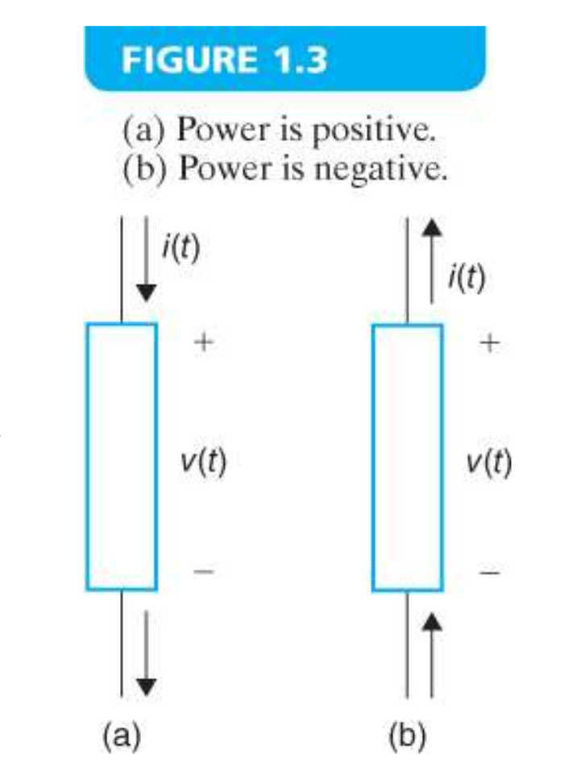

## 独立电源 independent source
- 独立电压源 independent voltage source
- 独立电流源 independent current source

### 独立电压源
>两端电压由自身决定，与电路中其他部分的电流、电压无关

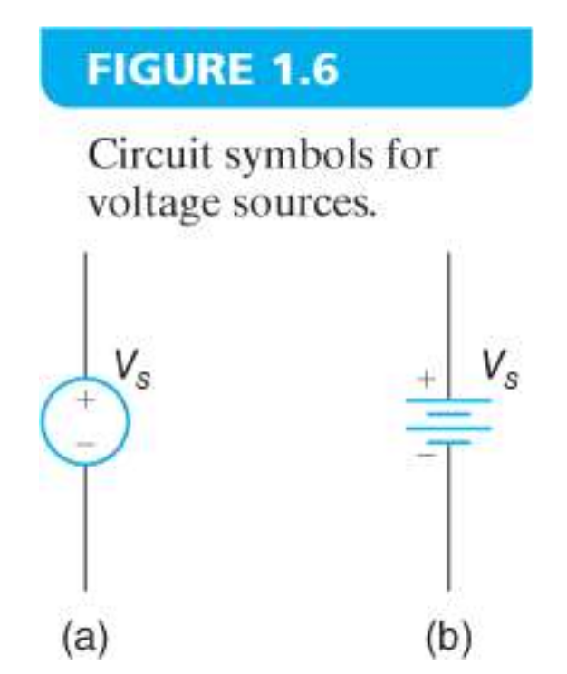

### 独立电流源
>输出电流由自身决定，与电路中其他部分的电压、电流无关

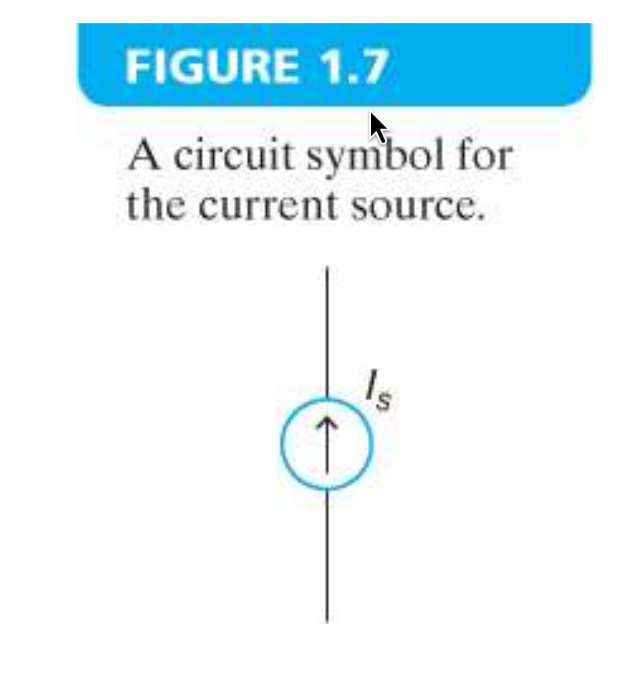

## 直流源和交流源 DC Sources and AC Sources
>If the voltage from the voltage source is
constant with time, the voltage source is
called the direct current (DC) voltage
source. Likewise, if the current from the
current source is constant with time, the
current source is called the direct current
(DC) current source.

>如果电压源输出的电压不随时间变化（恒定），则该电压源称为直流（DC）电压源。同样地，如果电流源输出的电流不随时间变化（恒定），则该电流源称为直流（DC）电流源。

>交流（AC）电压源是指输出电压随时间周期性变化的电压源；交流（AC）电流源是指输出电流随时间周期性变化的电流源。

### 符号 symbol

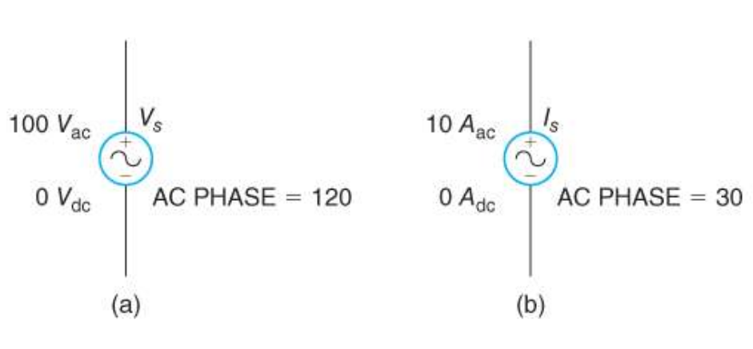

# Lecture 2

## 等效电压源和等效电流源   Equivalent Voltage Source and Equivalent Current Source

### 直流电压源串联 ->相加即可

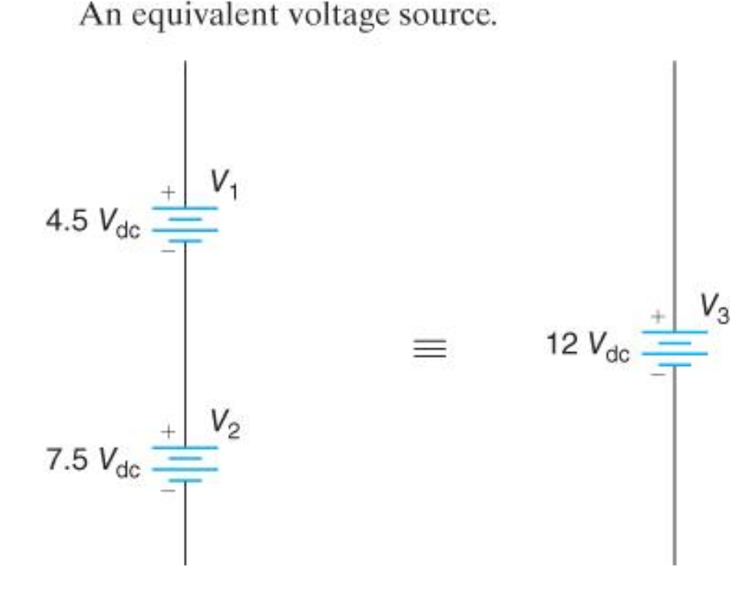

### 直流电流源串联 ->相加即可

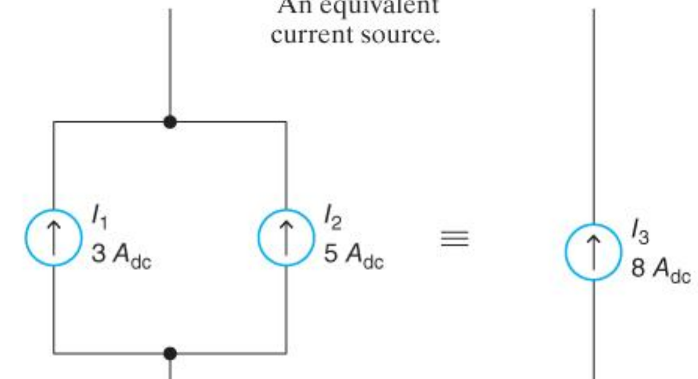

> [!NOTE]
> 注意方向，方向决定了是加号还是减号

#### 例题1.4
>Redraw the circuit shown in Figure 1.12 with one voltage source and one current source
without affecting the voltages across and currents through the resistors in the circuit.
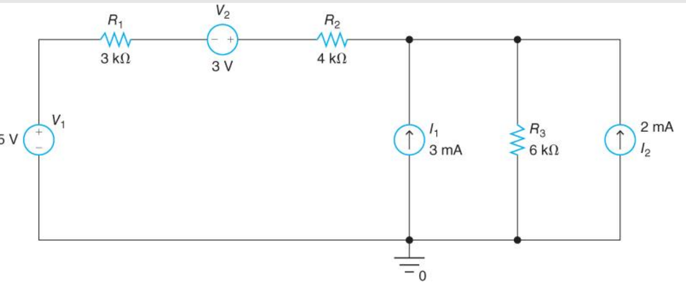

	
 答案 

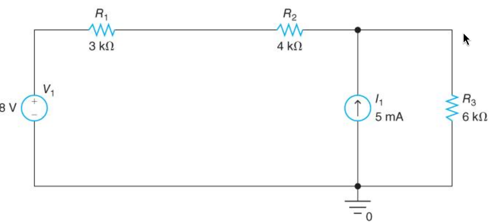

 

> [!IMPORTANT]
> 电流可以从独立电压源流入或流出，但电压的极性由电压源自身决定。
>
> Current can flow in and out of an independent voltage source, but the polarity of the voltage is determined by the voltage source.

## 无源元件 Passive Elements

### 定义definition
>无源器件是指在电路中不需要外部电源供电即可工作，且自身不能产生能量增益的电子元件

### 性质
>流过无源器件的电流大小和压降取决于所连接或者附近的电源（压/流）
>
>The magnitude of the voltage drop and current flowing through passive devices depends on
the voltage and current sources that are present and/or recently attached to the circuit.
### 分类
通常传统分类将电阻、电容、电感作为典型无源器件
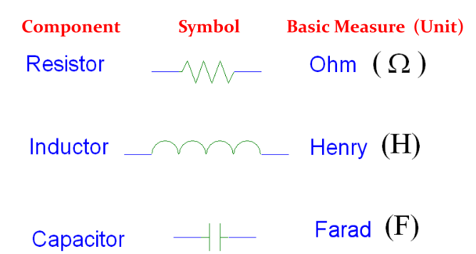

## 受控源 Dependent Sources

### 定义definition

>是指其输出电压或电流的大小受电路中其他支路的电压或电流控制的电源。
>
>The voltage or current on the dependent sources depend solely on the controlling
voltage or controlling current.

> [!TIP]
> controlling voltage controlling current 指的是受控源的大小取决于在支路中某一个电压或者电流的大小。取决与电压就是，那么那个电压就是controlling voltage，controlling current同理。

### 分类 classification

|         类型         |           意思           |
| :------------------: | :----------------------: |
| 电压控制电压源(VCVS) | 输出电压由某处电压控制。 |
| 电压控制电流源(VCCS) |  输出电流由某处电压控制  |
| 电流控制电压源(CCVS) |  输出电压由某处电流控制  |
| 电流控制电流源(CCCS) |  输出电流由某处电流控制  |

> [!TIP]
>  VCVS 代表着 voltage controlled voltage source

### 符号 symbol
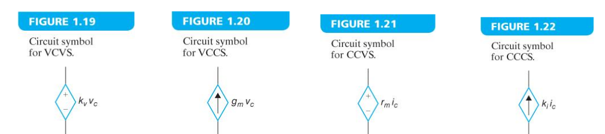
菱形就是受控源，标有正负极就是电压源，标有方向就是电流源，表达式中是`V`就说明是电压控制，是`I`就说明是电流控制

>对比独立源的符号
>
>
>

> [!IMPORTANT]
> 独立源是圆形的，受控源是菱形的

### 例题1.6

	
 In the circuit shown in Figure 1.23, the controlling voltage, which is the voltage across R2, is Va = 0.9851 V. Find the controlled current through the VCCS

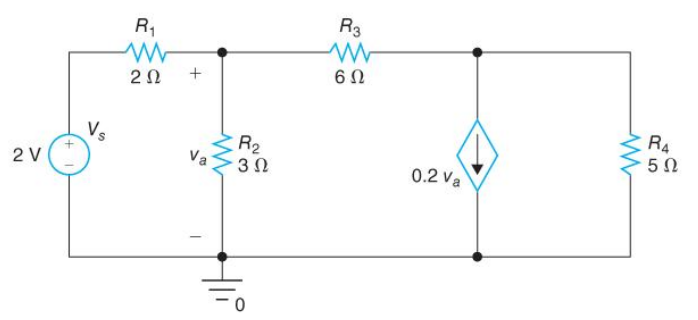

$$
	\text{the controlled current through the VCCS}=0.2 \times {V_a}=0.2(A/V) \times 0.9851 V=1.9702A
$$

## 初等函数 Elementary Functions

### 分类 classification
- 狄拉克δ函数 Dirac Delta Function
- 阶跃函数 Step Function
- 斜坡函数 Ramp Function
- 三角脉冲 Rectangular Pulse
- 矩形脉冲 Triangular Pulse

#### 狄拉克δ函数 Dirac Delta Function

##### 基础概念

A rectangular pulse with height $\frac{1}{\tau}$ and width $\tau$ is shown in Figure 1.25. The pulse is centered at $–\frac{\tau}{2}$ and the area of the pulse is one. The rectangular pulse can be written as

$$
f(x)=\frac{1}{\tau} rect(\frac{t+\frac{\tau}{2}}{\tau})
$$
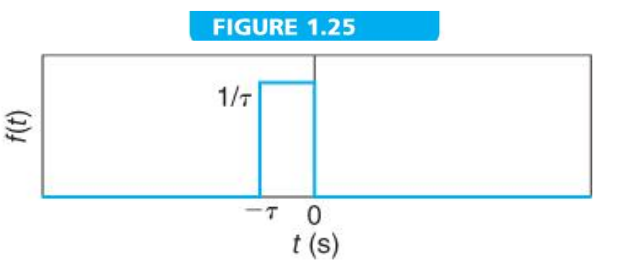

> [!NOTE]
> rect 函数全称是矩形函数，也叫门函数，是信号处理和电路分析中用来描述一个有限宽度的矩形脉冲的标准数学函数。
>
>定义：
$$
\text{rect}(x) = 
\begin{cases}
1, & |x| < \frac{1}{2} \\[4pt]
0, & |x| > \frac{1}{2}
\end{cases}
$$

实际使用时，往往要对它进行时间平移和宽度缩放。公式：
$$f(t) = \frac{1}{\tau}\,\text{rect}\!\left(\frac{t + \frac{\tau}{2}}{\tau}\right)$$
就是通过变量代换，得到一个从 $t=-\tau$ 开始、持续到 $t=0$、高度为 $\frac{1}{\tau}$、总面积为 1​ 的矩形脉冲。

 

当$\tau$趋于0是，脉冲的高度会趋于无穷大并保持这个脉冲的面积为1
$$
\delta(t) = \lim_{\tau \to 0} \frac{1}{\tau} \operatorname{rect} \left( \frac{t + \frac{\tau}{2}}{\tau} \right)
$$
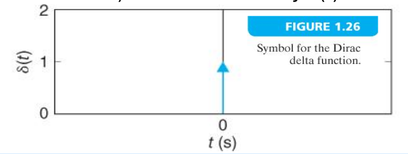

> [!NOTE]
> Question:
>
>为什么在第二个函数图像上面纵坐标是1而不是正无穷，当$\tau$趋于0的时候这个高度难道不是应该趋于正无穷吗
>
>

>	
答案

>	我们要区分 幅值 与 强度 的区别。图中的箭头标柱的1代表的是 Delta 函数的强度，即积分面积，而不是在某一点的幅值
>

##### 变形
- 时移(时间超前或者时间延迟)：eg.$\delta(t+1)$

	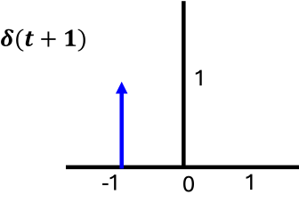
时间提前1个单位
- 强度缩放

	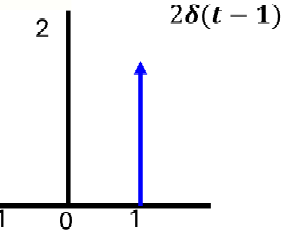
时间延后一个单位，并且强度变为2倍

###### 例题

	
画函数图像

$$
\text{f(t)=4}\delta
(t – 1)
$$

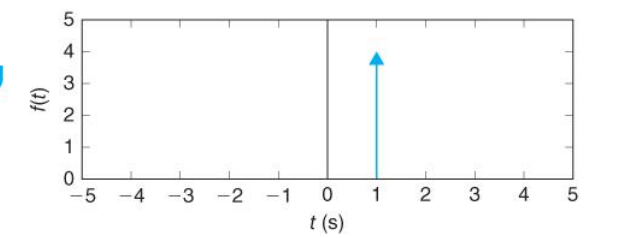

##### 筛选性质 Sifting Property

>当一个连续信号 $f(t)$ 与延迟了 $a$ 的δ函数相乘，并在全时间轴（$-\infty$ 到 $\infty$）上积分时，结果会精准提取出信号在 $t=a$ 时刻的值 $f(a)$。
>
>When a continuous signal f(t) is multiplied by $\delta$(t – a) and integrated from –$\infty$ to $\infty$, we
obtain f(a), that is,
>$$
>\int_{-\infty}^{\infty} f(t)\delta(t-a)dt = f(a)
>$$

> [!NOTE]
> 在其他不靠近a的点$\delta$(t)=0(根据rect函数的定义)
>
>$$
\text{rect}(x) = 
\begin{cases}
1, & |x| < \frac{1}{2} \\[4pt]
0, & |x| > \frac{1}{2}
\end{cases}
$$

>又因为靠近a点的点积分值为1,所以整个积分的值会筛选f(a)的值，过滤掉其他点的值

#### 阶跃函数 Step Function

##### 定义

单位阶跃函数指的是当x<0时，函数值为0,x>=0时，函数值为1
The unit step function H(x), which has a value of zero for negative arguments
and one for positive arguments
$$
\text{H}(x) = 
\begin{cases}
1, & x >= 0 \\[4pt]
0, & x < 0
\end{cases}
$$

> [!NOTE]
> 单位阶跃函数的微分就是delta 函数

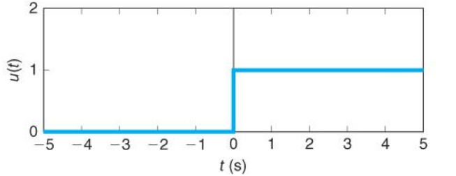

###### 例题

	
画图,u(t)是单位阶跃函数

$$
	\text{画出 f(x)=u(t)-u(t-2)}
$$

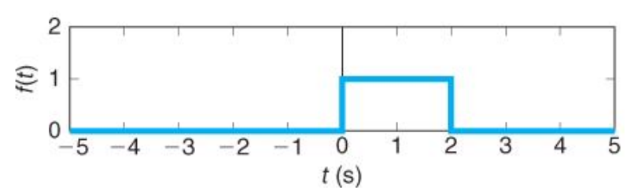

#### 斜坡函数 Ramp Function 

##### 定义(单位斜坡函数)
$$
r(t)=t \times u(t)
$$

- 单位斜坡函数是单位阶跃函数的积分
$$
r(t)=\int _{-\infty}^t u(\lambda)\mathrm{d}\lambda
$$
- 单位斜坡函数的微分就是单位阶跃函数

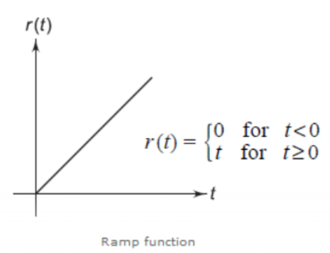

#### 指数衰减 Exponential Decay

##### 定义definition
指数衰减(Exponential Decay) 是一种随时间按指数规律逐渐减小的信号或物理过程
##### 一般形式
$$f(t) = u(t) e^{-\alpha t}, \quad t \ge 0$$
- $e^{-\alpha t}$:指数衰减因子
- $\alpha$:衰减常数

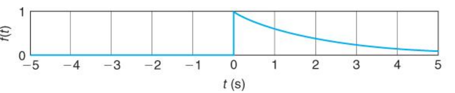

#### 三角脉冲 Rectangular Pulse
##### 定义

$$
f(t) = 
\begin{cases}
A\left(1 - \frac{|t|}{\tau}\right), & |t| \le \tau \\[4pt]
0, & |t| > \tau
\end{cases}
$$

$$or$$

$$
f(x)=A\ tri(\frac{t}{\tau})
$$
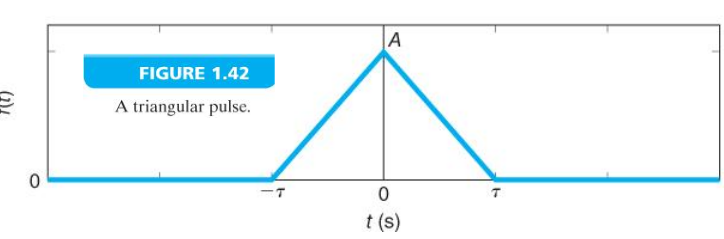

#### 矩形脉冲 Triangular Pulse
##### 定义
$$
f(t) = 
\begin{cases}
A, & |t| \le \frac{\tau}{2} \\[4pt]
 0, & |t| > \frac{\tau}{2}
\end{cases}
$$
$$or$$
$$f(t) = A \cdot \operatorname{rect}\!\left(\frac{t}{\tau}\right)$$

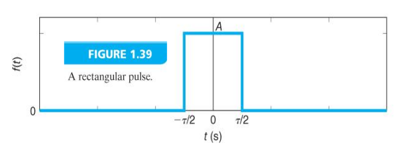

# Lecture 3

## 一些重要定义
### 支路 branch
它可以是一个单一元件，也可以是多个元件串联组成的路径

> [!NOTE]
> 一个分支的电流大小相等

### 节点 node
#### 定义
节点是电路中两个或更多电路元件（或支路）相连接的点。
- 简单节点 simple node 只连接2个元件
- 关键节点 essential node 连接三个及以上元件

### 回路 loop
任何闭合的路线都可以叫做一个回路（一个节点只能通过一次
### 网孔 mesh
内部没有其他支路和元件的回路
> [!NOTE]
> 所有网孔都是回路，但不是每一个回路都是网孔

### 电阻 resistor
>电阻的阻值是材料的导电率和尺寸共同决定的

$$
\text{大小：}R=\rho\frac{l}{A}
$$It can be shown that the current density is proportional to the electric field
### 电流密度
>单位面积流过的电流

$$
J=\frac{I}{A},I是电流大小，A是电流流过的横截面积
$$

电流密度正比于电场强度

	
推导过程

推导过程（基于均匀导体）
设有一段均匀导体，长度为 $L$，横截面积为 $A$，电阻率为 $\rho$（电导率 $\sigma = 1/\rho$）。
宏观欧姆定律​
导体两端的电压 $V$ 与流过导体的电流 $I$ 满足：
$$V = I R$$

其中电阻 $R = \rho \frac{L}{A}$。
引入电场强度​
对于均匀导体，内部的电场强度 $E$ 处处相等，且方向沿导体轴向。电压与电场强度的关系为：
$$V = E L$$
引入电流密度​
电流密度 $J$ 是单位横截面积上通过的电流，方向与电流相同：
$$J = \frac{I}{A}$$
代入推导​
将 $V = EL$ 和 $R = \rho \frac{L}{A}$ 代入欧姆定律：
$$EL = I \cdot \left( \rho \frac{L}{A} \right)$$

两边同时除以 $L$（假设 $L \neq 0$）：
$$E = I \cdot \frac{\rho}{A}$$

再将 $I = J A$ 代入：
$$E = (J A) \cdot \frac{\rho}{A} = J \rho$$

整理得：
$$J = \frac{1}{\rho} E = \sigma E$$

## 欧姆定律 Ohm’s Law
>电流与电压成正比
>
>$$ V=IR$$

$\frac{1}{R}$也被称为电导

## 基尔霍夫电流定律(KCL)
>流进一个节点的电流和流出一个点的电流相等

> [!TIP]
> 因为在稳定的电路中，如果流入一个节点的电流不等于流出一个节点的电流，那么电荷就会在节点堆积，导致电路不稳定。`基于电荷守恒定律`
>净流进量等于净流出量

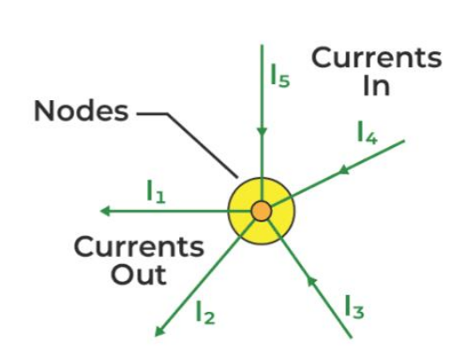
$$
{I_1}+{I_2}= {I_3} +{I_4}+{I_5}
$$
> [!TIP]
> 流进等于流出

### 例题

 

求出电流$\mathrm{I}$的大小

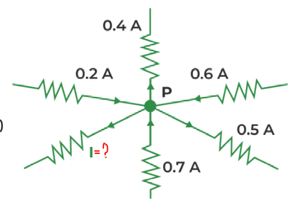

>根据KCL,流入的电流等于流出的电流
>
>$\therefore$ 0.2+0.6+0.7=I+0.4+0.5
>$\therefore$ I=0.6A

计算${V_1}$,${I_1}$,${I_2}$和${I_3}$
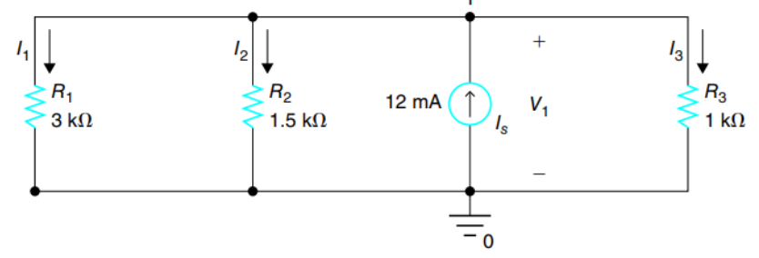

答案

>$\because {R_1},{R_2},{R_3}并联，两端的电压相等,根据$
>
>$$I=\frac{V}{R}$$
>
>可以得到流过${R_1},{R_2},{R_3}的电流的比为\frac{1}{3}:\frac{1}{1.5} : 1$,即1：2：3,对电流源的节点分析，
>
>$$12mA={I_1}+{I_2}+{I_3}$$
>
>解得${I_1}=2mA,{I_2}=4mA,{I_3}=6mA,{V_1}=6V$

## 基尔霍夫电压定律(KVL)
### 定义
>在一个回路中，升压等于降压
>
>The sum of voltage rise in a loop = the sum of voltage drops around a loop

> [!IMPORTANT]
>理解
>- 原因是 **能量守恒**,产生的电势能等于消耗的电势能，又由于 $${P_\text{电功率}}=VI$$并且物质是能量的载体，产生的能量必须转移到另外一个物质上去(这里是电路中的各种元件)，而且能量又不能凭空产生，所以用来提供能量的电能等于用来消耗的电能，即其他能量产生的电能等于电能产生的其他能量。因为时时刻刻都满足这个关系，所以电功率也满足这个关系,又因为一个回路中电流相等，所以电压满足这个关系。所以KVL成立 
>- 还可以将电压理解成电场力将一个单位正电荷通过一段距离所做的功，因为电场是保守场，所以从一点转一圈回到原点所做的功为0,所以电压差为0，这个电压差又可以分成几段，也就是${V_1}+{V_2}+...+{V_n}=0$,意思是各段做的功等于做的总功

### 电势升降
#### 电势降 potential drop
电能转换成其他能量，即电场力做正功，电势能减小，所以电流流入的一端是正极，流出的一端是负极，正极的电势能大于负极的电势能(电流从高电势流向低电势)

#### 电势升 potential rise
其他能量转换成电能，即电场力做负功，电势能增大，所以电流流入的一端是负极，流出的一端是正极，正极的电势能大于负极的电势能(电流从低电势流向高电势)

##### 例题

###### 2.7

 

Given ${V_2}$ = 6 V, find ${I_2}$, ${I_3}$, ${I_4}$, ${V_4}$, ${I_1}$, ${V_1}$, ${V_s}$ in the circuit shown in Figure 2.21.

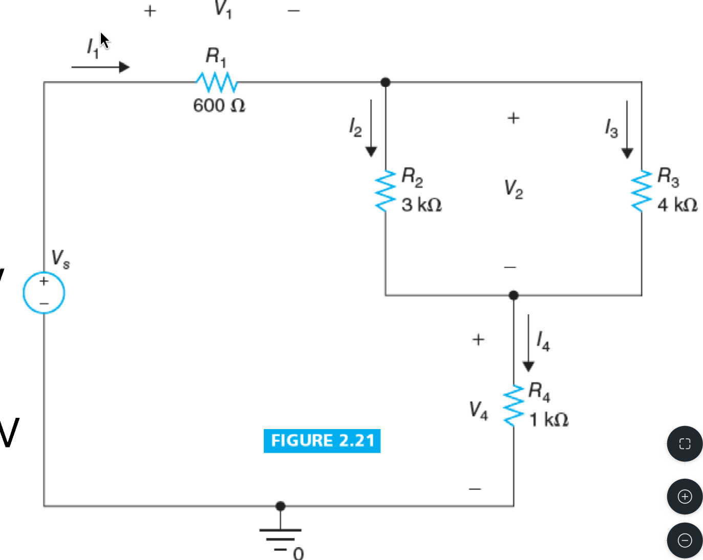

根据Ohm's Law, 
	$${I_2}=\frac{V_2}{R_2}=2mA,{I_3}=\frac{V_3}{R_3}=1.5mA$$
 
又根据KCL
	$${I_1}={I_4}={I_2}+{I_3}=2mA+1.5mA=3.5mA$$
 
Ohm's Law:
	$$ {V_4}={R_4}{I_4}=3.5V \\{V_1}={R_1}{I_1}=2.1V $$
 
KVL Again:
	$$\because 升压等于降压\\ \therefore {V_s}={V_1}+{V_2}+{V_4}\\\therefore {V_s}=11.6V$$

## 等效电阻 Equivalent Resistance

### 串联 in series
和中学学的一样
$$基于V={V_1+V_2+...+V_n}\\(KVL)$$
### 并联 in parallel
和中学学的一样
$$基于I={I_1+I_2+...+I_n}\\(KCL)$$

> [!IMPORTANT]
> 基于等效电阻，可以实现对于电路的简化，方便后续分析
>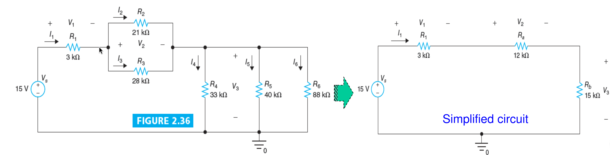

# Lecture 4

## 分压规则 Voltage Divider Rule

如果串联，那么电流相等，电阻的分压与电阻的阻值成正比

## 分压规则 Current Divider Rule

如果并联，那么两端的电压相等，各支路的电流与电阻成反比

# Lecture 5

## 节点分析法 Nodal analysis

### 定义 definition
>一种在电路中计算电压的方法
>
>“The method for calculating the voltage at the circuit
nodes.”

> [!IMPORTANT]
> 主要用到的是$\textcolor{blue}{KCL}$和$\textcolor{blue}{Ohm's Law}$
###  特征 feature
- 是KCL的应用
- 如果一共有N个节点，则需要选取一个支路较多的节点来作为参考节点。设该点的电位(电压)为0
> [!TIP]
> 因为在实际应用中，我们需要的是两点之间的电势差，即相对值，所以我们取任意一个点作为参考节点(电压为0)其实不影响最终的结果。又因为后面我们要对其他节点列出KCL方程，所以当这个流经参考节点的支路越多，，就可以省去项数最多的一项KCL方程，后面所列出的的KCL方程越简洁
- 为了解出其余的$N-1$个非参考节点，需要列出$N-1$个线性无关的方程，从而求解各个节点的电压,各个节点的电压都知道了，整个电路基本就分析清楚了

### 一般步骤 Procedure
1. 识别节点+选定参考节点
    -
	- 先找出电路中所有基本节点
	- 选其中1个作为参考节点（接地）
		>[!TIP]
		> 优先选择 **连接支路多的** 或者 **接最多独立电压源负极端** ,最大化简化后续计算
2. 标注节点电位
	-
	标记各个节点 **相对于参考节点** 的电位，如果一眼看不出来就设置未知数，后续求解

3. 用欧姆定律+KCL列节点方程
	-
	- 先通过欧姆定律求出这一条支路上面的电流
		> [!TIP]
		> 用电压差除以电阻来计算电流（欧姆定律），要先假设一个方向，如果算出来是负的，则实际电流方向与假设的电流方向相反
	- 对每个未知电位节点列KCL,流入等于流出
4. 计算个节点电压
	-

#### 例题
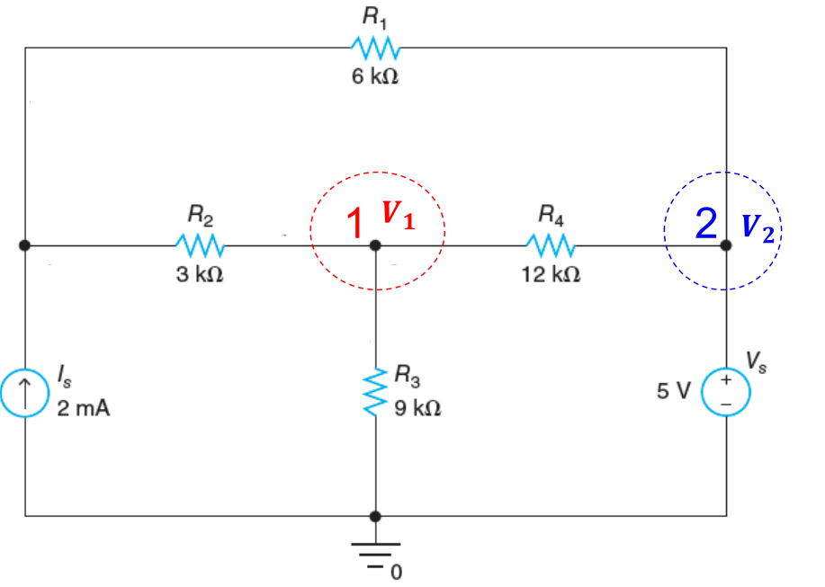

分析该电路，计算节点1,2的电压值

$$设1,2节点的电压分别为V1,V2.$$

$$根据KVL,可以得出V_2等于5V$$

设左边的节点为${V_3}$,可以对左边的节点和中间的节点列出KCL方程
	$$
	\frac{V_3-V_2}{R_1}+\frac{V_3-V_1}{R_2}=2, 
	\frac{V_3-V_1}{R_2}=\frac{V_1}{R_3}+\frac{V_1-V_2}{R_4}
	$$
$$可以解出，V_2=5V,V_1=\frac{83}{11}=7.5V,V_3=\frac{353}{33}=10.7V$$

## 超级节点 supernode

>这是一个节点分析法使用过程中需要用到的一种特殊方法，用来解决分析两个未知节点时，中间有电压源，使得无法表示这条支路的电流，导致无法列出KCL的情况

>例子
>
>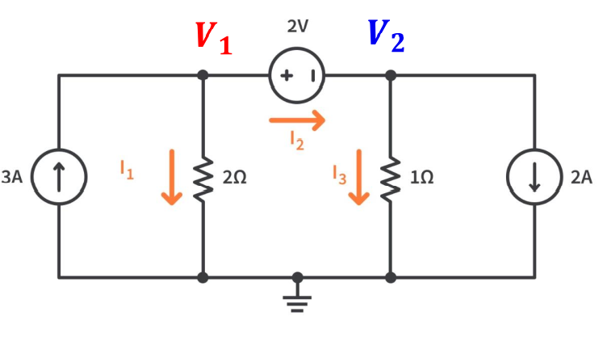

>[!NOTE]
>对这个$V_1,V_2$这两个节点列KCL时，会发现$I_2$无法用常规的节点分析法的步骤表示，即用$V_1,V_2$和对应的电阻值表示，如果直接用$I_2$,那么会引入1个新变量$I_2$。导致现在有2个节点$V_1,V_2$,我们都无法对这两个节点列出完整的KCL方程，无法求解$V_1,V_2$这个时候需要将这两个节点看成一个大节点
>
>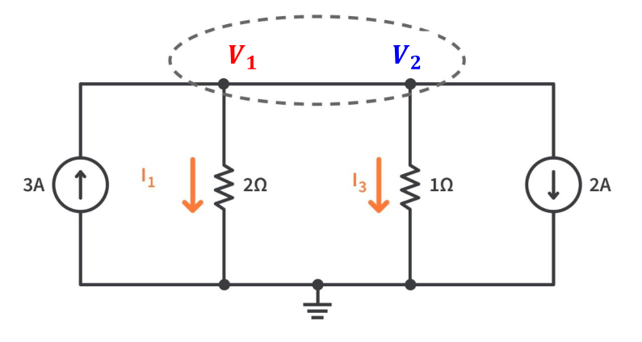
>
>可以对这个大节点列出KCL方程$$3=I_1+I_3+2$$
>带入$I_1,I_3$可以得到
>$$3=\frac{V_1}{2}+\frac{V_2}{1}+2$$
>化简可得
>$$2=V_1+2V_2$$
>这个时候我们有两个未知数$V_1,V_2$,但是只有一个方程。注意到我们还有一个 **电压源** 没有用，即
>$$V_1-2=V_2$$
>结合这两个式子，可以解出$$V_1=2V,V_2=0V$$

### 例题

识别超级节点

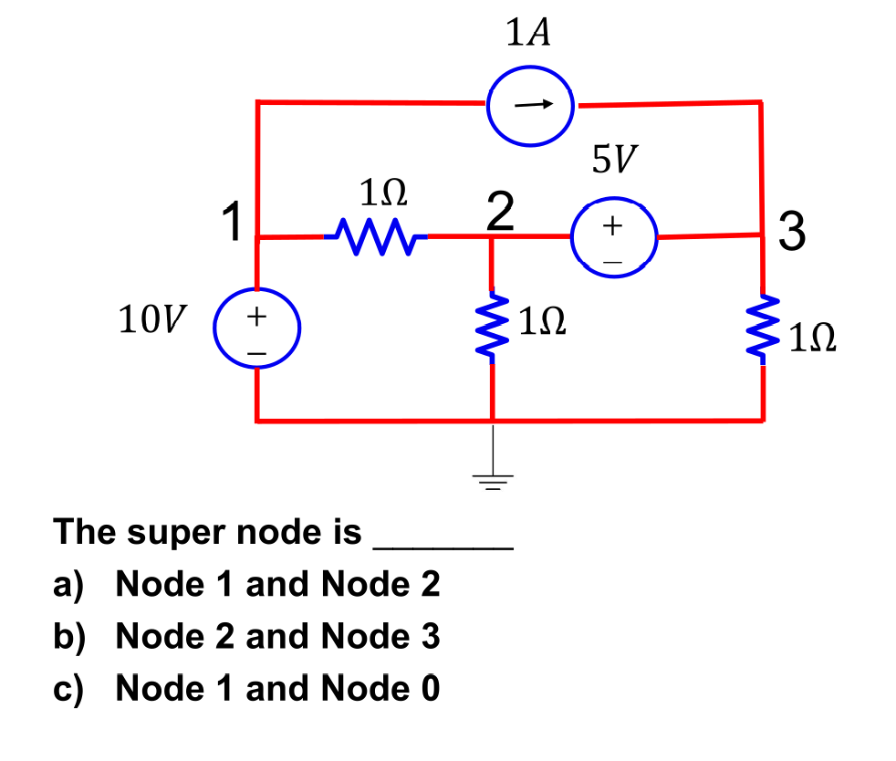

>选b，节点2,3是超级节点

# Lecture 6

## 网格分析法 Mesh analysis
### 网格 Mesh
>中间没有任何支路或者电子元件的回路叫做网格（mesh）
>
>A mesh is a loop that does not contain any other loops

#### 例题

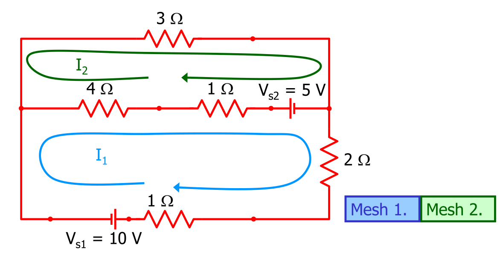

判断这个电路图包含几个网格

 

$$两个，蓝色的是1个网格，绿色的是一个网格，总的那个大回路不算，因为回路中间包含了两个电阻$$

### 与节点分析法的差异
> [!NOTE]
> 与节点分析法不同的是,节点分析法是从$\textcolor{red}{电压}$入手，从而分析整个电路，而网格分析法则是从$\textcolor{red}{电流}$入手,从而分析整个电路

|    方法    |             节点分析法             |                  网格分析法                  |
| :--------: | :--------------------------------: | :------------------------------------------: |
|    变量    |         设每一个节点的电压         |             设每网格上流过的电流             |
| 运用的定律 |            欧姆定律+KCL            |                 欧姆定律+KVL                 |
|  方程个数  |              节点个数              |                   边的个数                   |
|  特殊情况  | 超级节点(两个节点中间有一个电压源) | 超级网格(两个网格相连的那一条边有一个电流源) |

### 分析过程
> [!TIP]
>整体来说和节点分析法的过程很像，只不过是用电流来表示电压，然后再利用KVL来列出方程求解

1. 找网格 Identification
	- 
	找到电路中所有的网格
2. 标记 Lable
	-
	- 标记每一个网格的电流
	- 用欧姆定律计算节点之间的电压差
3. 运用KVL
	-
	- 每一个网格中升压等于降压
	- 列方程，解出每一个网格的电流

> [!IMPORTANT]
> 如果一个网格和另外一个网格共享一个支路，那么这条支路的电流就是这两个网格电流相加或者相减(具体是哪一个要看电流的方向)

## 超级网格 supermesh
> [!TIP]
> 想法和超级节点差不多，只不过这个是用在两个网格共享的支路上面有一个电流源。这个时候会少两个KVL方程，只有将这两个网格合在一起，看成一个超级网格，可以可以补充一个KVL方程。不过还是少了一个方程，而且这个电流源的信息还没有使用，这个时候可以用KCL将这两个网格的电流和这个电流源的信息合起来，形成一个新的方程。这个时候就有n个未知数和n个方程了。

# Lecture 7

## 叠加原理 superposition principle

>If a circuit contains more than one source, the circuit can be analyzed by summing the
response from each source with all other sources deactivated. This is called the
superposition principle.
>
>如果一个电路中有多个独立源，那么所分析的物理量可以看作是不同独立源作用的叠加

> [!IMPORTANT]
> 在计算一个独立源的作用效果时，需要屏蔽掉其他的独立源，也就是将其他的独立源的值设置成0.（独立电流源就看成断路，独立电压源就看成短路）

> [!TIP]
> 叠加原理要求电路是线性的
>即
>
> - 所有元件都是线性元件：即元件的参数（如电阻值 $R$、电感值 $L$、电容值 $C$）不随施加的电压或流过的电流改变而改变。典型例子包括固定电阻器、空气芯电感、无铁芯电容等 
> - 电路中的受控源（如果有）必须是线性受控源：受控源的输出量与控制量之间呈线性关系（例如 $V = kI$ 或 $I = gV$）
> - 电源（独立源）本身不影响线性性质：独立电压源和独立电流源属于线性元件，因为它们输出的电压或电流与外部电路变量之间满足线性关系（理想源是线性的）。

### 例题

#### 1

Consider a circuit with a voltage source $V_s$, a current source $I_s$, and two resistors $R_1$ and $R_2$. Finding $V_1$ and $I$ using superposition principle?

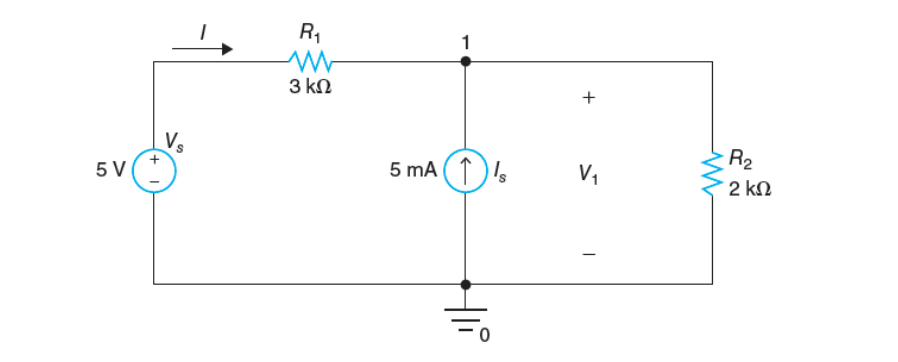 

我们可以看见这一个电路里面有2个独立源。$V_s$和$I_s$,我们可以用电路叠加原理
	
我们首先只看$V_s$对这个电路造成的影响，就需要把$I_s$的值设置成0,也就是断路。
电路就变成了这样：
	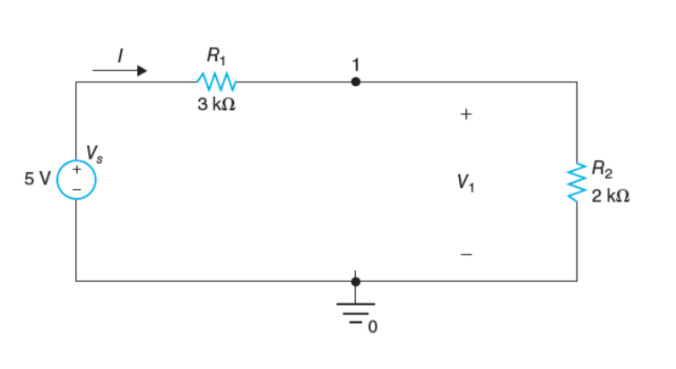

对这个电路计算$I$和$V$就比较简单了

$$
	根据欧姆定律 可以算出{I=\frac{V}{R}=\frac{V_s}{R_1+R_2}=1mA}
$$
这里的$V_1$指的是电阻$R_2$两端的电压，即

$$
	V_1=I\times R_2=1mA \times 2K\Omega=2V
$$

关于电压源的分析就完了，接下来分析电流源，将电压源的值设为0,也就是短路，电路变成了

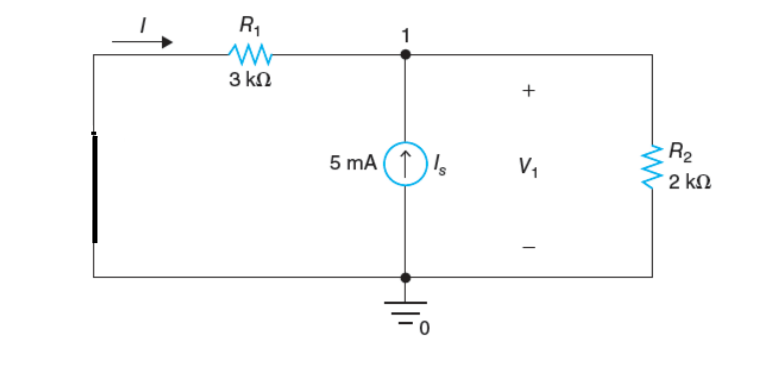 

这是一个并联电路总电流为5mA,要经过电阻值为2K$\Omega$和3K$\Omega$的电阻，因为并联，分流与电阻阻值成反比，所以分别是2mA和3mA.$V_1$为6V,$I$为-2mA(与规定正方向相反)

有叠加原理，可以求出原电路的$I$为-1A,$V_1$为8V

> [!IMPORTANT]
>- Keep only $\textcolor{red}{ONE}$ input and kill all other inputs
>- Find response to the input
>- repeat for each input
>- total response=sum of each response

# Lecture 8

## 戴维南定理 Thévenin’s theorem

### 定义 
>将$\textcolor{red}{一对端点}$所连接的电路等效成一个电压源串联上一个电阻，分别叫做戴维南电压($V_{th}$)和戴维南电阻($R_{th}$),新电路被称为戴维南等效电路。

> [!WARNING]
> - 仅适用于线性网络：戴维南定理只适用于包含电阻、独立电源和受控源的线性有源二端网络。
> - 戴维南等效只对外电路等效:把一个复杂的线性有源二端网络（比如一堆电源和电阻）化简成一个简单的电压源 $V_{th}$ 串联一个电阻 $R_{th}$ 之后，这个简化电路仅仅在它的两个输出端（a、b）所连接的外部负载上，与原复杂电路的行为完全一致。
> - 所选取的需要等效的那个电路只能有$\textcolor{red}{两个端口}$与外部电路连接。并且所求的外部电路中不能包含受所等效部分内部的电流或电压所控制的电流源或电压源(因为通过戴维南定理简化会丢失内部电路的电流和电压信息，导致后续无法分析)
### 一般步骤
1. 断开待求支路（移开负载） 
	>将要分析的外部电路（如负载电阻 $R_L$）从原电路的两个端点 a、b 处断开，使剩下的部分成为一个有源二端网络。
	>
	>目的：隔离出需要等效的内部电路，使其只剩下两个输出端
2. 求戴维南等效电压 $V_{th}$
	>计算断开的 a、b 两点之间的开路电压 $V_{oc}$
	>
	>保留原电路中的所有独立源和受控源。直接用基尔霍夫定律（KCL/KVL）、节点电压法、网孔电流法等常规方法求解 a、b 两端的电压。这个电压值就是 $V_{th}$，注意标注极性（正极指向 a 还是 b）。

3. 求戴维南等效电阻 $R_{th}$
	>将所有独立源的值设置成0(独立电流源就将这个支路看成开路，独立电压源就将这个支路看成短路)
	>
	>保留所有受控源，并且控制关系不变
	>
	>在a,b两个端口外加测试电压$V_{S}$,通过前面学过的分析简单电路的方法(KCL,KVL,节点分析法，网格分析法，等效电阻...)来计算电流$I_{S}$,进而用$$R_{th}=\frac{V_S}{I_S}$$来计算戴维南电阻

#### 例题

##### 8.1

Consider a circuit shown below. We are interested in finding Vth and Rth across terminals a and b.

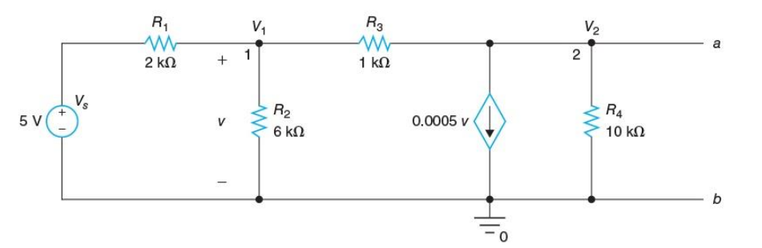 

这道题已经帮我们把需要做等效的部分给我们了，我们只需要找到对应的$V_{th}$和$R_{th}$就可以了

我们首先找$V_{th}$
$$
	首先将a,b端口设置成断路，然后求a,b之间的电压(在这个电路中就是R_4的电压),电路变成了
$$

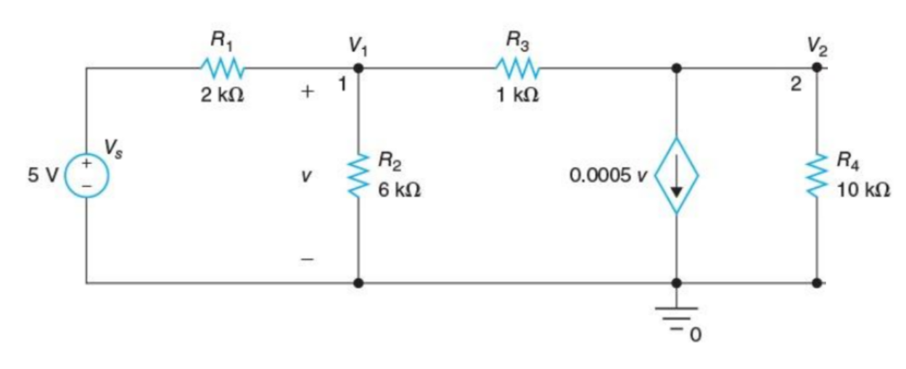

我们需要求解$V_2$

根据所学的电路分析方法，我们可以列出

$$

\frac{5-V_1}{2}=\frac{V_1-V_2}{1}+\frac{V_1}{6},
\frac{V_1-V_2}{1}=0.5V_1+\frac{V_2}{10}
$$

$$可以解得V_{th}=V_2=\frac{15}{16}=0.9375$$

接着求$R_{th}$

我们要断开所有的独立源，保留受控源,并在a,b两个端口加测试电压$V_S$电路变成了这样

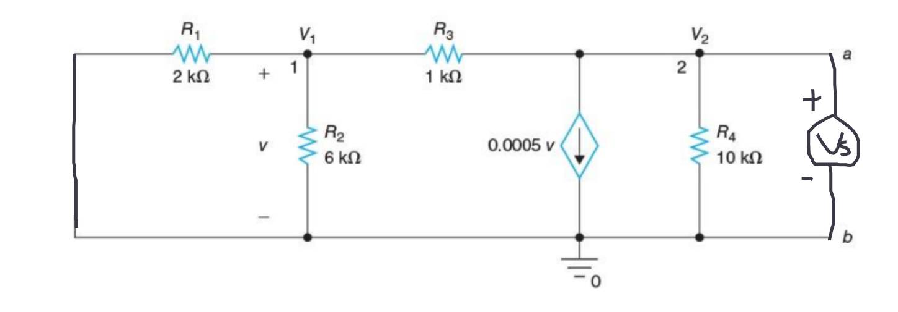

对电路进行分析，可以得到方程

$$
\frac{V2-V1}{1}=\frac{V_1}{6}+\frac{V_1}{2}
,\frac{V_2-V_1}{1}+0.5V_1+\frac{V_2}{10}=I_S
,V_2=V_S;
$$
可以解得
$$I_S=\frac{4V_S}{5},R_{th}=1.25K\Omega$$

# Lecture 9

## 诺顿定理Norton’s theorem

>和戴维南定理一样，是将两个端口内部的电路简化。与单位难定理不同的是，诺顿定理是将端口内的电路等效成一个电流源并联上一个电阻，其核心可以总结为
>
>
$$ 对于任意线性含源二端网络（对外仅引出a、b两个端子，内部全部由线性元件：
线性电阻、线性独立/受控源构成），对外特性可以完全等效为：
$$

$$
一个理想电流源 I_N（诺顿等效电流）与一个电阻 R_N（诺顿等效电阻）并联的电路，这个组合就叫诺顿等效电路。
$$

### 核心参数

#### 诺顿等效电流
$$将原二端网络的a、b端子直接短接，测得的端口短路电流 I_{sc} 就等于 I_N$$

#### 诺顿等效电阻
$$ 将全部独立源设置成0,保留受控源的关系$$

因为和戴维南定理十分相似，所以不另外补充例题

# Lecture 10

## 电容器 capacitor
### 定义
>电容是无源被动电子元件，核心功能是可以存储电场能量，需要时向外释放能量
>
>平行板电容的结构：两片平行导电极板，中间填充绝缘电介质(电介质材料：dielectric material)
>
>正负极板各自携带正电荷和负电荷

### 工作原理

能量被储存到正负极板之间的电场中,这个能量的大小取决于电容器的电容大小和两极板之间的电压 

### 分类
> 根据电容大小和使用的材料，电容器可以分为很多种类
- Aluminium electrolytic capacitor（铝电解电容）
- Ceramic capacitors（陶瓷电容）
- Tantalum capacitors（钽电容）
- Film capacitors（薄膜电容）
- Polyester capacitors etc ...（聚酯电容等...）

### 使用场景

1. 储能与供能
2. 信号处理
	- 过滤特殊频率范围内的信号

。。。

### 电容 capacitance

>电容器的电荷量与极板两端的电压成正比
>
>The amount of charge Q (in coulombs) on the plates is proportional to the voltage V (in
volts) of the source

$$Q=CV=>C=\frac{Q}{V},常数C被称为电容，单位为法拉(F)$$
电容被定义为储存的电荷量与极板两端电压的比值

### 电容器中电流与电压的关系
如果极板两端电压随时间变化，那么电荷量可以写成$Q=CV(t)$,其中，Q是电容器所储存的电荷量，V是极板两端的电压，C是电容器的电容

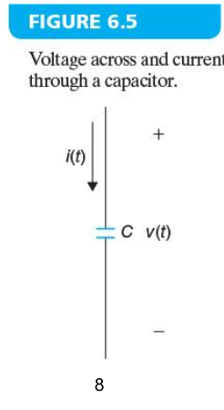

$\textcolor{red}{因为电流是电荷量关于时间的微分,所以可以等式左右两边同时对时间t求导，得到}$

$$i(t)=C\frac{dV(t)}{dt}$$

同样的，我们可以得到
$$V(t)=\frac{1}{C}\int_{-\infty}^{t}i(t) \, dt=V_0+\frac{1}{C}\int_{0}^{t}i(t) \, dt$$

其中$V_0$就是t=0时刻电容器两端的电压

### 功率和能量
对于所有二端元器件，瞬时功率都可以表示成$p(t)=v(t) i(t)$
那么对于电容器来说，也是如此，我们将上面的电流电压关系带入瞬时功率的式子，就可以得到$$p(t)=Cv(t)\frac{dv(t)}{dt}$$
电容器储存的能量w(t)=$\int_{-\infty}^{t} p(t) \, dt$
再进行一次替换，得到$w(t)=C\int_{-\infty}^{t}v(t)\frac{dv(t)}{dt} \, dt=\frac{Cv^{2}(t)}{2}$

### 电容器的串联
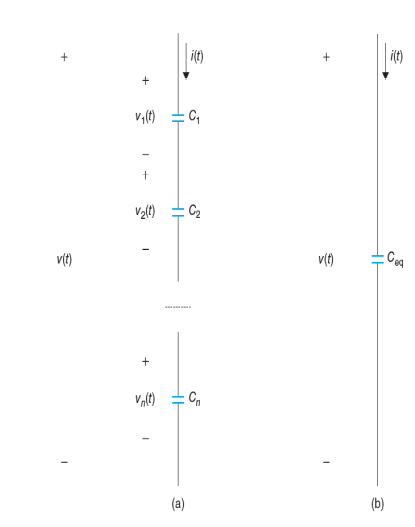
因为在这条线路上通过各个电容器的电流是相等的，只是总的$V(t)=V_1(t)+V_2(t)+...+V_n(t)$
所以$V_t=\frac{1}{C_1}\int_{-\infty}^{t}i(t) \, dt+\frac{1}{C_2}\int_{-\infty}^{t}i(t) \, dt+\frac{1}{C_3}\int_{-\infty}^{t}i(t) \, dt+...+\frac{1}{C_n}\int_{-\infty}^{t}i(t) \, dt=\frac{1}{C_eq}\int_{-\infty}^{t}i(t) \, dt$
。所以等效的电容满足
$$\frac{1}{C_{eq}}=\frac{1}{C_1}+\frac{1}{C_2}+...+\frac{1}{C_n}$$

> [!TIP]
> 电容器的串联的等效结果公式与电阻的并联等效公式很像

### 电容器的并联
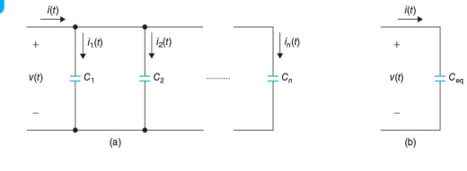 

因为并联，所以各个电容器两个极板之间电压相同，电流满足总的$I(t)=I_1(t)+I_2(t)+...+I_n(t)$

也就是
$i(t)=C_{eq}\frac{dV(t)}{dt}=C_{1}\frac{dV(t)}{dt}+C_{2}\frac{dV(t)}{dt}+...+C_{n}\frac{dV(t)}{dt}$。
所以
$$C_{eq}=C_1+C_2+...+C_n$$

> [!TIP]
> 电容器的并联的等效结果公式与电阻的串联等效公式很像

> [!IMPORTANT]
> 1. 电容器不符合欧姆定律
> 2. 电容器两端的电压不能突变，因为电流不可能无穷大
> 3. 当电压不变的时候，流过电容器的电流为0，电容器所在的支路相当于开路
> 4. 不像电阻，当电压为0的时候，流经电容器的电流不一定为0,当电流为0的时候，电容器两端的电压不一定为0

# Lecture 11

## 基本定理
### 安培定理 Ampère’s Law
>电流通过线圈确实会产生磁场
>
>current through a coil generates a magnetic field

围绕闭合回路的磁场与穿过该回路的总电流成正比
$$\oint \vec{B} \cdot d\vec{l} = \mu_0 I_{enc}$$
其中，B是磁场大小，dl是沿着磁场的一小段路径的微元，$\mu$是真空磁导率，$I_{enc}$是所选取回路里面的电流

对于长直的磁感线，电场强度是$B=\mu_0nl$

### 法拉第电磁感应定律 Faraday’s Law
$$\varepsilon = -\frac{d\Phi_B}{dt}$$
>闭合回路的感应电动势等于穿过回路的磁通量变化率的负值
>
>The induced electromotive force (EMF) in a closed circuit is
equal to the negative rate of change of magnetic flux through the circuit

磁通量：是描述穿过某个面的磁场总量的物理量
$$\Phi = B \cdot A \cdot \cos\theta$$

### 楞次定理 Lenz’s Law
感应电流产生的磁场，总是阻碍「引起感应电流的原磁通量的变化」

## 电感器 inductor
### 基本介绍
- 和电容器一样，属于无源元件
- 简单的电感器由螺旋管组成，即绕成螺旋状的导线
- 螺线管内部的核心可以填充空气，也可以填充铁磁性材料（ferromagnetic），使用铁磁性材料可以显著增强电感器的磁场强度和电感量

### 工作原理
- 当电流流过电感器时，会产生磁场，由法拉第电磁感应定律可以得到，变化的磁场会产生感应电动势
- 电感是衡量电感器在给定电流变化下产生磁通量的能力的度量

### 使用场景
- 在磁场中储能（有电流通过的时候会储能）
- 滤波（会阻碍高频信号，通过低频信号）
- 调谐信号（与电容器混合使用可以用来选择特定频率的信号）
- 变压器（通过电磁感应实现电压的升降）
- 感应传感（检测金属或者变化的磁场）

### 电感
>电感是衡量电感器在给定电流变化下产生磁通量的能力的度量

电感器里面存储的能量与自身的电感和流经的电流相关

电感器两端的电压$v(t) = L \frac{di(t)}{dt}$

电感电压取决于电流的变化率，而不是电流的大小。

同样，对该式子积分就可以得到电流随时间的关系
$$i(t) = \underbrace{\frac{1}{L}\int_{-\infty}^0 v(\tau)d\tau}_{i(0)} + \frac{1}{L}\int_0^t v(\tau)d\tau$$
### 能量
$$p(t) = v(t)i(t)$$
$$p(t) = i(t) \left[ L \frac{di(t)}{dt} \right] = Li(t) \frac{di(t)}{dt}$$
$$w(t) = \int_{-\infty}^{t} p(t) dt$$
$$w(t) = L \int_{-\infty}^{t} i(t) \frac{di(t)}{dt} dt = L \int_{-\infty}^{t} i(t) di(t) = \frac{1}{2}Li^2(t)$$

### 串并联
和电阻一样

# Lecture 12

## RC 电路
>同时包含电阻和电容的电路

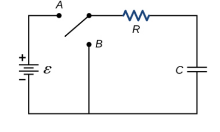 

RC电路的行为在电容充能和放能时有差异，可以分为
- RC电路的自然响应Natural response
- RC电路的阶跃响应Step response

### 自然响应
- 没有外部输入且电容放能
- 一直持续直到电容里面存储的能量释放完
- 也被称为瞬态响应、零输入响应或无源响应transient response, zero input response or source free response

### 阶跃响应
- 发生于RC电路的外部输入突然连接
- 这种行为展示了电容两端电压和电路中的电流如何随时间变化，从而导致电容的充电
- 一直持续直到达成稳态

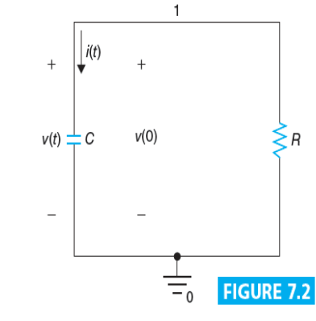 
根据kcl,可以列出方程
$$C\frac{dv}{dt}+\frac{v}{R}=0$$
整理为：
$$\frac{dv}{dt}=-\frac{v}{RC},\qquad t\geq0$$

当 $v(t)\neq0$ 时，两边同时除以 $v$：
$$\frac{1}{v}\frac{dv}{dt}=-\frac{1}{RC}$$
写成微分形式：
$$\frac{dv}{v}=-\frac{1}{RC}\,dt$$

$$\int\frac{dv}{v}=
-\frac{1}{RC}\int dt$$

得到：
$$\ln|v(t)|=
-\frac{t}{RC}+K$$

化简得
$$v(t)=e^k e^{-\frac{t}{RC}}$$
令A=$e^K$
化简该式子，得到$$v(t)=Ae^{-\frac{t}{RC}}$$
当t=0时，$v(0)=A\times1=A$。因此，A=v(0)=$V_0$

从整个时间轴来看，当t<0的时候，$V=0$,t>=0开始，电压开始不为零。所以从整个时间轴来看，电压可以写成一个分段函数，或者写成到$v(t)=Ae^{-\frac{t}{RC}}u(t)$,u(t)是一个阶跃函数

根据电容的电流和电压的关系$I=c\frac{dv}{dt}$
I可以计算得到$$I(t)=-\frac{V_0}{R}e^{-\frac{t}{\mathrm{RC}}}$$
### 时间常数 time constant
>$\tau$就是时间常数，其数值等于RC

之前所有的式子都可以通过用$\tau$来简化
$$V(t)=V_0e^{-\frac{t}{\tau}}$$
$$I(t)=-\frac{V_0}{R}e^{-\frac{t}{\tau}}$$
$$P(t)=-\frac{(V_0)^2}{R}e^{-\frac{2t}{\tau}}(P=VI)$$
> [!IMPORTANT]
> $\tau$越大，电容的充放电速度越快

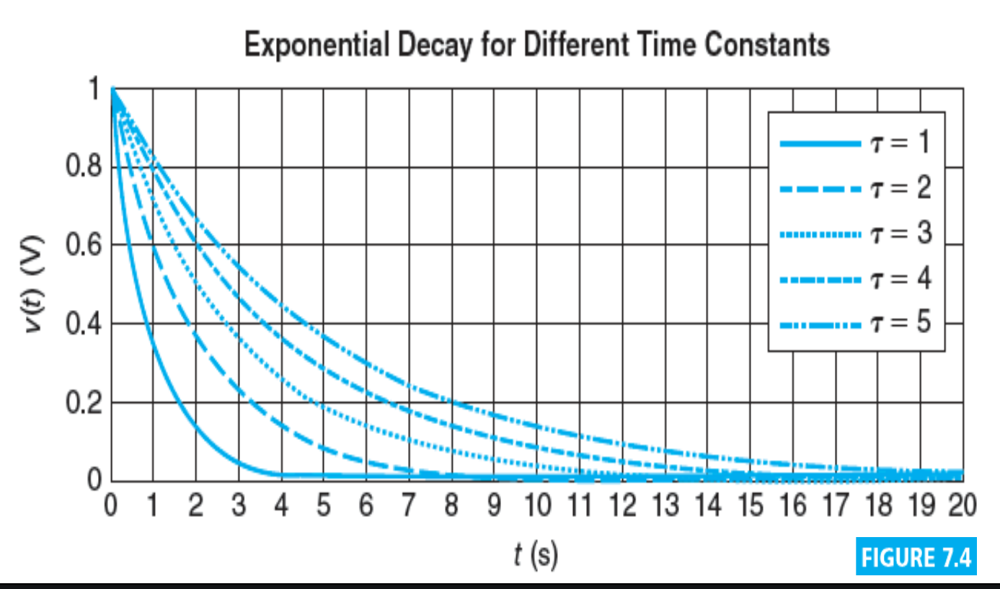 

特别地，当时间$t=\tau$时，$V=V_0 e^{-1}=0.367879V_0$

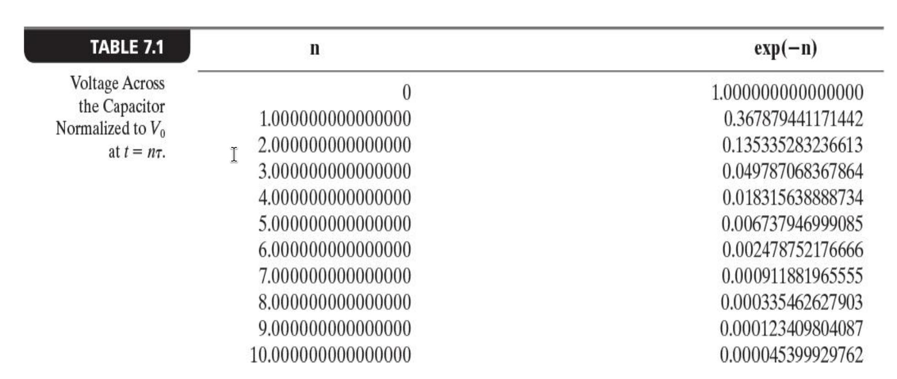 

#### 5 $\tau$近似
当 $t=5\tau$ 时,$v(5\tau) = V_0 \cdot e^{-5} \approx 0.00674 V_0 = 0.674\% V_0$，仅剩不到1%的初始电压。因此工程上默认：RC充放电的暂态过程在 $t\geq5\tau$ 后结束，此时可以认为电路已经达到稳态，无需再考虑动态暂态部分。（如果是充电过程 $v(t)=V_s(1-e^{-t/\tau})$，5τ时电压能达到目标值的99.3%，同样认为充电完成）

如果我们对$V(t)$求导，可以得到$$\frac{dV(t)}{dt}=V_0 \frac{de^{\frac{-t}{\tau}}}{dt}=-\frac{V_0}{\tau}e^{-\frac{t}{\tau}}$$
当$t=0$时，直线斜率(即变化率)等于$-\frac{V_0}{\tau}$

当$t=0$时，切线方程等于$V=(1-\frac{t}{\tau}){V_0}$,观察式子，可以发现，当$t=\tau$时，$V=0$

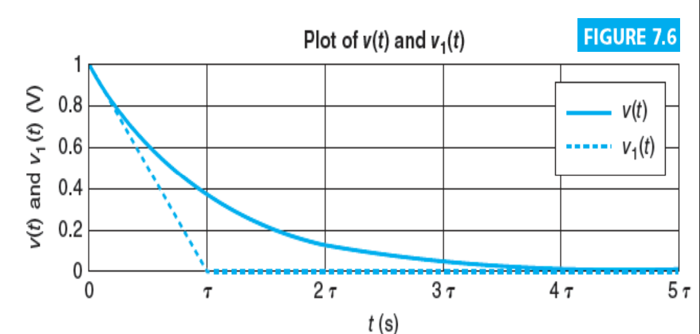 

### 计算时间常数
对于只有一个电容的RC电路，时间常数$\tau=R_{eq}C$
> [!TIP]
> 意味着如果单一电容器的RC电路中有多个电阻，那么时间常数$\tau$等于等效电阻乘以电容量C

> [!IMPORTANT]
> 关于阶跃响应的结果和分析方式和自然响应类似，于是不再赘述，请读者自行推导:)

# Extra
## $\footnotesize \Delta-Y$变换和$\footnotesize Y-\Delta$变换
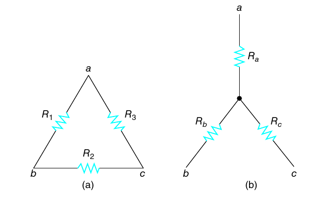 

图(a)为$\footnotesize \Delta$型，图(b)为$\footnotesize Y$型

有时$\Delta$型不容易分析电路，转换成$Y$型有奇效，同样的$Y$型不好分析的时候可以试着转换成$\Delta$型

### 转换公式及其推导

由上面的图片，我们设三个端口分别是a,b,c,我们需要等效的`就是端口两两之间的电阻`，也就是 ***(a)中ab端口间的电阻等于(b)中ab端口间的电阻***。bc之间，ac之间的端口同理。

我们想要根据一个类型($\Delta$或$Y$)构建出另一种类型($Y$或$\Delta$),我们就需要找到这两种类型中这些电阻的关系，可以通过设未知数然后求解来算出电阻。

#### $\Delta->Y$
以ab端口为例：
$$
R_{ab}=R_1||(R_2+R_3)=\frac{R_1R_2+R_1R_3}{R_1+R_2+R_3}=R_a+R_b\tag{1}
$$

同理，对ac端口，bc端口做分析，可以得到

$$
R_{ac}=R_3||(R_1+R_2)=\frac{R_1R_3+R_2R_3}{R_1+R_2+R_3}=R_a+R_c\tag{2}
$$

$$
R_{bc}=R_2||(R_1+R_3)=\frac{R_1R_2+R_2R_3}{R_1+R_2+R_3}=R_b+R_c\tag{3}
$$

现在我们已知$R_1,R_2,R_3$,想求解$R_a,R_b,R_c$,逐个消元即可

计算$R_a$:
$$R_a=\frac{(1)+(2)-(3)}{2}=\frac{2R_1R_3}{2(R_1+R_2+R_3)}=\frac{R_1R_3}{R_1+R_2+R_3}$$

同理，可以求出
$$R_b=\frac{(1)+(3)-(2)}{2}=\frac{2R_1R_2}{2(R_1+R_2+R_3)}=\frac{R_1R_2}{R_1+R_2+R_3}$$

$$R_c=\frac{(2)+(3)-(1)}{2}=\frac{2R_2R_3}{2(R_1+R_2+R_3)}=\frac{R_2R_3}{R_1+R_2+R_3}$$

所以，$\Delta -> Y$ 的解：
$$
\begin{cases}
R_a = \frac{R_1R_3}{R_1+R_2+R_3} \\[6pt]
R_b = \frac{R_1R_2}{R_1+R_2+R_3} \\[6pt]
R_c = \frac{R_2R_3}{R_1+R_2+R_3}
\end{cases}
$$

#### $Y->\Delta$
同样的道理，我们可以列出3个方程，不过未知量变成了$R_a,R_b,R_c$,我们需要求解$R_1,R_2,R_3$

从方程组
$$
\begin{cases}
R_{ab}=R_1||(R_2+R_3)=\frac{R_1R_2+R_1R_3}{R_1+R_2+R_3}=R_a+R_b\\[12pt]
R_{ac}=R_3||(R_1+R_2)=\frac{R_1R_3+R_2R_3}{R_1+R_2+R_3}=R_a+R_c\\[12pt]
R_{bc}=R_2||(R_1+R_3)=\frac{R_1R_2+R_2R_3}{R_1+R_2+R_3}=R_b+R_c
\end{cases}
$$
来看并不好入手化简，于是尝试从上面的解来入手，求出$R_1,R_2,R_3$

$$
\begin{cases}
R_a = \frac{R_1R_3}{R_1+R_2+R_3}(1) \\[12pt]
R_b = \frac{R_1R_2}{R_1+R_2+R_3}(2) \\[12pt]
R_c = \frac{R_2R_3}{R_1+R_2+R_3}(3)
\end{cases}
$$

$(1)\times(2)+(1)\times(3)+(2)\times(3)=R_aR_b+R_aR_c+R_bR_c=\frac{R_1R_2R_3}{R_1+R_2+R_3}$
> [!TIP]
> 我们可以注意到，等式的最右边是一个极其对称的结构，并且与$R_a,R_b,R_c$的值对比，就可以发现它其实可以拆分成两项的乘积，一个是$Y$电路里面的电阻，一个是$\Delta$里面的电阻,比如，可以拆分成$R_a\times R_2$

所以，我们可以求得解
$$
\begin{cases}
R_1 = \frac{R_aR_b+R_aR_c+R_bR_c}{R_c}\\[12pt]
R_2 = \frac{R_aR_b+R_aR_c+R_bR_c}{R_a}\\[12pt]
R_3 = \frac{R_aR_b+R_aR_c+R_bR_c}{R_b}
\end{cases}
$$

> [!IMPORTANT]
> 记忆
>
>$\Delta->Y$：分子邻边乘，分母三个和
>
>$Y->\Delta$：分子积之和，分母是对角

### 例题
#### ex1

求$V_c$的值

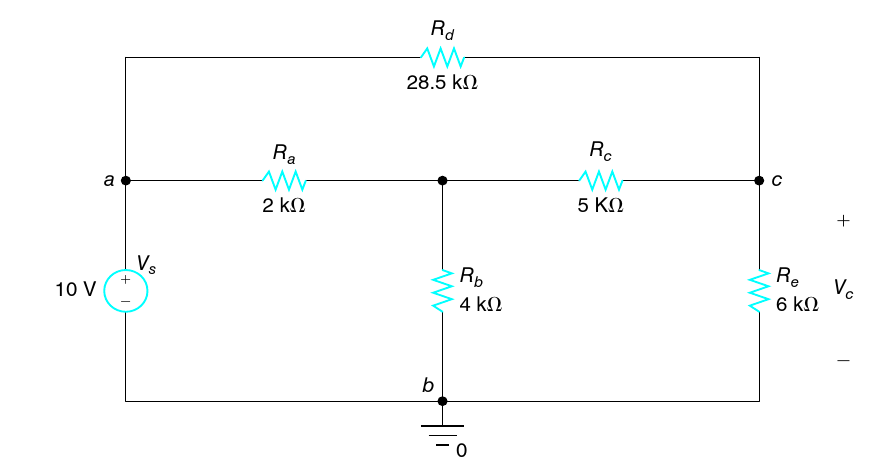 

我们可以将$a,b,c$及其连接的线路看作是一个$Y$型电路，我们可以将它简化成一个$\Delta$型电路

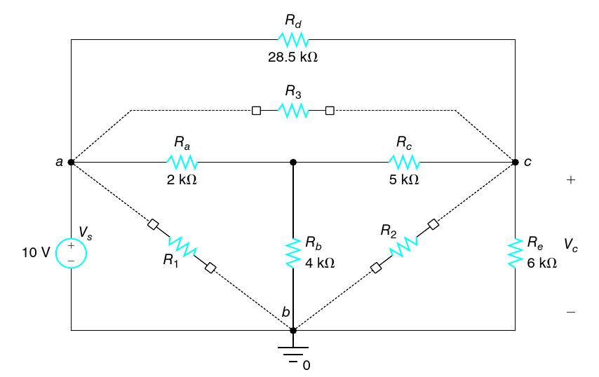 

这是一个$Y->\Delta$型的。根据上面推导的公式，我们可以计算出对应的电阻

$$
\begin{cases}
R_1 = \frac{R_aR_b+R_aR_c+R_bR_c}{R_c}=7.6K\Omega\\[12pt]
R_2 = \frac{R_aR_b+R_aR_c+R_bR_c}{R_a}=19K\Omega\\[12pt]
R_3 = \frac{R_aR_b+R_aR_c+R_bR_c}{R_b}=9.5K\Omega
\end{cases}
$$

为了使这个电路更好看一点，还可以画将并联的和在一起，简化成

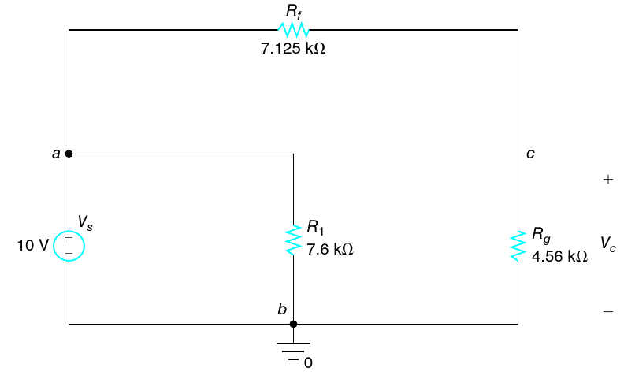 

其中，$R_f$是$R_d,R_3$并联的等效电阻，$R_g$是$R_2,R_e$并联的等效电阻,$V_c$就是$R_g$的分压，等于$3.9024V$
$$\therefore V_c=3.9024V$$

