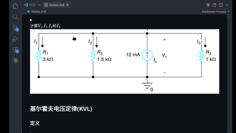

# Hi,there! :)

# 这是根据CAD的PPT总结出来的笔记，加上了一点个人的理解。个人觉得期末的时候可以完全用这个note替代ppt

# 各个文件的主要内容 
img文件夹中为Markdown文档中所用到的图片，主要来源是老师的课件以及 `Electric Circuit` 和 `Fundamentals of Electric Circuits sixth edition`的插图 

Notes.md就是所记的笔记啦

# 基本功能

## 折叠例题的答案和过程

可以在复习时先自己做一遍，做完再看答案，免得一下就瞥到答案了

# 笔记排版
都是以Lecture的顺序来排的，最后的Extra部分是在教材上面找的补充知识点

# 使用建议
你可以选择一个你自己喜欢的Markdown文件浏览器，我推荐使用VSCode外加插件的形式，以方便阅读一些 ***alerts*** 代码块 ，我推荐使用Vscode插件如下

- Matt Bierner的GitHub Markdown Preview，将markdown渲染成GitHUb风格的
- saeris的Markdown GitHub Alerts & Obsidian Callouts，可以成功渲染alerts块

安装这些插件后，退出并重启VsCode.打开Nodes.md文件后，如果看见的仍然是源码的形式，没有成功预览，说明没有成功打开预览模式。可以通过以下方式打开

- CTRL+shift+v(Windows/Linux)
- Cmd+shift+v(MacOS)

> [!IMPORTANT]
> 如果你在使用过程中发现错误，请联系我,以便及时更正！
>
> swanshsong07@outlook.com

## 如果这个笔记对你有帮助并且非常喜欢，star 一下,谢谢:)
